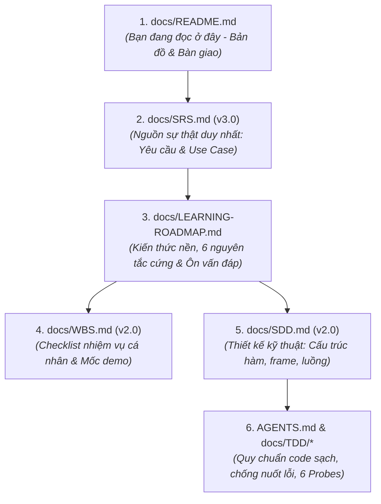

# 🧭 HƯỚNG DẪN ĐỌC TÀI LIỆU & BÀN GIAO CÔNG VIỆC (ONBOARDING & HANDOVER GUIDE)
## DỰ ÁN: CLIENT-SERVER ONLINE FILE SHARING APPLICATION (TOPIC 6 — GROUP 7)

> **Dành cho:** Trần Sỹ Nguyên (M1), Bùi Đức Hiếu (M2), Vũ Nhật Minh Dương (M3), Hà Đức Dương (M4)  
> **Mục tiêu tài liệu này:** Giúp từng thành viên nắm được bức tranh tổng thể, biết chính xác mình cần đọc tài liệu nào trước, hiểu sâu kiến thức cốt lõi (Core Invariants), nắm vững nhiệm vụ cá nhân, tiêu chí nghiệm thu (Expected Outputs), và kỷ luật tiến độ trong 2 tuần làm việc.

---

## 1. BẢN ĐỒ BỘ TÀI LIỆU DỰ ÁN (DOCUMENTATION MAP)

Bộ tài liệu dự án được tổ chức theo cấp bậc chặt chẽ. Đọc theo đúng thứ tự giúp bạn tiết kiệm thời gian và không bị "ngợp" thông tin:

| Thứ tự đọc | Tập tin | Mục đích & Nội dung chính | Đối tượng cần đọc |
|:---:|:---|:---|:---:|
| **1** | [docs/README.md](README.md) *(file này)* | Lộ trình đọc, phân công tóm tắt, nguyên tắc phối hợp | **Cả 4 thành viên** |
| **2** | [docs/SRS.md](SRS.md) *(v3.0)* | **Nguồn sự thật:** 7 yêu cầu gốc, phần mềm tham chiếu FileZilla, 13 use case, bảng quyết định quyền bước 0–7 | **Cả 4 thành viên** (Bắt buộc) |
| **3** | [docs/LEARNING-ROADMAP.md](LEARNING-ROADMAP.md) | 6 nguyên tắc kỹ thuật cứng, lộ trình tự học của từng người, kế hoạch 2 tuần, 11 câu hỏi giảng viên hay vặn | **Cả 4 thành viên** (Bắt buộc) |
| **4** | [docs/WBS.md](WBS.md) *(v2.0)* | Checklist từng đầu việc nhỏ, phân rã công việc chi tiết theo từng ngày | **Cả 4 thành viên** |
| **5** | [docs/SDD.md](SDD.md) *(v2.0)* | Thiết kế chi tiết hàm, struct, bảng sự kiện FSP, sơ đồ sequence diagram | Đọc kỹ chương module của mình |
| **6** | [AGENTS.md](../AGENTS.md) & [docs/TDD/](TDD/README.md) | 6 quy tắc "Cấm tuyệt đối", ma trận 6 Probes đối kháng, chuẩn ASan | Khi bắt đầu viết mã & test |
| **7** | [docs/C-MIGRATION-PLAN.md](C-MIGRATION-PLAN.md) | Bảng tra cứu port từ C++ sang C11 | M1, M2 |

---

## 2. SÁU NGUYÊN TẮC CỐT LÕI BẮT BUỘC PHẢI THUỘC LÒNG (THE 6 INVARIANTS)

Trước khi viết bất kỳ dòng mã nào, cả 4 thành viên phải thống nhất và tuân thủ 6 nguyên tắc sau:

1. **NT1 (Mạng - Byte Stream):** TCP là dòng byte, không có ranh giới tin nhắn. Luôn dùng vòng lặp `send_exact`/`recv_exact`. Không bao giờ giả định một lần `recv` đọc trúng trọn vẹn 1 frame 42 byte.
2. **NT2 (Bảo mật - Fail-Closed):** Mọi thao tác (trừ Register/Login) bắt buộc phải qua `session_lookup` (sai $\to$ `401`) và `perm_can_access` (sai $\to$ `403`). Không bao giờ có nhánh "tạm bỏ qua kiểm tra quyền".
3. **NT3 (Hệ thống file - Sandbox):** Mọi đường dẫn từ client là đường dẫn ảo bắt đầu bằng `/`. Server ánh xạ về `./storage/server_root` và kiểm tra qua `realpath()`. Chặn đứng $100\%$ lỗi Path Traversal (`../../etc/passwd`).
4. **NT4 (Dòng dữ liệu - Bộ đệm cố định 64 KB):** Truyền file theo từng khối tối đa 64 KB, mỗi khối kiểm tra CRC32. Upload ghi vào file tạm `.part`, chỉ đổi tên khi nhận đủ. Bộ nhớ RAM của tiến trình không tăng theo kích thước file.
5. **NT5 (Thư mục - Manifest-First):** Truyền thư mục phải quét đệ quy tạo Folder Manifest $\to$ bên nhận tạo khung thư mục trước $\to$ mới truyền từng file bên trong.
6. **NT6 (Giao diện - Bất đồng bộ):** Luồng GTK chỉ vẽ giao diện. Mọi thao tác mạng socket chạy trên luồng `pthread` riêng và cập nhật về UI độc quyền qua `g_idle_add()`. GUI không bao giờ bị treo (Not Responding).

---

## 3. NHIỆM VỤ CHI TIẾT & CHỈ TIÊU BÀN GIAO THEO TỪNG THÀNH VIÊN

---

### 👨‍💻 THÀNH VIÊN 1: TRẦN SỸ NGUYÊN (M1) — MẠNG CỐT LÕI & SERVER CORE
> **Nhánh Git:** `feat/m1-network-engine`  
> **Mục tiêu:** Xây dựng tầng truyền dẫn socket C11, phân tích gói tin 42-byte, tính toán CRC32, điều phối sự kiện và quản lý luồng server (1 thread / client).

#### 1. Tài liệu bắt buộc đọc theo thứ tự:
1. [include/common/FSPProtocol.h](../include/common/FSPProtocol.h): Nắm vững cấu trúc `FSPHeader` (42 byte) và `FileChunkHeader` (88 byte).
2. [docs/SDD.md](SDD.md) Chương 3 (Giao thức FSP) & Chương 4 (Chi tiết tầng mạng M1).
3. [docs/LEARNING-ROADMAP.md](LEARNING-ROADMAP.md) Mục 1 (NT1) và Mục 3 (Lộ trình M1).
4. [docs/WBS.md](WBS.md) Mục Checklist M1.

#### 2. Danh sách tập tin phụ trách:
* Header: `include/common/fsp_socket.h`, `include/common/fsp_packet.h`, `include/common/fsp_crc32.h`, `include/server/fsp_dispatcher.h`
* Mã nguồn: `src/common/fsp_socket.c`, `src/common/fsp_packet.c`, `src/common/fsp_crc32.c`, `src/server/server_main.c`, `src/server/fsp_dispatcher.c`
* Test: `tests/test_packet.c`, `tests/test_network_core.c`

#### 3. Sản phẩm bàn giao (Expected Outputs):
* Thư viện `libfsp_common.a` cung cấp:
  - `send_exact()` và `recv_exact()` xử lý chuẩn `EINTR` và đóng socket khi `<= 0`.
  - `fsp_send_frame()` và `fsp_recv_frame()` kiểm tra `magic == 0xAA`, `payload_len <= 128KB`, CRC32 payload.
  - `fsp_crc32()` chuẩn IEEE 802.3 bảng tra tĩnh.
* Server daemon (`server_main`):
  - Lắng nghe cổng 8088 (`SO_REUSEADDR`, bỏ qua `SIGPIPE`).
  - Mỗi client kết nối tạo 1 thread riêng (`pthread_create` + `pthread_detach`).
  - Tích hợp `dispatcher_register(event, fn)` và `dispatcher_handle()`.
* **Tiêu chí nghiệm thu:**
  - Vượt qua **Probe 1 (Sticky Packets)**: Tách đúng 2 frame nằm chung 1 buffer; ghép đúng 1 frame bị xé làm nhiều lần nhận.
  - Vượt qua **Probe 6**: Chạy ổn định khi có ≥ 5 client đồng thời kết nối.

---

### 👨‍💻 THÀNH VIÊN 2: BÙI ĐỨC HIẾU (M2) — XÁC THỰC, PHIÊN & PHÂN QUYỀN
> **Nhánh Git:** `feat/m2-auth-permissions`  
> **Mục tiêu:** Quản lý tài khoản, mã hóa Salted SHA-256, Session Token, thuật toán kiểm tra quyền `can_access` (bước 0–7) và các lệnh `PERM_GET`/`PERM_SET` đệ quy.

#### 1. Tài liệu bắt buộc đọc theo thứ tự:
1. [docs/SRS.md](SRS.md) Mục FR-1 (Quản lý User) và FR-6 (Phân quyền Linux 9-bit + Sharing Level).
2. [docs/M2-FUNCTION-REFERENCE.md](M2-FUNCTION-REFERENCE.md) *(đã có trên nhánh M2)*: Tham khảo toàn bộ logic C++ đã viết sẵn và pass 190 tests ở Checkpoint 1.
3. [docs/SDD.md](SDD.md) Chương 5 (Chi tiết Module M2).
4. [docs/LEARNING-ROADMAP.md](LEARNING-ROADMAP.md) Mục 1 (NT2) và Mục 3 (Lộ trình M2).
5. [docs/WBS.md](WBS.md) Mục Checklist M2.

#### 2. Danh sách tập tin phụ trách:
* Header: `include/server/fsp_sha256.h`, `include/server/fsp_user.h`, `include/server/fsp_session.h`, `include/server/fsp_perm.h`
* Mã nguồn: `src/common/fsp_sha256.c`, `src/server/fsp_user.c`, `src/server/fsp_session.c`, `src/server/fsp_perm.c`
* Test: `tests/test_auth.c`, `tests/test_perm.c`

#### 3. Sản phẩm bàn giao (Expected Outputs):
* Module User (`fsp_user.c`):
  - Đăng ký tài khoản (User đầu tiên tự động thành Admin `id = 1`), sinh Salt 16 bytes ngẫu nhiên từ `/dev/urandom`.
  - Băm Salted SHA-256 không dùng OpenSSL, so khớp mật khẩu thời gian hằng.
  - Lưu bền vững vào `data/users.json` (ghi file tạm `.tmp` rồi `rename`).
* Module Session (`fsp_session.c`):
  - Sinh token ngẫu nhiên 32 bytes (64 hex). Quản lý bảng phiên trong RAM có `pthread_mutex_t`.
  - Cung cấp `session_lookup(token, &user_id)` trả về `-1` (401) nếu sai/hết hạn.
* Module Permission (`fsp_perm.c`):
  - Cài đặt hàm `perm_can_access(user_id, vpath, action)` chuẩn xác theo **Bảng bước 0–7** trong SRS FR-6.
  - Cung cấp `perm_register()`, `perm_unregister()`, `perm_rename()`.
  - Cung cấp `perm_set()` hỗ trợ cờ `recursive=true` để chia sẻ cả cây thư mục cho user khác trong 1 thao tác.
* **Tiêu chí nghiệm thu:**
  - Vượt qua **Probe 2**: Token rỗng, token giả, token đã logout đều bị trả về `401`.
  - Vượt qua **Probe 3**: Mỗi bước 0–7 có ít nhất 1 test case; file `PRIVATE` có bit `0666` vẫn chặn đứng người ngoài (`403`).

---

### 👨‍💻 THÀNH VIÊN 3: VŨ NHẬT MINH DƯƠNG (M3) — HỆ THỐNG FILE ẢO, TRUYỀN DỮ LIỆU & TÌM KIẾM
> **Nhánh Git:** `feat/m3-filesystem-transfer`  
> **Mục tiêu:** Xây dựng VFS Sandbox chặn Path Traversal, các lệnh FTP (`ls`, `cd`, `mkdir`, `rm`, `mv`), truyền file 64 KB (.part + CRC32), truyền thư mục đệ quy qua Manifest, và tìm kiếm file lọc theo quyền.

#### 1. Tài liệu bắt buộc đọc theo thứ tự:
1. [docs/SRS.md](SRS.md) Mục FR-2 (Lệnh FTP), FR-3 (Truyền file), FR-4 (Truyền thư mục), FR-5 (Tìm kiếm).
2. [docs/SDD.md](SDD.md) Chương 6 (Chi tiết Module M3) & Chương 3.5 (Sequence diagram truyền file).
3. [docs/LEARNING-ROADMAP.md](LEARNING-ROADMAP.md) Mục 1 (NT3, NT4, NT5) và Mục 3 (Lộ trình M3).
4. [docs/WBS.md](WBS.md) Mục Checklist M3.

#### 2. Danh sách tập tin phụ trách:
* Header: `include/server/fsp_vfs.h`, `include/server/fsp_transfer.h`, `include/server/fsp_search.h`
* Mã nguồn: `src/server/fsp_vfs.c`, `src/server/fsp_transfer.c`, `src/server/fsp_search.c`
* Test: `tests/test_vfs.c`, `tests/test_transfer.c`, `tests/test_search.c`

#### 3. Sản phẩm bàn giao (Expected Outputs):
* Module VFS (`fsp_vfs.c`):
  - Hàm `vfs_resolve()`: Chuẩn hóa đường dẫn ảo, ghép vào `./storage/server_root`, dùng `realpath()` chặn đứng `../../etc/passwd` và symlink trỏ ra ngoài.
  - Các lệnh FTP: `DIR_LIST` (kèm quyền từ M2), `DIR_CHANGE` (`cd`), `DIR_PWD`, `DIR_MKDIR`, `FS_DELETE`, `FS_RENAME`.
* Module Truyền dữ liệu (`fsp_transfer.c`):
  - Xử lý upload: Khởi tạo phiên `transfer_id`, nhận từng chunk 64 KB, kiểm tra `chunk_crc` (CRC32), ghi vào `<file>.part`. Nhận xong đổi tên thành file thật.
  - Xử lý download: Đọc file theo bộ đệm 64 KB, gửi liên tiếp các gói `FILE_CHUNK`.
  - Mất mạng hoặc sai CRC32 $\to$ tự động xóa sạch file `.part`, không để lại rác trên đĩa.
  - Truyền thư mục: Quét `opendir`/`readdir` tạo Manifest $\to$ dựng khung thư mục trước $\to$ stream từng file con.
* Module Tìm kiếm (`fsp_search.c`):
  - Tìm theo chuỗi con (substring) không phân biệt hoa thường và lọc đuôi file.
  - Gọi `perm_can_access()` của M2: File `PRIVATE` của người khác tuyệt đối không xuất hiện trong kết quả (Zero-Leak).
* **Tiêu chí nghiệm thu:**
  - Vượt qua **Probe 4**: Sửa 1 bit dữ liệu trong chunk $\to$ phát hiện ngay sai CRC32, file `.part` bị xóa.
  - Vượt qua **Probe 5**: Gửi `../../etc/passwd` hoặc `cd ../../..` $\to$ bị chặn đứng với mã `403`.
  - File 500 MB upload/download xong khớp mã `sha256sum`, RAM tiến trình không tăng theo dung lượng file.

---

### 👨‍💻 THÀNH VIÊN 4: HÀ ĐỨC DƯƠNG (M4) — CLIENT GUI (GTK 3), CLI & TÍCH HỢP
> **Nhánh Git:** `feat/m4-gui-client`  
> **Mục tiêu:** Xây dựng công cụ CLI test sớm, kiến trúc Client đa luồng an toàn (UI Thread + Network Thread qua `g_idle_add`), giao diện GTK 3 bố cục 2 ngăn giống FileZilla, hộp thoại phân quyền, tìm kiếm và tích hợp toàn hệ thống.

#### 1. Tài liệu bắt buộc đọc theo thứ tự:
1. [docs/SRS.md](SRS.md) Mục FR-7 (Yêu cầu GUI) & Chương 6 (Bản vẽ giao diện UI/UX).
2. [docs/SDD.md](SDD.md) Chương 7 (Chi tiết kiến trúc Client M4).
3. [docs/LEARNING-ROADMAP.md](LEARNING-ROADMAP.md) Mục 1 (NT6) và Mục 3 (Lộ trình M4).
4. [docs/WBS.md](WBS.md) Mục Checklist M4.

#### 2. Danh sách tập tin phụ trách:
* Header: `include/client/client_net.h`, `include/client/gui.h`
* Mã nguồn: `src/client_net.c`, `src/client_gui/gui_main.c`, `src/client_gui/gui_login.c`, `src/client_gui/gui_dialogs.c`, `src/client_cli/cli_main.c`
* Test: Kịch bản test tích hợp qua CLI, test giao diện GTK đa luồng

#### 3. Sản phẩm bàn giao (Expected Outputs):
* CLI Test Client (`src/client_cli/cli_main.c`):
  - Xong sớm vào **Ngày 4–5** để M2 và M3 có công cụ test server thật qua mạng mà không cần chờ GUI.
  - Hỗ trợ đầy đủ các lệnh: `login`, `ls`, `cd`, `mkdir`, `put`, `get`, `putdir`, `getdir`, `find`, `chmod`, `share`.
* Luồng mạng Client (`client_net.c`):
  - Hàng đợi lệnh an toàn luồng (`pthread_mutex_t` + `pthread_cond_t`).
  - Gửi lệnh và nhận dữ liệu trên thread riêng; gửi cập nhật giao diện về luồng GTK độc quyền qua `g_idle_add()`.
* Desktop GUI GTK 3 (`src/client_gui/*`):
  - Màn hình Đăng nhập/Đăng ký trực quan.
  - Màn hình chính 2 ngăn (Local bên trái, Remote bên phải), thanh đường dẫn, nút lên thư mục cha.
  - Bảng hàng đợi truyền hiển thị phần trăm tiến độ mượt mà (`GtkProgressBar`).
  - Hộp thoại Phân quyền trực quan (lưới tick `r/w/s`, chọn mức chia sẻ, thêm user).
  - Hộp thoại Tìm kiếm hiển thị kết quả và nút Download trực tiếp.
* **Tiêu chí nghiệm thu:**
  - Vượt qua **Probe 6**: GUI hoàn toàn không bị đơ (vẫn bấm nút, cuộn danh sách mượt mà) trong lúc đang download file lớn 500 MB.
  - Chạy thành công toàn bộ kịch bản E2E trong SRS §3.4 (An tải thư mục lên $\to$ chia sẻ cho Bình $\to$ Bình tìm thấy và tải về $\to$ Chi tìm không thấy).

---

## 4. KẾ HOẠCH PHỐI HỢP & 3 CỘT MỐC DEMO (2-WEEK SPRINT)

Cả nhóm bám sát lịch trình 14 ngày sau:

| Giai đoạn | Ngày | Mục tiêu phối hợp | Sản phẩm cần đạt |
|:---|:---:|:---|:---|
| **Khởi động** | **1 – 2** | • Cả nhóm đọc xong tài liệu này, [SRS.md](SRS.md) và [LEARNING-ROADMAP.md](LEARNING-ROADMAP.md). • Họp chốt định dạng JSON phẳng và TSV cho từng sự kiện. | Biên bản thống nhất hợp đồng giao thức. |
| **Giai đoạn 1** | **3 – 4** | • M1 dựng socket C11 & frame 42B. • M2 port SHA-256, User store sang C11. • M3 làm VFS Sandbox `realpath` + lệnh FTP cơ bản. • M4 dựng CLI client khung ban đầu. | Các hàm đơn lẻ pass unit test trên máy cá nhân. |
| **🎯 MỐC 1** | **5** | **DEMO NỘI BỘ MỐC 1: THÔNG LUỒNG MẠNG & CLI** | **Dùng CLI Client đăng ký, đăng nhập và gọi `ls`, `cd`, `mkdir` thành công qua mạng thật.** |
| **Giai đoạn 2** | **6 – 7** | • M1 hỗ trợ truyền chunk, test 5 client đồng thời. • M2 hoàn thiện thuật toán quyền bước 0–7. • M3 hoàn thiện upload/download file khối 64 KB (.part + CRC32). • M4 dựng xong khung GTK 2 ngăn và luồng mạng. | Upload/Download 1 file thành công. Kiểm tra file 500 MB khớp `sha256sum`. |
| **Giai đoạn 3** | **8 – 9** | • M2 hoàn thiện `PERM_SET` đệ quy. • M3 hoàn thiện truyền Folder Manifest và Search theo quyền. • M4 hoàn thiện Dialog Phân quyền, Tìm kiếm và Progress bar trên GUI. | Tích hợp toàn bộ tính năng vào giao diện GTK. |
| **🎯 MỐC 2** | **10** | **DEMO NỘI BỘ MỐC 2: FULL TÍNH NĂNG TRÊN GUI** | **Đủ 7 tính năng chạy mượt mà trên giao diện GTK 3.** |
| **Hoàn thiện** | **11 – 13** | • Sửa lỗi tích hợp, kiểm tra toàn diện bảng truy vết SRS §9. • Chạy CTest với cờ `-fsanitize=address,undefined` (bắt buộc 0 memory leak). • Tự luyện tập trả lời 11 câu hỏi vấn đáp trong [LEARNING-ROADMAP.md](LEARNING-ROADMAP.md) §5. | Codebase sạch trên `develop`, hoàn thành slide thuyết trình. |
| **🎯 MỐC 3** | **14** | **TỔNG DUYỆT DEMO & SẴN SÀNG BÁO CÁO TRƯỚC GIẢNG VIÊN** | **Demo trơn tru kịch bản chia sẻ file An - Bình - Chi, sẵn sàng bảo vệ.** |

---

## 5. BỘ CÂU HỎI TỰ KIỂM TRA TRƯỚC KHI GẶP GIẢNG VIÊN

Trước khi bước vào buổi bảo vệ đồ án, từng thành viên tự mở [docs/LEARNING-ROADMAP.md](LEARNING-ROADMAP.md) Mục 5 và tự trả lời các câu hỏi tương ứng:
* **Cả nhóm:** Vì sao tự thiết kế giao thức FSP thay vì dùng FTP có sẵn? Bố cục tham chiếu gì từ FileZilla? Hệ thống có mã hóa TLS không?
* **M1 (Nguyên):** Vì sao TCP bị dính gói? Cơ chế `recv_exact` hoạt động ra sao? Mô hình đa luồng server xử lý thế nào khi 5 client cùng kết nối?
* **M2 (Hiếu):** Salt là gì và vì sao cần salt ngẫu nhiên? Trình bày từng bước trong bảng quyết định `can_access`? Một file `PRIVATE` nhưng set bit người khác là `r` thì ai đọc được?
* **M3 (Dương V.):** Hàm `realpath` hoạt động thế nào để chặn `../../etc/passwd`? Quá trình truyền file 500 MB diễn ra ra sao mà RAM không bị tràn? Vì sao tìm kiếm không để lộ tên file mật?
* **M4 (Dương H.):** Vì sao luồng GTK không được gọi socket trực tiếp? Cơ chế `g_idle_add` hoạt động ra sao để cập nhật thanh tiến trình mà GUI không bị đơ?

---

> 🚀 **HÀNH ĐỘNG NGAY BÂY GIỜ:**  
> Mỗi thành viên chuyển sang nhánh `feat/*` của mình, đọc kỹ tài liệu được chỉ định và bắt đầu triển khai các công việc của **Ngày 1–2**!
