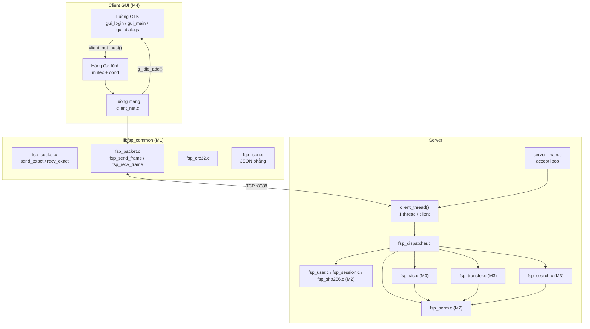
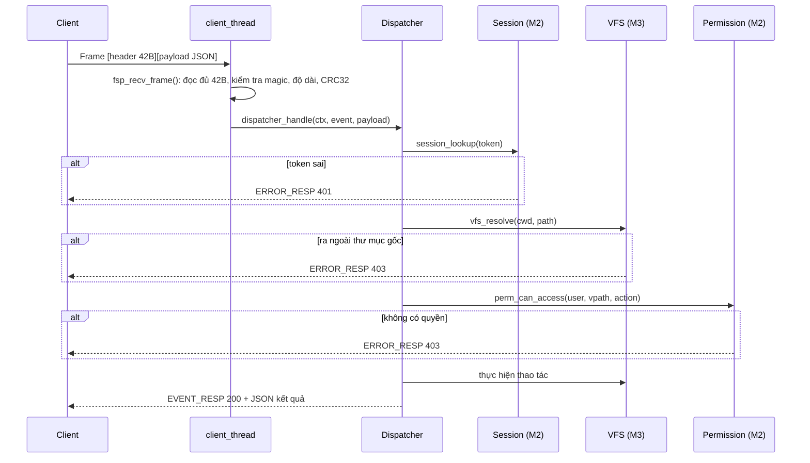
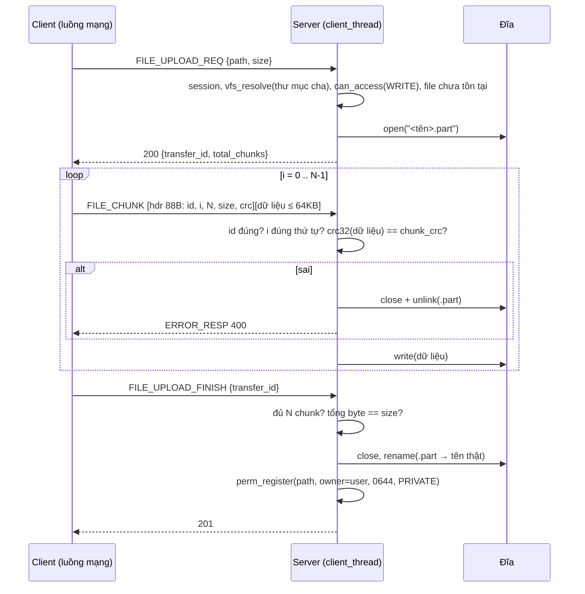

# BẢN THIẾT KẾ PHẦN MỀM (SOFTWARE DESIGN DOCUMENT - SDD)
## Dự án: Ứng dụng chia sẻ file Client-Server qua Socket (Topic 6 — Group 7)

* **Phiên bản:** 2.0 (đồng bộ với [SRS.md](SRS.md) v3.0)
* **Công nghệ:** C11, POSIX TCP socket, `pthread`, GTK 3, CMake
* **Nhóm 7:** Trần Sỹ Nguyên (20235985), Bùi Đức Hiếu (20235931), Vũ Nhật Minh Dương (20235925), Hà Đức Dương (20235923)

> SRS trả lời câu hỏi **"làm gì"**; SDD trả lời **"làm thế nào"**. Mọi mã yêu cầu (FR-x, NFR-x, UCxx) tham chiếu tới SRS.

---

## MỤC LỤC
1. [Tổng quan thiết kế](#1-tổng-quan-thiết-kế)
2. [Kiến trúc tổng thể (HLD)](#2-kiến-trúc-tổng-thể-hld)
3. [Giao thức FSP](#3-giao-thức-fsp)
4. [M1 — Tầng mạng & server core](#4-m1--tầng-mạng--server-core-trần-sỹ-nguyên)
5. [M2 — Người dùng, phiên & phân quyền](#5-m2--người-dùng-phiên--phân-quyền-bùi-đức-hiếu)
6. [M3 — Hệ thống file ảo, truyền dữ liệu & tìm kiếm](#6-m3--hệ-thống-file-ảo-truyền-dữ-liệu--tìm-kiếm-vũ-nhật-minh-dương)
7. [M4 — Client GUI & CLI](#7-m4--client-gui--cli-hà-đức-dương)
8. [Chiến lược kiểm thử](#8-chiến-lược-kiểm-thử)
9. [Vấn đề mở cần nhóm quyết định](#9-vấn-đề-mở-cần-nhóm-quyết-định)

---

## 1. TỔNG QUAN THIẾT KẾ

### 1.1 Mục tiêu thiết kế
| Mục tiêu | Quyết định thiết kế tương ứng |
|:---|:---|
| Đáp ứng đủ 7 yêu cầu gốc R1–R7 | Mỗi yêu cầu ↔ một nhóm sự kiện FSP (§3.4) |
| Dễ hiểu, dễ giải thích cho cả nhóm | 1 kết nối TCP / client, 1 thread / client, JSON phẳng cho lệnh |
| Truyền file lớn an toàn bộ nhớ | Bộ đệm cố định 64 KB, file tạm `.part` |
| Không lộ dữ liệu | Mọi handler đi qua `session_lookup` → `vfs_resolve` → `perm_can_access` |
| 4 người làm song song | Hợp đồng chung `FSPProtocol.h` + bảng sự kiện §3.4 được chốt trước |

### 1.2 So sánh với phần mềm tham chiếu (FileZilla)
| | FileZilla (FTP) | Hệ thống này (FSP) |
|:---|:---|:---|
| Kết nối | 1 kết nối điều khiển + 1 kết nối dữ liệu cho mỗi lần truyền | **1 kết nối TCP duy nhất** cho cả lệnh và dữ liệu |
| Định dạng lệnh | Dòng văn bản (`CWD /home\r\n`) | Frame nhị phân 42 byte + payload JSON |
| Dữ liệu file | Byte thô trên kết nối dữ liệu, kết thúc bằng đóng kết nối | Chunk ≤ 64 KB, mỗi chunk có header 88 byte + CRC32 |
| Trạng thái phiên | `cwd` lưu theo kết nối | `cwd` lưu trong phiên, khóa bằng token |

---

## 2. KIẾN TRÚC TỔNG THỂ (HLD)

### 2.1 Sơ đồ thành phần



### 2.2 Luồng xử lý một yêu cầu trên server



### 2.3 Mô hình luồng (threading)
| Tiến trình | Luồng | Nhiệm vụ | Đồng bộ |
|:---|:---|:---|:---|
| Server | Luồng chính | `socket → bind → listen → accept` lặp vô hạn | — |
| Server | 1 luồng / client (`pthread_create` + `pthread_detach`) | Đọc frame, gọi dispatcher, gửi phản hồi, phục vụ truyền file | Bảng user, bảng phiên, bảng quyền: mỗi bảng 1 `pthread_mutex_t` |
| Client | Luồng GTK | Vẽ giao diện, nhận thao tác | Chỉ đọc kết quả qua callback `g_idle_add` |
| Client | Luồng mạng | Lấy lệnh từ hàng đợi, gửi/nhận frame, truyền file | Hàng đợi lệnh: `pthread_mutex_t` + `pthread_cond_t` |

> **Giới hạn đã chấp nhận:** mỗi client dùng **một kết nối**, lệnh xử lý **tuần tự**. Trong lúc đang truyền file, lệnh duyệt thư mục phía Remote sẽ chờ tới khi truyền xong (GUI vẫn không treo vì chờ ở luồng mạng). Mở kết nối thứ hai cho truyền file là hướng mở rộng (COULD).

### 2.4 Bố cục lưu trữ
```
storage/server_root/            ← gốc "/" ảo
  home/<username>/...           ← thư mục cá nhân (tạo khi đăng ký)
data/users.json                 ← JSON-lines: id, username, full_name, salt, password_hash, group_id, created_at
data/permissions.json           ← JSON-lines: path, owner_id, group_id, perm_bits, sharing_level, acl
storage/client_downloads/       ← thư mục tải về mặc định của client
```
File `data/*.json` ghi theo kiểu **ghi file tạm rồi `rename()`** để không bao giờ bị ghi dở.

### 2.5 Cấu trúc mã nguồn
```
include/common/   FSPProtocol.h  Config.h  fsp_socket.h  fsp_packet.h  fsp_crc32.h  fsp_json.h
include/server/   fsp_dispatcher.h  fsp_user.h  fsp_session.h  fsp_sha256.h  fsp_perm.h
                  fsp_vfs.h  fsp_transfer.h  fsp_search.h
include/client/   client_net.h  gui.h
src/common/       (libfsp_common — dùng chung server, CLI, GUI)
src/server/       server_main.c + các module trên
src/client_cli/   cli_main.c
src/client_gui/   gui_main.c  gui_login.c  gui_dialogs.c  client_net.c
tests/            test_*.c (CTest)
```

---

## 3. GIAO THỨC FSP

### 3.1 Header cố định 42 byte (`FSPHeader`)
| Offset | Trường | Kiểu | Kích thước | Ý nghĩa |
|:-:|:---|:---|:-:|:---|
| 0 | `magic` | `uint8_t` | 1 | Luôn `0xAA`, sai → đóng kết nối |
| 1 | `type` | `uint8_t` | 1 | `EVENT_REQ=1`, `EVENT_RESP=2`, `FILE_CHUNK=3`, `ACK=4`, `ERROR_RESP=5`, `PING=6`, `PONG=7` |
| 2–5 | `payload_len` | `uint32_t` | 4 | Độ dài payload, **big-endian** (`htonl`/`ntohl`) |
| 6–37 | `event` | `char[32]` | 32 | Tên sự kiện, kết thúc `\0`, phần dư đệm `0` |
| 38–41 | `checksum` | `uint32_t` | 4 | CRC32 (IEEE 802.3) của payload, big-endian; `0` nếu không có payload |

**Giới hạn:** `payload_len ≤ BUFFER_SIZE` (128 KB, trong `Config.h`). Lớn hơn → đóng kết nối (chống cấp phát bộ nhớ vô hạn).

### 3.2 Header chunk 88 byte (`FileChunkHeader`)
Đặt ở đầu payload của frame `type = FILE_CHUNK`, theo sau là `chunk_size` byte dữ liệu thô.

| Trường | Kiểu | Kích thước | Ý nghĩa |
|:---|:---|:-:|:---|
| `transfer_id` | `char[64]` | 64 | Mã phiên truyền do server cấp |
| `chunk_index` | `uint64_t` | 8 | Thứ tự chunk, bắt đầu từ 0 |
| `total_chunks` | `uint64_t` | 8 | Tổng số chunk |
| `chunk_size` | `uint32_t` | 4 | Số byte dữ liệu theo sau (≤ 65 536) |
| `chunk_crc` | `uint32_t` | 4 | CRC32 riêng của phần dữ liệu |

Các trường số nguyên trong `FileChunkHeader` cũng gửi dạng **big-endian** (dùng hàm chuyển 64-bit tự viết cho `uint64_t`).

### 3.3 Quy ước payload
* **Yêu cầu (`EVENT_REQ`)**: một object **JSON phẳng** (không lồng, không mảng). Mọi yêu cầu trừ `AUTH_REGISTER`/`AUTH_LOGIN` có trường `"token"`.
* **Phản hồi thành công (`EVENT_RESP`)**: dòng đầu là JSON phẳng có `"status"`. Với phản hồi dạng danh sách, **các dòng tiếp theo** là bản ghi, các trường cách nhau bằng ký tự tab (`\t`). Cách này giúp cả server và client C xử lý danh sách bằng `strtok`, không cần thư viện JSON đầy đủ.
* **Phản hồi lỗi (`ERROR_RESP`)**: `{"status":403,"error":"Bạn không có quyền ghi vào thư mục này"}`.
* Trường `event` của phản hồi **lặp lại tên sự kiện của yêu cầu** để client biết đây là phản hồi cho lệnh nào.

### 3.4 Bảng sự kiện (hợp đồng giữa 4 thành viên)

| Sự kiện | Yêu cầu (JSON phẳng) | Phản hồi thành công | Lỗi có thể | Handler |
|:---|:---|:---|:---|:-:|
| `AUTH_REGISTER` | `username`, `password`, `full_name`? | 201 `{"user_id":N}` | 400, 409 | M2 |
| `AUTH_LOGIN` | `username`, `password` | 200 `{"token":"…","home":"/home/an"}` | 400, 401 | M2 |
| `AUTH_LOGOUT` | `token` | 200 | 401 | M2 |
| `DIR_PWD` | `token` | 200 `{"path":"/home/an"}` | 401 | M3 |
| `DIR_CHANGE` | `token`, `path` | 200 `{"path":"/home/an/BaoCao"}` | 401, 403, 404 | M3 |
| `DIR_LIST` | `token`, `path`? (mặc định `cwd`) | 200 `{"path":…,"count":N}` + dòng: `name⇥type(f/d)⇥size⇥mtime⇥owner⇥perm(octal)⇥level` | 401, 403, 404 | M3 |
| `DIR_MKDIR` | `token`, `path` | 201 | 401, 403, 409 | M3 |
| `FS_DELETE` | `token`, `path` | 200 | 401, 403, 404, 409 (thư mục không rỗng) | M3 |
| `FS_RENAME` | `token`, `path`, `new_name` | 200 | 401, 403, 404, 409 | M3 |
| `FILE_UPLOAD_REQ` | `token`, `path` (đích, gồm tên file), `size` | 200 `{"transfer_id":…,"chunk_size":65536,"total_chunks":N}` | 401, 403, 409 | M3 |
| *(client → server)* `FILE_CHUNK` | frame `type=3`, payload = `FileChunkHeader` + dữ liệu | *(không phản hồi từng chunk)* | `ERROR_RESP` 400 nếu sai CRC/thứ tự → phiên bị hủy | M3 |
| `FILE_UPLOAD_FINISH` | `token`, `transfer_id` | 201 `{"path":…}` | 400 (thiếu chunk), 401 | M3 |
| `FILE_DOWNLOAD_REQ` | `token`, `path` | 200 `{"transfer_id":…,"size":S,"total_chunks":N}` rồi server gửi liên tiếp N frame `FILE_CHUNK` | 401, 403, 404 | M3 |
| `FOLDER_UPLOAD_REQ` | dòng 1: `token`, `path` (thư mục đích mới); các dòng sau: `d⇥rel/path` hoặc `f⇥rel/path⇥size` | 201 `{"dirs":D}` (server đã tạo các thư mục) — sau đó client upload từng file bằng `FILE_UPLOAD_REQ` | 401, 403, 409 | M3 |
| `FOLDER_DOWNLOAD_REQ` | `token`, `path` | 200 `{"count":N,"skipped":K}` + dòng `d⇥rel/path` / `f⇥rel/path⇥size` (chỉ mục có quyền đọc) — sau đó client tải từng file bằng `FILE_DOWNLOAD_REQ` | 401, 403, 404 | M3 |
| `SEARCH_QUERY` | `token`, `keyword`, `ext`? | 200 `{"count":N}` + dòng `path⇥size⇥owner` (tối đa 100) | 400 (từ khóa rỗng), 401 | M3 |
| `PERM_GET` | `token`, `path` | 200 `{"owner":…,"group":G,"perm":"0644","level":1}` + dòng `username⇥mask` | 401, 403, 404 | M2 |
| `PERM_SET` | `token`, `path`, và **một hoặc nhiều** trường: `perm`, `level`, `grant_user`+`grant_mask`, `revoke_user`, `recursive` (`true`/`false`) | 200 `{"updated":N}` | 400, 401, 403, 404 | M2 |
| `PING` / `PONG` | frame `type=6/7`, không payload | — | — | M1 |

> `FOLDER_UPLOAD_REQ` là yêu cầu duy nhất có nhiều dòng; dòng đầu vẫn là JSON phẳng. Tất cả tên sự kiện đã có sẵn trong `FSPProtocol.h` — **không cần thêm sự kiện mới**.

### 3.5 Trình tự upload một file (UC08)



Mất kết nối giữa chừng → `client_thread` thoát vòng lặp, đóng file và `unlink` file `.part` (NFR-4).

---

## 4. M1 — TẦNG MẠNG & SERVER CORE (Trần Sỹ Nguyên)

### 4.1 API `libfsp_common`
```c
/* fsp_socket.h */
int  fsp_listen(uint16_t port, int backlog);           /* trả fd hoặc -1 */
int  fsp_connect(const char *host, uint16_t port);     /* trả fd hoặc -1 */
int  send_exact(int fd, const void *buf, size_t len);  /* 0 = OK, -1 = lỗi/đóng */
int  recv_exact(int fd, void *buf, size_t len);        /* 0 = OK, -1 = lỗi/đóng */

/* fsp_packet.h */
typedef struct {
    uint8_t  type;
    char     event[FSP_EVENT_NAME_MAX_LEN];
    uint32_t payload_len;
    uint8_t *payload;           /* malloc bởi fsp_recv_frame, người gọi free */
} fsp_frame_t;

int  fsp_send_frame(int fd, uint8_t type, const char *event, const void *payload, uint32_t len);
int  fsp_recv_frame(int fd, fsp_frame_t *out);         /* 0 = OK, -1 = phải đóng kết nối */
void fsp_frame_free(fsp_frame_t *f);
int  fsp_parse_frames(const uint8_t *buf, size_t len, /* tách frame từ buffer — dùng cho Probe 1 */
                      fsp_frame_t *out, size_t max_out, size_t *consumed);

/* fsp_crc32.h */
uint32_t fsp_crc32(const void *data, size_t len);
```

### 4.2 Thuật toán `recv_exact` và `fsp_recv_frame`
```
recv_exact(fd, buf, len):
    got = 0
    while got < len:
        n = recv(fd, buf + got, len - got, 0)
        if n > 0:  got += n
        elif n < 0 and errno == EINTR: continue
        else: return -1              # n == 0 (đóng) hoặc lỗi thật
    return 0

fsp_recv_frame(fd, out):
    recv_exact(fd, hdr, 42)                     → lỗi thì return -1
    hdr.magic != 0xAA                           → return -1
    len = ntohl(hdr.payload_len); len > BUFFER_SIZE → return -1
    payload = malloc(len); recv_exact(fd, payload, len)
    fsp_crc32(payload, len) != ntohl(hdr.checksum) → free, return -1
    điền out, return 0
```

### 4.3 Server core
```c
typedef struct {
    int      fd;
    char     token[65];         /* rỗng nếu chưa đăng nhập */
    uint32_t user_id;
    char     cwd[FSP_PATH_MAX];  /* đường dẫn ảo */
    fsp_upload_t upload;        /* trạng thái upload đang dở (M3) */
} client_ctx_t;

typedef int (*fsp_handler_fn)(client_ctx_t *ctx, const fsp_frame_t *req);
int dispatcher_register(const char *event, fsp_handler_fn fn);   /* gọi lúc khởi động */
int dispatcher_handle(client_ctx_t *ctx, const fsp_frame_t *req);
```
* `server_main`: `fsp_listen(8088)` → lặp `accept` → `malloc(client_ctx_t)` → `pthread_create(client_thread)` → `pthread_detach`.
* `client_thread`: lặp `fsp_recv_frame` → nếu `type == PING` trả `PONG`; nếu `FILE_CHUNK` chuyển cho M3; còn lại `dispatcher_handle`. Khi lỗi: hủy upload dở (M3), `session_destroy` (M2), `close(fd)`, `free(ctx)`.
* Bảng dispatcher là mảng tĩnh `{tên, hàm}` (~20 phần tử), tìm tuyến tính bằng `strcmp` — đủ nhanh và dễ hiểu.
* `SO_REUSEADDR` để khởi động lại server ngay; `SIGPIPE` bị bỏ qua (`signal(SIGPIPE, SIG_IGN)`) để `send` vào socket đã đóng trả lỗi thay vì giết tiến trình.
* Bảng CRC32 khởi tạo **một lần trước khi tạo thread** (hoặc là mảng hằng) để tránh data race.

---

## 5. M2 — NGƯỜI DÙNG, PHIÊN & PHÂN QUYỀN (Bùi Đức Hiếu)

> Logic đã cài đặt bằng C++ ở Checkpoint 1 (nhánh `feat/m2-auth-permissions`, có `docs/M2-FUNCTION-REFERENCE.md`). Phần này là đặc tả để port sang C11, **giữ nguyên hành vi và bộ test**.

### 5.1 Người dùng
* `users.json` (JSON-lines): `id`, `username`, `full_name`, `salt` (32 hex), `password_hash` (64 hex), `group_id`, `created_at`.
* Đăng ký: kiểm tra `username` `[A-Za-z0-9_]{3,32}`, `password` 6–128 ký tự → salt 16 byte từ `/dev/urandom` (hoặc `getrandom`) → `hash = SHA256(salt_hex ‖ password)` → user đầu tiên có `id = 1` (Admin) → `group_id = id` (nhóm riêng).
* Đăng nhập: so sánh hash bằng hàm so sánh thời gian hằng; sai 5 lần liên tiếp khóa 5 phút (COULD, đã có).
* Khi đăng ký thành công: gọi `perm_register("/home/<username>", id, 0755, PRIVATE)`; M3 tạo thư mục thật trên đĩa.

```c
int user_register(const char *username, const char *password, const char *full_name, uint32_t *out_id);
int user_verify(const char *username, const char *password, fsp_user_t *out);    /* trả StatusCode */
int user_find_by_id(uint32_t id, fsp_user_t *out);
int user_find_by_name(const char *username, fsp_user_t *out);
int user_set_group(uint32_t actor, uint32_t user, uint32_t group);              /* Admin, COULD */
```

### 5.2 Phiên
* Token = 32 byte ngẫu nhiên → 64 ký tự hex. Bảng phiên trong RAM: `token → {user_id, last_active}`; bảo vệ bằng mutex.
* `cwd` nằm trong `client_ctx_t` (M1), không nằm trong bảng phiên.
* Hủy khi `AUTH_LOGOUT` hoặc khi kết nối đóng. Hết hạn 30 phút không hoạt động (COULD, đã có).

```c
int  session_create(uint32_t user_id, char out_token[65]);
int  session_lookup(const char *token, uint32_t *out_user_id);  /* 0 = hợp lệ, -1 → 401 */
void session_destroy(const char *token);
```

### 5.3 Phân quyền
* `permissions.json` (JSON-lines): `path` (ảo), `owner_id`, `group_id`, `perm_bits` (0–0777), `sharing_level` (0/1/2), `acl` dạng `"uid:mask,uid:mask"`.
* **Chú ý hai bảng mã khác nhau:**
  * `perm_bits` theo kiểu Linux: r = 4, w = 2, s = 1 (ví dụ `OWNER_READ = 0400`).
  * `mask` trong ACL và tham số `action` dùng `AccessType`: READ = 1, WRITE = 2, SHARE = 4.
* Thuật toán `perm_can_access(user_id, vpath, action)` — đúng bảng bước 0–7 trong SRS FR-6:
```
0. không có bản ghi cho vpath, hoặc user không tồn tại  → DENY
1. user_id == 1 (Admin)                                → ALLOW
2. user_id == owner: READ/SHARE → ALLOW; WRITE → bit OWNER_WRITE
3. level == PRIVATE                                     → DENY
4. user.group == meta.group và bit GROUP_<action> bật   → ALLOW
5. level == PUBLIC và action == READ                    → ALLOW
6. level == SHARED và acl[user_id] chứa action          → ALLOW
7.                                                      → DENY
```
* `PERM_SET` với `recursive=true` (FR-6.4): áp dụng thay đổi cho `vpath` và mọi bản ghi có tiền tố `vpath + "/"` (chú ý: `/a-b` **không** phải con của `/a`). Ghi file một lần sau khi sửa xong; lỗi ghi → khôi phục trạng thái cũ.
* `PERM_SET` nhận `grant_user` là **username**; server đổi sang `user_id` bằng `user_find_by_name` (không tồn tại → 404).

```c
int  perm_register(const char *vpath, uint32_t owner, uint16_t bits, uint8_t level);
int  perm_unregister(const char *vpath);                      /* gọi khi xóa */
int  perm_rename(const char *old_vpath, const char *new_vpath); /* gọi khi đổi tên, kéo theo con */
bool perm_can_access(uint32_t user_id, const char *vpath, uint8_t action);
int  perm_get(const char *vpath, fsp_perm_meta_t *out);
int  perm_chmod(uint32_t actor, const char *vpath, uint16_t bits, bool recursive);
int  perm_set_level(uint32_t actor, const char *vpath, uint8_t level, bool recursive);
int  perm_grant(uint32_t actor, const char *vpath, uint32_t target, uint8_t mask, bool recursive);
int  perm_revoke(uint32_t actor, const char *vpath, uint32_t target, bool recursive);
```

---

## 6. M3 — HỆ THỐNG FILE ẢO, TRUYỀN DỮ LIỆU & TÌM KIẾM (Vũ Nhật Minh Dương)

### 6.1 Chuẩn hóa đường dẫn & chặn path traversal (`vfs_resolve`)
```
vfs_resolve(cwd, input, must_exist, out_vpath, out_realpath):
    1. Nếu input bắt đầu bằng "/" thì p = input, ngược lại p = cwd + "/" + input
    2. Chuẩn hóa từ vựng: tách theo "/", bỏ "" và ".", ".." thì bỏ phần tử trước.
       Nếu ".." vượt lên trên "/"                → trả 403 (cố ý thoát gốc)
       → out_vpath (luôn bắt đầu "/")
    3. real = realpath(SERVER_ROOT) + out_vpath
    4. Nếu must_exist: r = realpath(real)  (404 nếu không tồn tại)
       Ngược lại (tạo mới): r = realpath(dirname(real)) + "/" + basename(real)
    5. r phải bằng root hoặc bắt đầu bằng root + "/"  → nếu không: 403 (thoát qua symlink)
```
* Kết quả: `cd ../../..` từ `/home/an` → `403`, `cwd` giữ nguyên; `../../etc/passwd` → `403`.
* Tên file từ client không được chứa `/` (với `new_name`, tên trong manifest phải là đường dẫn tương đối không có `..`).

### 6.2 Lệnh kiểu FTP
| Lệnh | Hiện thực | Quyền cần |
|:---|:---|:---|
| `DIR_LIST` | `opendir/readdir/stat`, bỏ `.`/`..` và file `*.part`; mỗi mục lấy metadata quyền từ M2 | `READ` trên thư mục |
| `DIR_CHANGE` | `vfs_resolve(must_exist)`, phải là thư mục | `READ` trên thư mục đích |
| `DIR_MKDIR` | `mkdir(real, 0755)` + `perm_register` | `WRITE` trên thư mục cha |
| `FS_DELETE` | `unlink` hoặc `rmdir` (chỉ thư mục rỗng) + `perm_unregister` | `WRITE` trên mục bị xóa |
| `FS_RENAME` | `rename` trong cùng thư mục + `perm_rename` | `WRITE` trên mục bị đổi tên |

### 6.3 Truyền file
```c
typedef struct {
    bool     active;
    char     transfer_id[65];
    char     vpath[FSP_PATH_MAX];
    char     part_path[PATH_MAX];
    FILE    *fp;
    uint64_t size, total_chunks, next_index, received;
} fsp_upload_t;
```
* Upload: theo §3.5. Kiểm tra `chunk_index == next_index` (TCP giữ thứ tự nên lệch là lỗi phía client) và `chunk_size ≤ 65536`.
* Download: `fopen(r)` → lặp `fread(buf, 1, 65536)` → tính CRC32 → `fsp_send_frame(FILE_CHUNK)`; bộ đệm `uint8_t buf[65536]` cấp phát **một lần** cho mỗi phiên truyền.
* Bộ nhớ không phụ thuộc kích thước file (NFR-2).
* `transfer_id`: 16 byte ngẫu nhiên dạng hex (dùng lại hàm random của M2).

### 6.4 Truyền thư mục
* **Phía gửi** (client khi upload, server khi download) — `manifest_build(root)`: duyệt đệ quy `opendir/readdir`, dùng `lstat` để **bỏ qua symlink**, ghi danh sách `d⇥rel` / `f⇥rel⇥size` theo thứ tự cha trước con.
* **Upload thư mục:** server nhận manifest → kiểm tra `WRITE` trên thư mục đích → `mkdir` lần lượt + `perm_register` → client upload từng file như §3.5.
* **Download thư mục:** server chỉ đưa vào manifest mục có `READ` (FR-4.3), đếm `skipped` → client `mkdir -p` theo manifest → tải từng file.

### 6.5 Tìm kiếm
```
search_by_name(user, keyword, ext, results, max=100):
    duyệt đệ quy từ "/" (bỏ symlink, bỏ *.part)
    với mỗi file:
        tên (chữ thường) chứa keyword (chữ thường)?   → không thì bỏ
        ext cho trước và tên không kết thúc bằng ext? → bỏ
        perm_can_access(user, vpath, READ)?           → không thì bỏ (không để lộ tên)
        thêm (vpath, size, owner) vào kết quả; đủ max thì dừng
```
Duyệt toàn bộ kho mỗi lần tìm là chấp nhận được với quy mô vài nghìn file của đồ án.

---

## 7. M4 — CLIENT GUI & CLI (Hà Đức Dương)

### 7.1 Mô hình hai luồng
```c
typedef enum { CMD_LOGIN, CMD_LIST, CMD_CD, CMD_MKDIR, CMD_UPLOAD, CMD_DOWNLOAD,
               CMD_UPLOAD_DIR, CMD_DOWNLOAD_DIR, CMD_SEARCH, CMD_PERM_GET, CMD_PERM_SET } cmd_type_t;

typedef struct client_cmd {
    cmd_type_t type;
    char arg1[PATH_MAX], arg2[PATH_MAX];  /* đường dẫn local/remote, từ khóa... */
    struct client_cmd *next;
} client_cmd_t;

void client_net_start(void);              /* tạo luồng mạng */
void client_net_post(client_cmd_t *cmd);  /* gọi từ luồng GTK: thêm vào hàng đợi, signal cond */
```
* Luồng mạng: `pthread_cond_wait` chờ lệnh → gửi frame → nhận phản hồi → tạo struct kết quả (`malloc`) → `g_idle_add(on_result_idle, result)`.
* `on_result_idle` chạy trên luồng GTK: cập nhật `GtkListStore`, hộp thoại lỗi… rồi `free(result)` và trả `G_SOURCE_REMOVE`.
* Tiến độ truyền: sau mỗi chunk luồng mạng gửi `g_idle_add(on_progress_idle, {id, bytes_done, total})`; để tránh dồn quá nhiều callback, chỉ gửi khi phần trăm thay đổi.

### 7.2 Cấu trúc giao diện (bố cục như SRS §6)
| Màn hình | Widget chính |
|:---|:---|
| Đăng nhập | `GtkGrid` + 4 `GtkEntry` (host, port, user, pass) + 2 `GtkButton` + `GtkLabel` báo lỗi |
| Màn hình chính | `GtkPaned` ngang chứa 2 khung (Local, Remote): mỗi khung có `GtkEntry` đường dẫn + `GtkTreeView`/`GtkListStore`; thanh nút; `GtkTextView` nhật ký; `GtkTreeView` hàng đợi truyền với cột `GtkCellRendererProgress` |
| Hộp thoại quyền | `GtkDialog` + lưới 3×3 `GtkCheckButton` + 3 `GtkRadioButton` (mức) + danh sách chia sẻ + ô "áp dụng cho toàn bộ bên trong" |
| Hộp thoại tìm kiếm | `GtkDialog` + `GtkEntry` từ khóa, đuôi file + `GtkTreeView` kết quả + nút Download |

* Ngăn Local đọc trực tiếp bằng `opendir/readdir` trên luồng GTK (nhanh, không qua mạng).
* Khi đang chờ phản hồi: vô hiệu hóa nút liên quan (`gtk_widget_set_sensitive`).

### 7.3 CLI client
Dùng cùng `client_net`/`libfsp_common`, đọc lệnh từ stdin: `register`, `login`, `pwd`, `ls`, `cd`, `mkdir`, `rm`, `mv`, `put`, `get`, `putdir`, `getdir`, `find`, `perm`, `chmod`, `share`. Mục đích: M2/M3 test server khi GUI chưa xong, và viết kịch bản kiểm thử end-to-end.

---

## 8. CHIẾN LƯỢC KIỂM THỬ

| Mức | Nội dung | Công cụ |
|:---|:---|:---|
| Unit | Từng module với dữ liệu thật (buffer byte, file tạm, bảng quyền thật) | `tests/test_*.c` + CTest |
| Tích hợp | Server thật trên cổng ngẫu nhiên + client socket trong test | CTest |
| End-to-end | Kịch bản SRS §3.4 và bảng truy vết SRS §9 qua CLI client | Script shell + `sha256sum`, `diff -r` |
| Bộ nhớ | Toàn bộ test dưới ASan + UBSan | `-fsanitize=address,undefined` |

**Ánh xạ 6 Probe → file test:**
| Probe | File test | Ví dụ ca kiểm thử |
|:-:|:---|:---|
| 1 | `test_packet.c` | 2 frame trong 1 buffer; 1 frame gửi qua socketpair thành 3 lần |
| 2 | `test_auth.c` | không token / token giả / token đã logout → 401 |
| 3 | `test_perm.c` | mỗi bước 0–7; `PRIVATE` + `0666` vẫn từ chối; PERM_SET đệ quy không đụng `/a-b` khi sửa `/a` |
| 4 | `test_transfer.c` | lật 1 bit trong chunk → lỗi, không còn `.part` |
| 5 | `test_vfs.c` | `../../etc/passwd`, `cd ../../..`, symlink trỏ ra ngoài → 403 |
| 6 | `test_concurrency.c` + toàn bộ dưới ASan | 5 client upload đồng thời, file đích đúng nội dung |

---

## 9. VẤN ĐỀ MỞ CẦN NHÓM QUYẾT ĐỊNH

| # | Vấn đề | Đề xuất |
|:-:|:---|:---|
| 1 | `DEFAULT_DIR_PERM = 0755` trong `FSPProtocol.h` nghĩa là bộ Nhóm có bit `s` → thành viên cùng nhóm đổi được quyền thư mục khi mức ≠ `PRIVATE` | Đổi giá trị hằng thành `0744` (chỉ đổi giá trị, không đổi cấu trúc header) — cần cả 4 người đồng ý |
| 2 | Phản hồi dạng danh sách dùng "JSON dòng đầu + các dòng TSV" (§3.3) thay vì JSON lồng | Chốt trong buổi họp Ngày 1–2 (LEARNING-ROADMAP §4) |
| 3 | `Config.h` còn hằng `THREAD_POOL_SIZE` và lớp CRC32 C++ | Bỏ hằng; chuyển CRC32 sang `fsp_crc32.c` khi port C11 |
| 4 | Một kết nối, xử lý tuần tự (§2.3) | Giữ nguyên cho bản nộp; kết nối truyền riêng là COULD |
