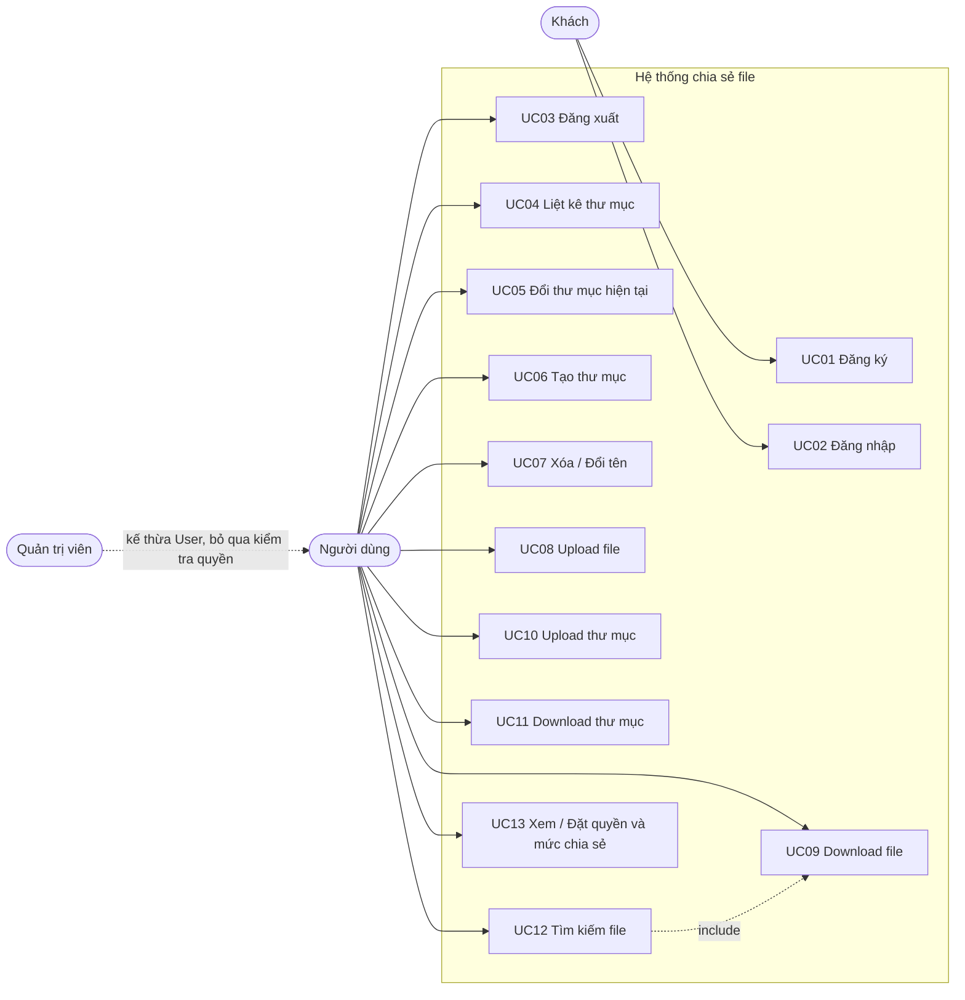
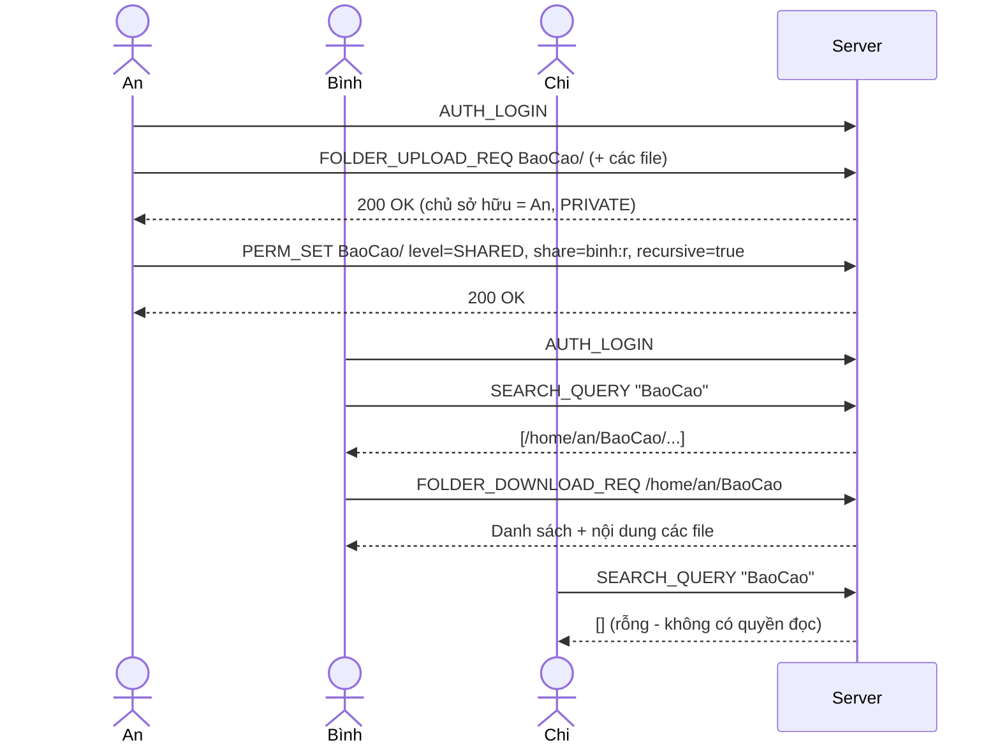
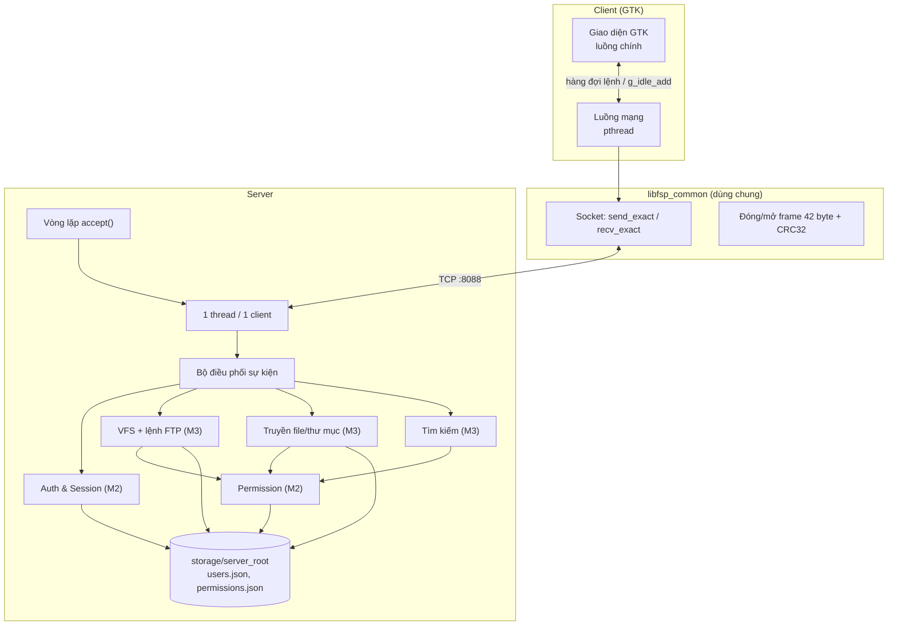

# BẢN ĐẶC TẢ YÊU CẦU PHẦN MỀM (SRS)
## Dự án: Ứng dụng chia sẻ file Client-Server qua Socket (Topic 6 — Group 7)

* **Phiên bản:** 3.0 (Thu gọn về phạm vi đồ án môn học, khả thi trong 2 tuần)
* **Công nghệ:** C11, POSIX TCP Socket (`<sys/socket.h>`), `pthread`, GTK 3, CMake
* **Môi trường chạy:** Server trên Linux/WSL; Client GUI trên Linux/WSL có GTK 3
* **Tài liệu đi kèm:** [LEARNING-ROADMAP.md](LEARNING-ROADMAP.md) (lộ trình kiến thức & kế hoạch 2 tuần)

> **Quy ước mức ưu tiên (MoSCoW):**
> **MUST** = bắt buộc để đạt yêu cầu đề bài · **SHOULD** = nên có nếu kịp · **COULD** = làm thêm khi dư thời gian · **WON'T** = không làm trong đồ án này.

---

## 1. BÀI TOÁN (PROBLEM STATEMENT)

### 1.1 Yêu cầu gốc của đề bài
Đề bài yêu cầu xây dựng ứng dụng chia sẻ file client-server bằng lập trình socket, gồm 7 nhóm chức năng:

| # | Yêu cầu gốc (nguyên văn) | Diễn giải ngắn |
|:-:|:---|:---|
| R1 | User Management: Account registration and login | Đăng ký, đăng nhập |
| R2 | File Management Commands (similar to FTP) | Liệt kê file, tạo thư mục, đổi thư mục hiện tại |
| R3 | File Upload/Download | Tải lên / tải về từng file |
| R4 | Folder Upload/Download | Tải lên / tải về cả thư mục |
| R5 | File Search | Tìm theo tên file, tải về ngay từ kết quả |
| R6 | Permission Management (similar to Linux) | Phân quyền file/thư mục, đặt mức chia sẻ |
| R7 | Graphical User Interface | Giao diện đồ họa dễ dùng |

### 1.2 Bối cảnh sử dụng
Một nhóm nhỏ (lớp học, câu lạc bộ, nhóm dự án ~5–30 người) cần **một máy chủ chung trong mạng LAN** để:
* Mỗi người có không gian lưu trữ riêng trên server.
* Đưa file/thư mục lên, lấy về, sắp xếp thư mục giống thao tác FTP.
* **Chủ động quyết định file nào riêng tư, file nào chia sẻ cho người cụ thể, file nào công khai** cho mọi thành viên.
* Tìm nhanh một file theo tên trong những file mình được phép xem.

### 1.3 Tuyên bố bài toán
> Xây dựng một ứng dụng chia sẻ file theo mô hình client-server, trong đó server lưu trữ file tập trung cho nhiều người dùng, client có giao diện đồ họa để duyệt, tải lên/tải về file và thư mục bằng các lệnh kiểu FTP. Khác với một FTP server thông thường, mỗi file/thư mục có **chủ sở hữu và quyền truy cập kiểu Linux** kèm **mức chia sẻ** (riêng tư / chia sẻ / công khai), và chức năng **tìm kiếm chỉ trả về những file người dùng được phép đọc**. Toàn bộ giao tiếp mạng được tự cài đặt trên TCP socket với một giao thức ứng dụng do nhóm tự thiết kế (FSP).

### 1.4 Phần mềm tham chiếu: FileZilla
Nhóm chọn **FileZilla** (client + server, mã nguồn mở, https://filezilla-project.org) làm phần mềm tham chiếu vì đề bài yêu cầu thao tác "giống FTP" và FileZilla là ứng dụng FTP phổ biến nhất.

| Khía cạnh | FileZilla làm gì | Dự án này lấy gì / khác gì |
|:---|:---|:---|
| Giao thức | FTP/FTPS/SFTP chuẩn | **Tự thiết kế giao thức FSP** trên 1 kết nối TCP (mục tiêu học tập của môn) |
| Lệnh FTP | `LIST`, `CWD`, `PWD`, `MKD`, `DELE`, `RMD`, `RNFR/RNTO`, `STOR`, `RETR` | Ánh xạ 1-1 sang sự kiện FSP (xem §4.2) |
| Giao diện client | Thanh kết nối nhanh, nhật ký, 2 ngăn Local/Remote, hàng đợi truyền | **Sao chép bố cục này** (xem §6) |
| Tài khoản | Admin tạo tài khoản trên server | **Thêm**: người dùng tự đăng ký |
| Phân quyền | Admin cấp quyền theo thư mục cho từng tài khoản | **Thay bằng**: chủ file tự phân quyền kiểu Linux + mức chia sẻ |
| Tìm kiếm | "Search remote files": client tự duyệt đệ quy bằng nhiều lệnh `LIST`, chỉ thấy những gì tài khoản được phép | **Đổi**: server tự tìm trong kho (1 yêu cầu `SEARCH_QUERY`) và lọc theo quyền từng file |

---

## 2. TÁC NHÂN (ACTORS)

| Tác nhân | Mô tả | Quyền chính |
|:---|:---|:---|
| **Khách (Guest)** | Người mở client nhưng chưa đăng nhập | Chỉ đăng ký, đăng nhập |
| **Người dùng (User)** | Đã đăng nhập. Đóng 2 vai tùy tài nguyên: **Chủ sở hữu** (file mình tạo/tải lên) hoặc **Người nhận** (file người khác chia sẻ) | Quản lý file của mình; truy cập file được chia sẻ theo quyền |
| **Quản trị viên (Admin)** | Tài khoản đăng ký **đầu tiên** trên server (mã user = 1) | Truy cập mọi file (bỏ qua kiểm tra quyền); đổi nhóm user, đổi chủ sở hữu (COULD) |

> Ngoài ra có **CLI client** chỉ dùng cho nhóm phát triển kiểm thử giao thức — không phải tác nhân nghiệp vụ.

---

## 3. USE CASE

### 3.1 Sơ đồ Use Case



### 3.2 Danh sách Use Case

| Mã | Tên | Yêu cầu gốc | Ưu tiên |
|:-:|:---|:-:|:-:|
| UC01 | Đăng ký tài khoản | R1 | MUST |
| UC02 | Đăng nhập | R1 | MUST |
| UC03 | Đăng xuất | R1 | MUST |
| UC04 | Liệt kê nội dung thư mục (`ls`) | R2 | MUST |
| UC05 | Đổi thư mục hiện tại (`cd`, `pwd`) | R2 | MUST |
| UC06 | Tạo thư mục (`mkdir`) | R2 | MUST |
| UC07 | Xóa (`rm`) / Đổi tên (`mv`) | R2 | SHOULD |
| UC08 | Upload một file | R3 | MUST |
| UC09 | Download một file | R3 | MUST |
| UC10 | Upload cả thư mục | R4 | MUST |
| UC11 | Download cả thư mục | R4 | MUST |
| UC12 | Tìm kiếm file theo tên + tải từ kết quả | R5 | MUST |
| UC13 | Xem / đặt quyền và mức chia sẻ | R6 | MUST |

### 3.3 Đặc tả chi tiết 4 Use Case trọng tâm

#### UC02 — Đăng nhập
| Mục | Nội dung |
|:---|:---|
| Tác nhân | Khách |
| Tiền điều kiện | Client đã kết nối TCP tới server |
| Luồng chính | 1. Nhập username, password → 2. Client gửi `AUTH_LOGIN` → 3. Server so khớp mật khẩu đã băm → 4. Server tạo session token, đặt thư mục hiện tại = `/home/<username>` → 5. Client chuyển sang màn hình chính |
| Luồng lỗi | 3a. Sai username/password → `401`, client hiện thông báo, ở lại màn hình đăng nhập |
| Hậu điều kiện | Kết nối này gắn với một người dùng; mọi yêu cầu sau phải kèm token hợp lệ |

#### UC08 — Upload một file
| Mục | Nội dung |
|:---|:---|
| Tác nhân | Người dùng |
| Tiền điều kiện | Đã đăng nhập; có quyền `WRITE` trên thư mục đích |
| Luồng chính | 1. Chọn file ở ngăn Local, kéo/bấm Upload → 2. Client gửi `FILE_UPLOAD_REQ` (tên, kích thước) → 3. Server kiểm tra quyền & đường dẫn, trả `transfer_id` → 4. Client đọc file từng khối 64 KB, gửi `FILE_CHUNK` kèm CRC32 → 5. Server kiểm tra CRC32, ghi vào file tạm `.part` → 6. Client gửi `FILE_UPLOAD_FINISH` → 7. Server đổi tên `.part` thành tên thật, ghi chủ sở hữu = người upload, mức `PRIVATE` → 8. Hàng đợi truyền hiển thị "Thành công" |
| Luồng lỗi | 3a. Không có quyền → `403` · 3b. Tên đã tồn tại → `409` · 5a. Sai CRC32 → server hủy phiên, xóa `.part`, trả lỗi · Mất kết nối → server xóa `.part` |
| Hậu điều kiện | File nằm trên server, nội dung giống hệt file gốc |

#### UC12 — Tìm kiếm file và tải từ kết quả
| Mục | Nội dung |
|:---|:---|
| Tác nhân | Người dùng |
| Luồng chính | 1. Mở hộp thoại Tìm kiếm, nhập từ khóa (và đuôi file nếu muốn) → 2. Client gửi `SEARCH_QUERY` → 3. Server duyệt toàn bộ kho, giữ lại file có tên chứa từ khóa **và** người dùng có quyền `READ` → 4. Trả về danh sách (đường dẫn, kích thước, chủ sở hữu) → 5. Người dùng chọn 1 dòng, bấm Download → thực hiện UC09 với đường dẫn đó |
| Quy tắc | File không có quyền đọc **không xuất hiện** trong kết quả; tối đa 100 kết quả |

#### UC13 — Đặt quyền và mức chia sẻ
| Mục | Nội dung |
|:---|:---|
| Tác nhân | Người dùng (chủ sở hữu hoặc người có quyền `SHARE`) |
| Luồng chính | 1. Chuột phải file/thư mục ở ngăn Remote → "Quyền…" → 2. Client gửi `PERM_GET`, hiện hộp thoại → 3. Người dùng tick các ô r/w/s, chọn mức Riêng tư / Chia sẻ / Công khai, thêm username vào danh sách chia sẻ → 4. Client gửi `PERM_SET` → 5. Server kiểm tra quyền `SHARE`, lưu lại |
| Luồng lỗi | 5a. Không có quyền `SHARE` → `403` · 3a. Username không tồn tại → `404` |

### 3.4 Luồng nghiệp vụ mẫu (End-to-End)
**Kịch bản "Chia sẻ tài liệu cho bạn cùng nhóm":** An tải thư mục `BaoCao/` lên → đặt mức *Chia sẻ* cho Bình với quyền đọc → Bình đăng nhập, tìm "BaoCao" → thấy và tải về. Chi (không được chia sẻ) tìm cùng từ khóa → không thấy gì.



---

## 4. YÊU CẦU CHỨC NĂNG (FUNCTIONAL REQUIREMENTS)

### FR-1 Quản lý người dùng (R1)
| Mã | Yêu cầu | Ưu tiên |
|:---|:---|:-:|
| FR-1.1 | Đăng ký với `username` (3–32 ký tự `[A-Za-z0-9_]`) và `password` (6–128 ký tự). Trùng username → `409`. | MUST |
| FR-1.2 | Khi đăng ký, server tạo thư mục `/home/<username>`, chủ sở hữu là người đó, mức `PRIVATE`. | MUST |
| FR-1.3 | Mật khẩu lưu dạng **băm SHA-256 có salt ngẫu nhiên**, không lưu mật khẩu gốc. | MUST |
| FR-1.4 | Đăng nhập thành công trả về session token; mọi yêu cầu (trừ đăng ký/đăng nhập) phải có token hợp lệ, nếu không → `401`. | MUST |
| FR-1.5 | Đăng xuất hoặc ngắt kết nối → token bị hủy. | MUST |
| FR-1.6 | Token tự hết hạn sau 30 phút không hoạt động. | COULD *(M2 đã có ở Checkpoint 1)* |
| FR-1.7 | Khóa tạm tài khoản sau 5 lần sai mật khẩu liên tiếp. | COULD *(M2 đã có ở Checkpoint 1)* |

### FR-2 Lệnh quản lý file kiểu FTP (R2)
| Mã | Sự kiện FSP | Tương đương FTP | Yêu cầu | Ưu tiên |
|:---|:---|:---|:---|:-:|
| FR-2.1 | `DIR_LIST` | `LIST` | Trả về tên, loại (file/thư mục), kích thước, thời gian sửa, chủ sở hữu, quyền, mức chia sẻ. Cần quyền `READ` trên thư mục. | MUST |
| FR-2.2 | `DIR_CHANGE` | `CWD` | Đổi thư mục hiện tại của phiên; hỗ trợ đường dẫn tuyệt đối, tương đối, `..`. | MUST |
| FR-2.3 | `DIR_PWD` | `PWD` | Trả về đường dẫn ảo hiện tại (ví dụ `/home/an/BaoCao`). | MUST |
| FR-2.4 | `DIR_MKDIR` | `MKD` | Tạo thư mục mới, cần quyền `WRITE` trên thư mục cha. | MUST |
| FR-2.5 | `FS_DELETE` | `DELE` / `RMD` | Xóa file hoặc thư mục rỗng, cần quyền `WRITE`. | SHOULD |
| FR-2.6 | `FS_RENAME` | `RNFR`+`RNTO` | Đổi tên trong cùng thư mục, cần quyền `WRITE`. | SHOULD |

**Quy tắc chung:** client chỉ thấy **đường dẫn ảo** bắt đầu bằng `/`. Server ánh xạ `/` → `./storage/server_root`. Mọi đường dẫn sau khi chuẩn hóa nằm ngoài thư mục này đều bị từ chối (`403`).

### FR-3 Upload/Download file (R3)
| Mã | Yêu cầu | Ưu tiên |
|:---|:---|:-:|
| FR-3.1 | File được gửi thành các khối tối đa **64 KB** (`FILE_CHUNK`), mỗi khối có `FileChunkHeader` 88 byte kèm CRC32. | MUST |
| FR-3.2 | Bên gửi và bên nhận chỉ dùng **bộ đệm cố định**, không đọc cả file vào RAM. | MUST |
| FR-3.3 | Bên nhận kiểm tra CRC32 từng khối; sai → hủy phiên truyền, xóa file tạm, báo lỗi. | MUST |
| FR-3.4 | Upload ghi vào file `.part`, chỉ đổi tên thành file thật khi nhận đủ và hợp lệ. | MUST |
| FR-3.5 | Upload trùng tên → `409` (không ghi đè). | MUST |
| FR-3.6 | Kiểm tra thêm SHA-256 toàn file khi kết thúc. | COULD |

### FR-4 Upload/Download thư mục (R4)
| Mã | Yêu cầu | Ưu tiên |
|:---|:---|:-:|
| FR-4.1 | Bên gửi duyệt đệ quy thư mục (`opendir`/`readdir`), tạo **danh sách (manifest)** gồm đường dẫn tương đối của từng thư mục con và file. | MUST |
| FR-4.2 | Bên nhận tạo trước toàn bộ thư mục con theo manifest, sau đó lần lượt nhận từng file bằng cơ chế FR-3. | MUST |
| FR-4.3 | Download thư mục: server chỉ đưa vào manifest những mục người dùng có quyền `READ`; mục bị bỏ qua được báo lại cho client. | MUST |
| FR-4.4 | Kết quả: cấu trúc thư mục và nội dung file ở đích giống hệt nguồn. | MUST |

### FR-5 Tìm kiếm (R5)
| Mã | Yêu cầu | Ưu tiên |
|:---|:---|:-:|
| FR-5.1 | Tìm theo **chuỗi con trong tên file**, không phân biệt hoa thường. | MUST |
| FR-5.2 | Lọc thêm theo đuôi file (ví dụ `.pdf`). | SHOULD |
| FR-5.3 | Chỉ trả về file người dùng có quyền `READ`. | MUST |
| FR-5.4 | Kết quả có đường dẫn ảo đầy đủ để client gọi download trực tiếp. | MUST |
| FR-5.5 | Tìm bằng biểu thức chính quy. | WON'T |

### FR-6 Phân quyền kiểu Linux (R6)

**Mô hình dữ liệu:** mỗi file/thư mục có:
* `owner` — người tạo/tải lên.
* `group` — nhóm của chủ sở hữu. Mặc định mỗi user có **nhóm riêng** (mã nhóm = mã user); Admin có thể chuyển user vào nhóm chung (ví dụ cả nhóm đồ án vào một nhóm).
* `perm` — 9 bit chia 3 bộ **Chủ / Nhóm / Người khác**, mỗi bộ 3 bit: `r` (4: xem, tải về), `w` (2: tải lên, tạo, xóa, đổi tên), `s` (1: đổi quyền/chia sẻ). Bit `s` thay cho bit `x` của Linux vì hệ thống không có khái niệm "thực thi". Ví dụ `0640` = `rw- r-- ---`.
* `level` — mức chia sẻ: `PRIVATE`, `SHARED`, `PUBLIC`.
* `share_list` — danh sách người được chia sẻ kèm quyền (`r`/`w`/`s`). Giao diện nhập theo **username**, server lưu theo mã user.

**Thuật toán kiểm tra quyền `can_access(user, path, action)`:**

| Bước | Điều kiện | Kết quả |
|:-:|:---|:---|
| 0 | Đường dẫn chưa có bản ghi quyền, hoặc user không tồn tại | **Từ chối** |
| 1 | Người dùng là Admin | Cho phép |
| 2 | Người dùng là chủ sở hữu | `READ`, `SHARE`: luôn cho phép (giống Linux: chủ file luôn `chmod` được) · `WRITE`: theo bit `w` của bộ **Chủ** |
| 3 | `level = PRIVATE` | **Từ chối** (bỏ qua mọi bit Nhóm/Người khác) |
| 4 | Cùng nhóm với chủ sở hữu **và** bit tương ứng của bộ **Nhóm** bật | Cho phép |
| 5 | `level = PUBLIC` **và** `action = READ` | Cho phép |
| 6 | `level = SHARED` **và** người dùng có trong `share_list` với quyền tương ứng | Cho phép |
| 7 | Mọi trường hợp còn lại | **Từ chối** (`403`) |

> Bộ bit **Người khác** không được dùng để cấp quyền: người ngoài nhóm chỉ được truy cập qua mức `PUBLIC` (chỉ đọc) hoặc qua `share_list`. Đây là chỗ hệ thống "kết hợp" quyền Linux với mức chia sẻ theo yêu cầu đề bài.

| Mã | Yêu cầu | Ưu tiên |
|:---|:---|:-:|
| FR-6.1 | Áp dụng `can_access` cho **mọi** thao tác FR-2 → FR-5. | MUST |
| FR-6.2 | File/thư mục mới: chủ sở hữu = người tạo, `perm` = `0644` (file) / `0755` (thư mục), `level = PRIVATE`. Mỗi file/thư mục tạo ra (kể cả từng file trong thư mục được upload) đều phải có bản ghi quyền. | MUST |
| FR-6.3 | `PERM_GET` xem quyền; `PERM_SET` đổi `perm`, `level`, thêm/xóa người trong `share_list` (cần quyền `SHARE`). | MUST |
| FR-6.4 | `PERM_SET` trên thư mục có tùy chọn **"áp dụng cho toàn bộ bên trong"** (đệ quy) để chia sẻ cả thư mục trong một thao tác. | MUST |
| FR-6.5 | Dữ liệu quyền lưu bền vững (file `permissions.json`), còn nguyên sau khi khởi động lại server. | MUST |
| FR-6.6 | Đổi chủ sở hữu (`chown`) và đổi nhóm của user — chỉ Admin. | COULD *(M2 đã có ở Checkpoint 1)* |
| FR-6.7 | Mục mới tạo trong thư mục đã chia sẻ tự thừa hưởng `level` và `share_list` của thư mục cha. | COULD |

> **Đơn giản hóa có chủ đích (khác Linux thật):** chỉ kiểm tra quyền trên chính file/thư mục được truy cập, không kiểm tra dây chuyền các thư mục cha. Nhờ vậy một file được chia sẻ vẫn truy cập được (qua tìm kiếm hoặc đường dẫn) dù thư mục chứa nó là riêng tư — giống tính năng "Được chia sẻ với tôi" của các dịch vụ lưu trữ.

### FR-7 Giao diện đồ họa (R7)
| Mã | Yêu cầu | Ưu tiên |
|:---|:---|:-:|
| FR-7.1 | Màn hình đăng nhập/đăng ký (host, port, username, password). | MUST |
| FR-7.2 | Màn hình chính 2 ngăn: Local (máy mình) và Remote (server), có ô đường dẫn và nút lên thư mục cha. | MUST |
| FR-7.3 | Upload/Download bằng nút bấm hoặc menu chuột phải. | MUST |
| FR-7.4 | Bảng hàng đợi truyền: tên file, hướng, thanh tiến trình %, trạng thái. | MUST |
| FR-7.5 | Hộp thoại tìm kiếm có nút Download trên kết quả. | MUST |
| FR-7.6 | Hộp thoại phân quyền (ô tick r/w/s, chọn mức chia sẻ, danh sách chia sẻ). | MUST |
| FR-7.7 | Vùng nhật ký hiển thị lệnh đã gửi và kết quả/lỗi. | SHOULD |
| FR-7.8 | Kéo-thả file giữa 2 ngăn. | COULD |

---

## 5. YÊU CẦU PHI CHỨC NĂNG (NON-FUNCTIONAL REQUIREMENTS)

Mỗi yêu cầu đều có **cách kiểm chứng** cụ thể, đo được trong buổi demo.

| Mã | Yêu cầu | Cách kiểm chứng | Ưu tiên |
|:---|:---|:---|:-:|
| NFR-1 Đúng đắn dữ liệu | File tải lên rồi tải về giống hệt bản gốc | So sánh bằng `sha256sum` hoặc `cmp` trên file 1 KB, 10 MB, 500 MB | MUST |
| NFR-2 Bộ nhớ | Truyền file lớn không làm RAM tăng theo kích thước file | Theo dõi bằng `top`/`/usr/bin/time -v` khi truyền file 500 MB: bộ nhớ tiến trình ổn định | MUST |
| NFR-3 Đồng thời | Server phục vụ **ít nhất 5 client** cùng lúc (mỗi client một thread) | Mở 5 client upload/download đồng thời, tất cả hoàn tất đúng | MUST |
| NFR-4 Ổn định | Client ngắt kết nối giữa chừng không làm server sập, không để lại file `.part` | Tắt client khi đang upload, server vẫn phục vụ client khác | MUST |
| NFR-5 An toàn đường dẫn | Không truy cập được ra ngoài `./storage/server_root` | Gửi `../../etc/passwd` → `403` | MUST |
| NFR-6 Giao diện không treo | GUI vẫn bấm/cuộn được trong khi đang truyền file | Thao tác trên ngăn Local khi đang download file 500 MB | MUST |
| NFR-7 Thông báo lỗi | Mọi lỗi hiển thị thông điệp dễ hiểu (không chỉ mã số) | Kiểm tra các luồng lỗi trong §3.3 | SHOULD |
| NFR-8 Chất lượng mã | Unit test chạy sạch dưới AddressSanitizer | `ctest` với `-fsanitize=address,undefined` | SHOULD |

### Giới hạn đã biết (ghi rõ để tránh hiểu nhầm)
* **Không mã hóa đường truyền** (không TLS): mật khẩu và dữ liệu đi dạng rõ trên LAN. Đây là giới hạn chấp nhận được với phạm vi môn học; hướng mở rộng là bọc TLS.
* Không hỗ trợ truyền tiếp (resume) khi mất kết nối — phải truyền lại từ đầu.
* Không có giao diện web/di động; không đồng bộ tự động.

---

## 6. GIAO DIỆN NGƯỜI DÙNG (UI/UX)

Bố cục tham chiếu trực tiếp từ FileZilla Client để người dùng quen FTP dùng được ngay.

### 6.1 Màn hình đăng nhập
```
+--------------------------------------------+
|        FILE SHARING CLIENT - Đăng nhập     |
|--------------------------------------------|
|  Server:   [ 192.168.1.10      ] Port [8088]|
|  Username: [ an                         ]  |
|  Password: [ ********                   ]  |
|                                            |
|        [ Đăng nhập ]   [ Đăng ký ]         |
|  (!) Sai tên đăng nhập hoặc mật khẩu       |
+--------------------------------------------+
```

### 6.2 Màn hình chính
```
+--------------------------------------------------------------------------+
| Đã kết nối: an@192.168.1.10:8088          [Tìm kiếm] [Đăng xuất]         |
|--------------------------------------------------------------------------|
| NHẬT KÝ: > DIR_LIST /home/an ... 200 OK (5 mục)                          |
|--------------------------------------------------------------------------|
| LOCAL: [/home/an/Documents  ] [↑] | REMOTE: [/home/an          ] [↑]     |
| Tên            Kích thước          | Tên         Kích thước Quyền    Mức  |
| BaoCao/        --                  | BaoCao/     --         rwsr-s   SHR  |
| slide.pptx     2.1 MB              | data.zip    40 MB      rw-r--   PRV  |
| ...                                | ...                                  |
|              [ Upload → ]          | [ ← Download ] [Thư mục mới] [Quyền] |
|--------------------------------------------------------------------------|
| HÀNG ĐỢI TRUYỀN                                                          |
| ↑ slide.pptx   [██████████░░░░░░] 62%   Đang truyền                      |
| ↓ data.zip     [████████████████] 100%  Thành công                       |
+--------------------------------------------------------------------------+
```

### 6.3 Hộp thoại phân quyền
```
+----------------------------------------------+
| Quyền: /home/an/BaoCao       Chủ sở hữu: an  |
|----------------------------------------------|
|            Đọc(r)   Ghi(w)   Chia sẻ(s)      |
|  Chủ        [x]      [x]       [x]           |
|  Nhóm       [x]      [ ]       [ ]           |
|  Người khác [ ]      [ ]       [ ]           |
|----------------------------------------------|
|  Mức chia sẻ: ( ) Riêng tư (•) Chia sẻ ( ) Công khai |
|  Chia sẻ với: binh (r--)  [Xóa]              |
|               [ username ] [r][w][s] [Thêm]  |
|  [x] Áp dụng cho toàn bộ bên trong thư mục   |
|                         [ Lưu ]  [ Hủy ]     |
+----------------------------------------------+
```

### 6.4 Hộp thoại tìm kiếm
```
+----------------------------------------------------+
| Từ khóa: [ baocao        ]  Đuôi: [.pdf ] [Tìm]    |
|----------------------------------------------------|
| Đường dẫn                        Kích thước  Chủ   |
| /home/an/BaoCao/baocao_v1.pdf    1.2 MB      an    |
| /home/binh/baocao_nhom.pdf       800 KB      binh  |
|----------------------------------------------------|
|                     [ Download mục đã chọn ]       |
+----------------------------------------------------+
```

**Nguyên tắc UX:** mọi thao tác dài (truyền file, tìm kiếm) chạy nền và hiện tiến trình; nút bấm bị vô hiệu khi đang chờ phản hồi; lỗi hiện bằng hộp thoại kèm lý do (ví dụ "Bạn không có quyền ghi vào thư mục này").

---

## 7. KIẾN TRÚC TỔNG QUAN (HIGH-LEVEL ARCHITECTURE)



**Mô hình luồng:**
* **Server:** thread chính chạy `accept()`; mỗi client mới được phục vụ bởi một thread riêng (`pthread_create` + `pthread_detach`). Dữ liệu dùng chung (danh sách user, phiên, bảng quyền) được bảo vệ bằng `pthread_mutex_t`. *(Thread pool là COULD.)*
* **Client:** luồng GTK chỉ vẽ giao diện; mọi lệnh mạng được đẩy sang luồng mạng; kết quả trả về luồng GTK qua `g_idle_add()`.

**Giao thức FSP (tóm tắt — chi tiết trong [SDD.md](SDD.md) và [FSPProtocol.h](../include/common/FSPProtocol.h)):**
* Mỗi thông điệp = **header cố định 42 byte** (`magic`, `type`, `payload_len`, `event[32]`, `checksum`) + payload.
* Lệnh điều khiển: payload là JSON ngắn (ví dụ `{"token":"...","path":"/home/an"}`).
* Dữ liệu file: payload = `FileChunkHeader` 88 byte + tối đa 64 KB dữ liệu thô.
* Vì TCP là dòng byte, bên nhận luôn đọc **đủ 42 byte header**, rồi đọc **đủ `payload_len` byte** (hàm `recv_exact`) — giải quyết hiện tượng dính gói/tách gói.

---

## 8. THIẾT KẾ CHI TIẾT (LOW-LEVEL — MỨC MODULE)

| Module | File C | Hàm chính (dự kiến) | Phụ trách |
|:---|:---|:---|:-:|
| Socket & Frame | `fsp_socket.c`, `fsp_packet.c`, `fsp_crc32.c` | `send_exact`, `recv_exact`, `fsp_send_frame`, `fsp_recv_frame`, `crc32` | M1 |
| Server core | `server_main.c`, `fsp_dispatcher.c` | `server_listen`, `client_thread`, `dispatcher_register`, `dispatcher_handle` | M1 |
| Người dùng & Phiên | `fsp_user.c`, `fsp_session.c`, `fsp_sha256.c` | `user_register`, `user_verify`, `session_create`, `session_lookup`, `session_destroy` | M2 |
| Phân quyền | `fsp_perm.c` | `perm_can_access`, `perm_get`, `perm_set`, `perm_add_entry`, `perm_remove_entry`, `perm_load/save` | M2 |
| File hệ thống ảo | `fsp_vfs.c` | `vfs_resolve` (ảo → thật + kiểm tra biên), `vfs_list`, `vfs_mkdir`, `vfs_delete`, `vfs_rename` | M3 |
| Truyền dữ liệu | `fsp_transfer.c` | `transfer_upload_begin/chunk/finish`, `transfer_send_file`, `manifest_build`, `manifest_apply` | M3 |
| Tìm kiếm | `fsp_search.c` | `search_by_name(user, keyword, ext, results, max)` | M3 |
| Client GUI | `gui_login.c`, `gui_main.c`, `gui_dialogs.c`, `client_net.c` | `client_net_start`, `client_net_post(cmd)`, `on_result_idle` | M4 |
| CLI test client | `cli_main.c` | Lệnh `login`, `ls`, `cd`, `put`, `get`, `find`, `chmod` | M4 (+ mọi người dùng để test) |

**Lưu trữ trên server:**
```
storage/server_root/
  home/an/...            ← file thật của người dùng
data/users.json          ← {username, salt, hash, group}
data/permissions.json    ← {path, owner, group, perm, level, share_list}
```

---

## 9. MA TRẬN TRUY VẾT YÊU CẦU (TRACEABILITY)

| Yêu cầu gốc | Use Case | FR | NFR | Phụ trách chính | Kiểm thử bắt buộc |
|:-:|:---|:---|:---|:-:|:---|
| R1 | UC01–03 | FR-1 | — | M2 | Đăng ký trùng → 409; token giả → 401 |
| R2 | UC04–07 | FR-2 | NFR-5 | M3 | `cd ../../..` không thoát khỏi `/` |
| R3 | UC08–09 | FR-3 | NFR-1, 2, 4 | M3 + M1 | Sửa 1 bit trong chunk → bị phát hiện; file 500 MB khớp `sha256sum` |
| R4 | UC10–11 | FR-4 | NFR-1 | M3 | Thư mục 3 cấp, 20 file → cấu trúc giống hệt |
| R5 | UC12 | FR-5 | — | M3 + M2 | File PRIVATE của người khác không xuất hiện |
| R6 | UC13 | FR-6 | NFR-5 | M2 | Bảng bước 0–7 của `can_access` — mỗi bước ≥ 1 test |
| R7 | Tất cả | FR-7 | NFR-6, 7 | M4 | GUI không treo khi truyền file 500 MB |
| (Nền tảng) | — | — | NFR-3, 4 | M1 | 2 frame dính trong 1 lần `recv` được tách đúng; 5 client đồng thời |

---

## 10. THAY ĐỔI SO VỚI PHIÊN BẢN TRƯỚC (cần cả nhóm thống nhất)

| Nội dung cũ | Phiên bản 3.0 | Lý do |
|:---|:---|:---|
| Bối cảnh "mạng cô lập doanh nghiệp R&D", so sánh với SMB/SFTP/Nextcloud | Nhóm nhỏ dùng chung server trong LAN; chỉ tham chiếu FileZilla | Bối cảnh cũ chưa được nhóm kiểm chứng, dễ bị hỏi vặn |
| File ≥ 2 GB, RAM ≤ 50 MB | File 500 MB, bộ nhớ không tăng theo kích thước file | Đo được bằng công cụ có sẵn trong buổi demo |
| ≥ 50 kết nối, Worker ThreadPool | ≥ 5 client, 1 thread / client; ThreadPool là COULD | Đơn giản, đủ chứng minh xử lý đồng thời |
| SHA-256 toàn file bắt buộc | CRC32 từng khối là MUST; SHA-256 toàn file là COULD | CRC32 đã có sẵn trong header giao thức |
| Tìm kiếm bằng regex | Chuỗi con + đuôi file | Đề bài chỉ yêu cầu "tìm theo tên" |
| Khóa tài khoản chống brute-force, TTL 30 phút | COULD | Không thuộc yêu cầu gốc |
| ACL `uid:mask` + quy trình 9 bước, viết như một chuẩn riêng | Giữ đúng logic M2 đã cài đặt, trình bày lại thành bảng bước 0–7; thêm PERM_SET đệ quy cho thư mục | Không phải viết lại code M2; dễ giải thích, dễ test hết |
| 4 persona (Admin, Engineer, CI Runner, Auditor) | 3 tác nhân: Khách, Người dùng, Admin | CI Runner/Auditor không xuất phát từ đề bài |

> **Ảnh hưởng tới tài liệu khác:** `AGENTS.md`, `WBS.md`, `SDD.md`, `CICD.md`, `C-MIGRATION-PLAN.md` và `docs/TDD/*` đã được cập nhật theo bảng trên. `FSPProtocol.h` **không thay đổi**.
