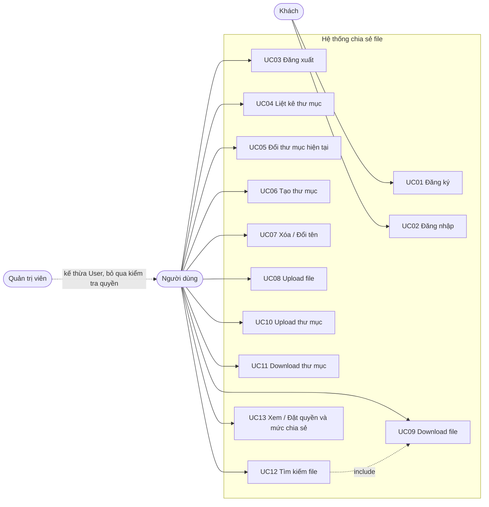
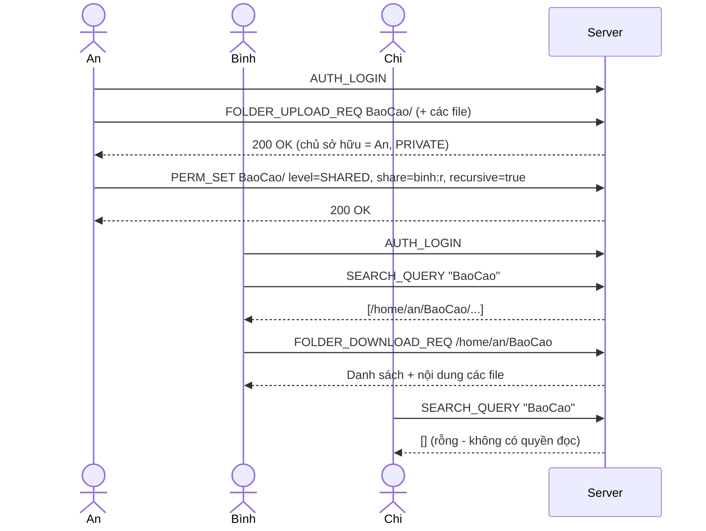
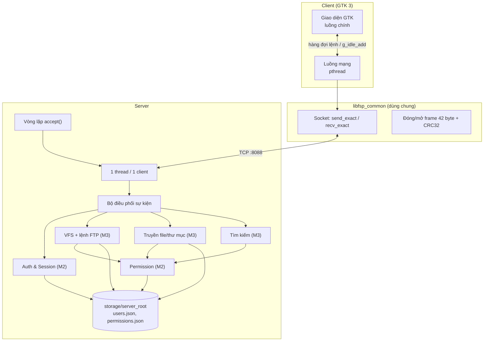

# BẢN ĐẶC TẢ YÊU CẦU PHẦN MỀM (SRS)
## Dự án: Ứng dụng chia sẻ file Client-Server qua Socket (Topic 6 — Group 7)

* **Phiên bản:** 3.1 (Baseline chính thức — Đồng bộ 13 Use Case v1.0, FR-1..FR-7 và 27 NFR chính thức)
* **Công nghệ:** C11, POSIX TCP Socket (`<sys/socket.h>`), `pthread`, GTK 3, CMake
* **Môi trường chạy:** Server trên Linux/WSL2; Client GUI trên Linux/WSL2 có GTK 3 (+ CLI test client)
* **Tài liệu đi kèm:** [LEARNING-ROADMAP.md](../archive/LEARNING-ROADMAP.md) · [SDD.md](SDD.md) (v2.1) · [UC-CHECKLIST.md](../uc-details/UC-CHECKLIST.md) · [NFR-CHECKLIST.md](../uc-details/NFR-CHECKLIST.md) · [uc-details/](../uc-details/README.md)

> **Quy ước mức ưu tiên (MoSCoW):**
> **MUST** = bắt buộc để đạt yêu cầu đề bài · **SHOULD** = nên có (đã chốt 7 NFR bổ trợ) · **COULD** = làm thêm khi dư thời gian · **WON'T** = không làm trong đồ án này.

---

## 1. BÀI TOÁN (PROBLEM STATEMENT)

### 1.1 Yêu cầu gốc của đề bài
Đề bài yêu cầu xây dựng ứng dụng chia sẻ file client-server bằng lập trình socket, gồm 7 nhóm chức năng:

| # | Yêu cầu gốc (nguyên văn) | Diễn giải ngắn |
|:-:|:---|:---|
| R1 | User Management: Account registration and login | Đăng ký, đăng nhập |
| R2 | File Management Commands (similar to FTP) | Liệt kê file, tạo thư mục, đổi thư mục hiện tại |
| R3 | File Upload/Download | Tải lên / tải về từng file |
| R4 | Folder Upload/Download | Tải lên / tải về cả thư mục |
| R5 | File Search | Tìm theo tên file, tải về ngay từ kết quả |
| R6 | Permission Management (similar to Linux) | Phân quyền file/thư mục, đặt mức chia sẻ |
| R7 | Graphical User Interface | Giao diện đồ họa dễ dùng |

### 1.2 Bối cảnh sử dụng
Một nhóm nhỏ (lớp học, câu lạc bộ, nhóm dự án ~5–30 người) cần **một máy chủ chung trong mạng LAN** để:
* Mỗi người có không gian lưu trữ riêng trên server.
* Đưa file/thư mục lên, lấy về, sắp xếp thư mục giống thao tác FTP.
* **Chủ động quyết định file nào riêng tư, file nào chia sẻ cho người cụ thể, file nào công khai** cho mọi thành viên.
* Tìm nhanh một file theo tên trong những file mình được phép xem.

### 1.3 Tuyên bố bài toán
> Xây dựng một ứng dụng chia sẻ file theo mô hình client-server, trong đó server lưu trữ file tập trung cho nhiều người dùng, client có giao diện đồ họa để duyệt, tải lên/tải về file và thư mục bằng các lệnh kiểu FTP. Khác với một FTP server thông thường, mỗi file/thư mục có **chủ sở hữu và quyền truy cập kiểu Linux** kèm **mức chia sẻ** (riêng tư / chia sẻ / công khai), và chức năng **tìm kiếm chỉ trả về những file người dùng được phép đọc**. Toàn bộ giao tiếp mạng được tự cài đặt trên TCP socket với một giao thức ứng dụng do nhóm tự thiết kế (FSP).

### 1.4 Phần mềm tham chiếu: FileZilla
Nhóm chọn **FileZilla** (client + server, mã nguồn mở, https://filezilla-project.org) làm phần mềm tham chiếu vì đề bài yêu cầu thao tác "giống FTP" và FileZilla là ứng dụng FTP phổ biến nhất.

| Khía cạnh | FileZilla làm gì | Dự án này lấy gì / khác gì |
|:---|:---|:---|
| Giao thức | FTP/FTPS/SFTP chuẩn | **Tự thiết kế giao thức FSP** trên 1 kết nối TCP (mục tiêu học tập của môn) |
| Lệnh FTP | `LIST`, `CWD`, `PWD`, `MKD`, `DELE`, `RMD`, `RNFR/RNTO`, `STOR`, `RETR` | Ánh xạ 1-1 sang sự kiện FSP (xem §4.2) |
| Giao diện client | Thanh kết nối nhanh, nhật ký, 2 ngăn Local/Remote, hàng đợi truyền | **Sao chép bố cục này** (xem §6) |
| Tài khoản | Admin tạo tài khoản trên server | **Thêm**: người dùng tự đăng ký |
| Phân quyền | Admin cấp quyền theo thư mục cho từng tài khoản | **Thay bằng**: chủ file tự phân quyền kiểu Linux + mức chia sẻ |
| Tìm kiếm | "Search remote files": client tự duyệt đệ quy bằng nhiều lệnh `LIST`, chỉ thấy những gì tài khoản được phép | **Đổi**: server tự tìm trong kho (1 yêu cầu `SEARCH_QUERY`) và lọc theo quyền từng file |

---

## 2. TÁC NHÂN (ACTORS)

| Tác nhân | Mô tả | Quyền chính |
|:---|:---|:---|
| **Khách (Guest)** | Người mở client nhưng chưa đăng nhập | Chỉ đăng ký, đăng nhập |
| **Người dùng (User)** | Đã đăng nhập. Đóng 2 vai tùy tài nguyên: **Chủ sở hữu** (file mình tạo/tải lên) hoặc **Người nhận** (file người khác chia sẻ) | Quản lý file của mình; truy cập file được chia sẻ theo quyền |
| **Quản trị viên (Admin)** | Tài khoản đăng ký **đầu tiên** trên server (mã user = 1) | Truy cập mọi file (bỏ qua kiểm tra quyền); đổi nhóm user, đổi chủ sở hữu (COULD) |

> Ngoài ra có **CLI client** dùng cho kiểm thử tự động, kiểm thử tích hợp và demo dự phòng qua terminal — không phải tác nhân nghiệp vụ.

---

## 3. USE CASE

### 3.1 Sơ đồ Use Case



### 3.2 Danh sách 13 Use Case chính thức (v1.0)

> Toàn bộ đặc tả chi tiết 14 mục (kèm biểu đồ Mermaid và tích hợp NFR) của từng Use Case nằm trong [uc-details/](../uc-details/README.md) và theo dõi tiến độ tại [UC-CHECKLIST.md](../uc-details/UC-CHECKLIST.md).

| Mã | Tên | Yêu cầu gốc | Ưu tiên | Đặc tả chi tiết (v1.0) |
|:-:|:---|:-:|:-:| :--- |
| UC01 | Đăng ký tài khoản | R1 | MUST | [UC01-dang-ky-tai-khoan.md](../uc-details/UC01-dang-ky-tai-khoan.md) |
| UC02 | Đăng nhập | R1 | MUST | [UC02-dang-nhap.md](../uc-details/UC02-dang-nhap.md) |
| UC03 | Đăng xuất | R1 | MUST | [UC03-dang-xuat.md](../uc-details/UC03-dang-xuat.md) |
| UC04 | Liệt kê nội dung thư mục (`ls`) | R2 | MUST | [UC04-liet-ke-thu-muc.md](../uc-details/UC04-liet-ke-thu-muc.md) |
| UC05 | Đổi thư mục hiện tại (`cd`, `pwd`) | R2 | MUST | [UC05-doi-thu-muc-hien-tai.md](../uc-details/UC05-doi-thu-muc-hien-tai.md) |
| UC06 | Tạo thư mục (`mkdir`) | R2 | MUST | [UC06-tao-thu-muc.md](../uc-details/UC06-tao-thu-muc.md) |
| UC07 | Xóa (`rm`) / Đổi tên (`mv`) | R2 | SHOULD | [UC07-xoa-doi-ten.md](../uc-details/UC07-xoa-doi-ten.md) |
| UC08 | Upload một file | R3 | MUST | [UC08-upload-file.md](../uc-details/UC08-upload-file.md) |
| UC09 | Download một file | R3 | MUST | [UC09-download-file.md](../uc-details/UC09-download-file.md) |
| UC10 | Upload cả thư mục | R4 | MUST | [UC10-upload-thu-muc.md](../uc-details/UC10-upload-thu-muc.md) |
| UC11 | Download cả thư mục | R4 | MUST | [UC11-download-thu-muc.md](../uc-details/UC11-download-thu-muc.md) |
| UC12 | Tìm kiếm file theo tên + tải từ kết quả | R5 | MUST | [UC12-tim-kiem-file.md](../uc-details/UC12-tim-kiem-file.md) |
| UC13 | Xem / đặt quyền và mức chia sẻ | R6 | MUST | [UC13-phan-quyen-chia-se.md](../uc-details/UC13-phan-quyen-chia-se.md) |

### 3.3 Tóm tắt 4 Use Case trọng tâm

#### UC02 — Đăng nhập
| Mục | Nội dung |
|:---|:---|
| Tác nhân | Khách |
| Tiền điều kiện | Client đã kết nối TCP tới server |
| Luồng chính | 1. Nhập username, password → 2. Client gửi `AUTH_LOGIN` → 3. Server so khớp mật khẩu đã băm → 4. Server tạo session token, đặt thư mục hiện tại = `/home/<username>` → 5. Client chuyển sang màn hình chính |
| Luồng lỗi | 3a. Sai username/password → `401`, client hiện thông báo, ở lại màn hình đăng nhập |
| Hậu điều kiện | Kết nối này gắn với một người dùng; mọi yêu cầu sau phải kèm token hợp lệ |

#### UC08 — Upload một file
| Mục | Nội dung |
|:---|:---|
| Tác nhân | Người dùng |
| Tiền điều kiện | Đã đăng nhập; có quyền `WRITE` trên thư mục đích |
| Luồng chính | 1. Chọn file ở ngăn Local, bấm Upload → 2. Client gửi `FILE_UPLOAD_REQ` (tên, kích thước) → 3. Server kiểm tra quyền & đường dẫn, trả `transfer_id` → 4. Client đọc file từng khối 64 KB, gửi `FILE_CHUNK` kèm CRC32 → 5. Server kiểm tra CRC32, ghi vào file tạm `.part` → 6. Client gửi `FILE_UPLOAD_FINISH` → 7. Server đổi tên `.part` thành tên thật, ghi chủ sở hữu = người upload, mức `PRIVATE` → 8. Hàng đợi truyền hiển thị "Thành công" |
| Luồng lỗi | 3a. Không có quyền → `403` · 3b. Tên đã tồn tại → `409` · 5a. Sai CRC32 → server hủy phiên, xóa `.part`, trả lỗi · Mất kết nối → server xóa `.part` |
| Hậu điều kiện | File nằm trên server, nội dung giống hệt file gốc |

#### UC12 — Tìm kiếm file và tải từ kết quả
| Mục | Nội dung |
|:---|:---|
| Tác nhân | Người dùng |
| Luồng chính | 1. Mở hộp thoại Tìm kiếm, nhập từ khóa (và đuôi file nếu muốn) → 2. Client gửi `SEARCH_QUERY` → 3. Server duyệt toàn bộ kho, giữ lại file có tên chứa từ khóa **và** người dùng có quyền `READ` → 4. Trả về danh sách (đường dẫn, kích thước, chủ sở hữu) → 5. Người dùng chọn 1 dòng, bấm Download → thực hiện UC09 với đường dẫn đó |
| Quy tắc | File không có quyền đọc **không xuất hiện** trong kết quả; tối đa 100 kết quả |

#### UC13 — Đặt quyền và mức chia sẻ
| Mục | Nội dung |
|:---|:---|
| Tác nhân | Người dùng (chủ sở hữu hoặc người có quyền `SHARE`) |
| Luồng chính | 1. Chuột phải file/thư mục ở ngăn Remote → "Quyền…" → 2. Client gửi `PERM_GET`, hiện hộp thoại → 3. Người dùng tick các ô r/w/s, chọn mức Riêng tư / Chia sẻ / Công khai, thêm username vào danh sách chia sẻ → 4. Client gửi `PERM_SET` → 5. Server kiểm tra quyền `SHARE`, lưu lại |
| Luồng lỗi | 5a. Không có quyền `SHARE` → `403` · 3a. Username không tồn tại → `404` |

### 3.4 Luồng nghiệp vụ mẫu (End-to-End)
**Kịch bản "Chia sẻ tài liệu cho bạn cùng nhóm":** An tải thư mục `BaoCao/` lên → đặt mức *Chia sẻ* cho Bình với quyền đọc → Bình đăng nhập, tìm "BaoCao" → thấy và tải về. Chi (không được chia sẻ) tìm cùng từ khóa → không thấy gì.



---

## 4. YÊU CẦU CHỨC NĂNG (FUNCTIONAL REQUIREMENTS)

### FR-1 Quản lý người dùng (R1)
| Mã | Yêu cầu | Ưu tiên |
|:---|:---|:-:|
| FR-1.1 | Đăng ký với `username` (3–32 ký tự `[A-Za-z0-9_]`) và `password` (6–128 ký tự). Trùng username → `409`. | MUST |
| FR-1.2 | Khi đăng ký, server tạo thư mục `/home/<username>`, chủ sở hữu là người đó, mức `PRIVATE`. | MUST |
| FR-1.3 | Mật khẩu lưu dạng **băm SHA-256 có salt ngẫu nhiên**, không lưu mật khẩu gốc. | MUST |
| FR-1.4 | Đăng nhập thành công trả về session token; mọi yêu cầu (trừ đăng ký/đăng nhập) phải có token hợp lệ, nếu không → `401`. | MUST |
| FR-1.5 | Đăng xuất hoặc ngắt kết nối → token bị hủy. | MUST |
| FR-1.6 | Token tự hết hạn sau 30 phút không hoạt động. | COULD *(M2 đã có)* |
| FR-1.7 | Khóa tạm tài khoản sau 5 lần sai mật khẩu liên tiếp. | COULD *(M2 đã có)* |

### FR-2 Lệnh quản lý file kiểu FTP (R2)
| Mã | Sự kiện FSP | Tương đương FTP | Yêu cầu | Ưu tiên |
|:---|:---|:---|:---|:-:|
| FR-2.1 | `DIR_LIST` | `LIST` | Trả về tên, loại (file/thư mục), kích thước, thời gian sửa, chủ sở hữu, quyền, mức chia sẻ. Cần quyền `READ` trên thư mục. | MUST |
| FR-2.2 | `DIR_CHANGE` | `CWD` | Đổi thư mục hiện tại của phiên; hỗ trợ đường dẫn tuyệt đối, tương đối, `..`. | MUST |
| FR-2.3 | `DIR_PWD` | `PWD` | Trả về đường dẫn ảo hiện tại (ví dụ `/home/an/BaoCao`). | MUST |
| FR-2.4 | `DIR_MKDIR` | `MKD` | Tạo thư mục mới, cần quyền `WRITE` trên thư mục cha. | MUST |
| FR-2.5 | `FS_DELETE` | `DELE` / `RMD` | Xóa file hoặc thư mục rỗng, cần quyền `WRITE`. | SHOULD |
| FR-2.6 | `FS_RENAME` | `RNFR`+`RNTO` | Đổi tên trong cùng thư mục, cần quyền `WRITE`. | SHOULD |

**Quy tắc chung:** client chỉ thấy **đường dẫn ảo** bắt đầu bằng `/`. Server ánh xạ `/` → `./storage/server_root`. Mọi đường dẫn sau khi chuẩn hóa nằm ngoài thư mục này đều bị từ chối (`403`).

### FR-3 Upload/Download file (R3)
| Mã | Yêu cầu | Ưu tiên |
|:---|:---|:-:|
| FR-3.1 | File được gửi thành các khối tối đa **64 KB** (`FILE_CHUNK`), mỗi khối có `FileChunkHeader` 88 byte kèm CRC32. | MUST |
| FR-3.2 | Bên gửi và bên nhận chỉ dùng **bộ đệm cố định**, không đọc cả file vào RAM. | MUST |
| FR-3.3 | Bên nhận kiểm tra CRC32 từng khối; sai → hủy phiên truyền, xóa file tạm, báo lỗi. | MUST |
| FR-3.4 | Upload ghi vào file `.part`, chỉ đổi tên thành file thật khi nhận đủ và hợp lệ. | MUST |
| FR-3.5 | Upload trùng tên → `409` (không ghi đè). | MUST |
| FR-3.6 | Kiểm tra thêm SHA-256 toàn file khi kết thúc. | COULD |

### FR-4 Upload/Download thư mục (R4)
| Mã | Yêu cầu | Ưu tiên |
|:---|:---|:-:|
| FR-4.1 | Bên gửi duyệt đệ quy thư mục (`opendir`/`readdir`), tạo **danh sách (manifest)** gồm đường dẫn tương đối của từng thư mục con và file. | MUST |
| FR-4.2 | Bên nhận tạo trước toàn bộ thư mục con theo manifest, sau đó lần lượt nhận từng file bằng cơ chế FR-3. | MUST |
| FR-4.3 | Download thư mục: server chỉ đưa vào manifest những mục người dùng có quyền `READ`; mục bị bỏ qua được báo lại cho client. | MUST |
| FR-4.4 | Kết quả: cấu trúc thư mục và nội dung file ở đích giống hệt nguồn. | MUST |

### FR-5 Tìm kiếm (R5)
| Mã | Yêu cầu | Ưu tiên |
|:---|:---|:-:|
| FR-5.1 | Tìm theo **chuỗi con trong tên file**, không phân biệt hoa thường. | MUST |
| FR-5.2 | Lọc thêm theo đuôi file (ví dụ `.pdf`). | SHOULD |
| FR-5.3 | Chỉ trả về file người dùng có quyền `READ`. | MUST |
| FR-5.4 | Kết quả có đường dẫn ảo đầy đủ để client gọi download trực tiếp. | MUST |
| FR-5.5 | Tìm bằng biểu thức chính quy. | WON'T |

### FR-6 Phân quyền kiểu Linux (R6)

**Mô hình dữ liệu:** mỗi file/thư mục có:
* `owner` — người tạo/tải lên.
* `group` — nhóm của chủ sở hữu. Mặc định mỗi user có **nhóm riêng** (mã nhóm = mã user); Admin có thể chuyển user vào nhóm chung.
* `perm` — 9 bit chia 3 bộ **Chủ / Nhóm / Người khác**, mỗi bộ 3 bit: `r` (4: xem, tải về), `w` (2: tải lên, tạo, xóa, đổi tên), `s` (1: đổi quyền/chia sẻ). Bit `s` thay cho bit `x` của Linux vì hệ thống không có khái niệm "thực thi". Ví dụ `0640` = `rw- r-- ---`.
* `level` — mức chia sẻ: `PRIVATE`, `SHARED`, `PUBLIC`.
* `share_list` — danh sách người được chia sẻ kèm quyền (`r`/`w`/`s`). Giao diện nhập theo **username**, server lưu theo mã user.

**Thuật toán kiểm tra quyền `can_access(user, path, action)`:**

| Bước | Điều kiện | Kết quả |
|:-:|:---|:---|
| 0 | Đường dẫn chưa có bản ghi quyền, hoặc user không tồn tại | **Từ chối** |
| 1 | Người dùng là Admin | Cho phép |
| 2 | Người dùng là chủ sở hữu | `READ`, `SHARE`: luôn cho phép · `WRITE`: theo bit `w` của bộ **Chủ** |
| 3 | `level = PRIVATE` | **Từ chối** (bỏ qua mọi bit Nhóm/Người khác) |
| 4 | Cùng nhóm với chủ sở hữu **và** bit tương ứng của bộ **Nhóm** bật | Cho phép |
| 5 | `level = PUBLIC` **và** `action = READ` | Cho phép |
| 6 | `level = SHARED` **và** người dùng có trong `share_list` với quyền tương ứng | Cho phép |
| 7 | Mọi trường hợp còn lại | **Từ chối** (`403`) |

> Bộ bit **Người khác** không được dùng để cấp quyền: người ngoài nhóm chỉ được truy cập qua mức `PUBLIC` (chỉ đọc) hoặc qua `share_list`.

| Mã | Yêu cầu | Ưu tiên |
|:---|:---|:-:|
| FR-6.1 | Áp dụng `can_access` cho **mọi** thao tác FR-2 → FR-5. | MUST |
| FR-6.2 | File/thư mục mới: chủ sở hữu = người tạo, `perm` = `0644` (file) / `0755` (thư mục), `level = PRIVATE`. Mỗi file/thư mục tạo ra (kể cả từng file trong thư mục được upload) đều phải có bản ghi quyền. | MUST |
| FR-6.3 | `PERM_GET` xem quyền; `PERM_SET` đổi `perm`, `level`, thêm/xóa người trong `share_list` (cần quyền `SHARE`). | MUST |
| FR-6.4 | `PERM_SET` trên thư mục có tùy chọn **"áp dụng cho toàn bộ bên trong"** (đệ quy) để chia sẻ cả thư mục trong một thao tác. | MUST |
| FR-6.5 | Dữ liệu quyền lưu bền vững (`permissions.json`), còn nguyên sau khi khởi động lại server. | MUST |
| FR-6.6 | Đổi chủ sở hữu (`chown`) và đổi nhóm của user — chỉ Admin. | COULD *(M2 đã có)* |
| FR-6.7 | Mục mới tạo trong thư mục đã chia sẻ tự thừa hưởng `level` và `share_list` của thư mục cha. | COULD |

> **Đơn giản hóa có chủ đích (khác Linux thật):** chỉ kiểm tra quyền trên chính file/thư mục được truy cập, không kiểm tra dây chuyền các thư mục cha.

### FR-7 Giao diện đồ họa (R7)
| Mã | Yêu cầu | Ưu tiên |
|:---|:---|:-:|
| FR-7.1 | Màn hình đăng nhập/đăng ký (host, port, username, password). | MUST |
| FR-7.2 | Màn hình chính 2 ngăn: Local (máy mình) và Remote (server), có ô đường dẫn và nút lên thư mục cha. | MUST |
| FR-7.3 | Upload/Download bằng nút bấm hoặc menu chuột phải. | MUST |
| FR-7.4 | Bảng hàng đợi truyền: tên file, hướng, thanh tiến trình %, trạng thái. | MUST |
| FR-7.5 | Hộp thoại tìm kiếm có nút Download trên kết quả. | MUST |
| FR-7.6 | Hộp thoại phân quyền (ô tick r/w/s, chọn mức chia sẻ, danh sách chia sẻ). | MUST |
| FR-7.7 | Vùng nhật ký hiển thị lệnh đã gửi và kết quả/lỗi. | SHOULD |
| FR-7.8 | Kéo-thả file giữa 2 ngăn. | COULD |

---

## 5. YÊU CẦU PHI CHỨC NĂNG CHÍNH THỨC (27 NFR — 20 MUST + 7 SHOULD)

Dự án chốt bộ **27 NFR chính thức** (chi tiết phân tích & phân bổ theo từng UC xem tại [NFR-CHECKLIST.md](../uc-details/NFR-CHECKLIST.md)):

### 5.1 Bộ 20 Yêu cầu Lõi Bắt buộc (`MUST`)

| Mã NFR | Nhóm | Yêu cầu chi tiết | Cách kiểm chứng đo được | UC liên quan |
|:---|:---|:---|:---|:---|
| `NFR-A1` | Toàn vẹn | File upload/download (1 KB, 10 MB, 500 MB) khớp 100% từng byte với bản gốc | `sha256sum` hoặc `cmp` | `UC08`–`UC11` |
| `NFR-A2` | Toàn vẹn | Mọi `FILE_CHUNK` (≤ 64 KB) kiểm tra CRC32; sai CRC32 hủy truyền ngay | Probe 4 (lật 1 bit trong chunk) | `UC08`–`UC11` |
| `NFR-A3` | Toàn vẹn | Upload ghi vào `<file>.part`; chỉ `rename()` thành tên thật khi nhận đủ & hợp lệ | Ngắt kết nối / sai CRC → không còn `.part` | `UC08`–`UC11` |
| `NFR-A4` | Toàn vẹn | Tách/ghép đúng frame 42B qua `send_exact`/`recv_exact` (dính gói & phân mảnh) | Probe 1 (`test_packet`, `test_network_core`) | `UC01`–`UC13` |
| `NFR-B1` | Bộ nhớ | Truyền file 500 MB không làm RSS RAM tăng theo dung lượng file (bộ đệm cố định 64 KB) | `/usr/bin/time -v` hoặc `top` khi truyền 500 MB | `UC08`–`UC11` |
| `NFR-B2` | Bộ nhớ | Từ chối ngay mọi frame có `payload_len > FSP_BUFFER_SIZE` (128 KB) | Gửi header giả `payload_len` > 128 KB → đóng kết nối | `UC04`, `UC08`–`UC12` |
| `NFR-C1` | Đồng thời | Phục vụ đồng thời **ít nhất 5 client** (`1 thread / client`) upload/download song song | Chạy ≥ 5 client đồng thời, tất cả hoàn tất | `UC02`, `UC08`–`UC11` |
| `NFR-C2` | Đồng thời | Bảng `user`, `session`, `permission`, `transfer` bảo vệ bằng `pthread_mutex_t` theo thứ tự khóa cố định | Test đa luồng + review lock order | `UC01`–`UC13` |
| `NFR-D1` | Tin cậy | Client ngắt đột ngột / gửi rác không làm sập server; cleanup hook hủy phiên & xóa `.part` trong < 1s | Tắt client giữa chừng, server vẫn phục vụ client khác | `UC03`, `UC08`–`UC11` |
| `NFR-D2` | Tin cậy | Bỏ qua `SIGPIPE` (`SIG_IGN`) và bật `SO_REUSEADDR` để restart nhanh trên cổng `8088` | Tắt/bật lại server liên tiếp trên `:8088` | `UC01`–`UC03`, `UC08`, `UC09` |
| `NFR-E1` | Bảo mật | Cô lập sandbox 100% trong `./storage/server_root`, chặn `../` và symlink qua `realpath()` (`403`) | Probe 5 (`../../../../etc/passwd`, `cd ../../..`) | `UC04`–`UC13` |
| `NFR-E2` | Bảo mật | Fail-Closed: thiếu/sai token → `401`; 8 bước `can_access` (0–7) → `403`; tìm kiếm & tải thư mục Zero-Leak | Probe 2 + Probe 3 + test search/download thư mục | `UC02`–`UC13` |
| `NFR-E3` | Bảo mật | Mật khẩu lưu dạng `SHA-256` + 16 byte salt ngẫu nhiên, so sánh constant-time | Kiểm tra `users.json` chỉ lưu `salt_hex` & `password_hash` | `UC01`, `UC02` |
| `NFR-F1` | Giao diện | Luồng GTK 3 tách biệt luồng mạng (`pthread` + `g_idle_add()`); Local pane mượt khi tải 500 MB | Thao tác ngăn Local khi đang tải 500 MB | `UC04`–`UC13` |
| `NFR-F2` | Giao diện | Lỗi (`400`, `401`, `403`, `404`, `409`) hiển thị thông điệp tiếng Việt dễ hiểu, không chỉ mã số | Kiểm tra các luồng lỗi trên GUI | `UC01`–`UC13` |
| `NFR-F3` | Giao diện | Vô hiệu hóa nút gửi lệnh mạng khi đang chờ phản hồi để chống bấm lặp | Bấm đúp Login / Register / Save Perm | `UC01`, `UC02`, `UC06`, `UC12`, `UC13` |
| `NFR-G1` | Mã nguồn | Test headless CTest chạy sạch 0 leak / 0 UB dưới ASan + UBSan *(không ép ASan lên GTK GUI)* | `ctest --output-on-failure` với `-fsanitize=address,undefined` | `UC01`–`UC13` |
| `NFR-G2` | Mã nguồn | Biên dịch sạch với `-std=c11 -Wall -Wextra -Wpedantic` và chuẩn `clang-format` | GitHub Actions `code-formatting` + `build-and-test` | `UC01`–`UC13` |
| `NFR-G3` | Mã nguồn | Tầng mạng 100% chỉ dùng POSIX `<sys/socket.h>`, `<netinet/in.h>`, `<arpa/inet.h>`, `<pthread.h>` | Kiểm tra `CMakeLists.txt` & `#include` | `UC01`–`UC13` |
| `NFR-H1` | Môi trường | Build và chạy kiểm thử tái lập 1 lệnh qua CMake ≥ 3.16 trên Linux / WSL2 | `cmake -B build -S . && cmake --build build && ctest` | `UC01`–`UC13` |

### 5.2 Bộ 7 Yêu cầu Bổ trợ Chính thức (`SHOULD`)

| Mã NFR | Nhóm | Yêu cầu chi tiết | Cách kiểm chứng | UC liên quan |
|:---|:---|:---|:---|:---|
| `NFR-A5` | Toàn vẹn | Ghi nguyên tử `users.json` & `permissions.json` qua `.tmp + rename()` *(M2 đã có)* | Kiểm tra code & test restart server | `UC01`, `UC06`, `UC07`, `UC08`, `UC10`, `UC13` |
| `NFR-B3` | Hiệu năng | Lệnh điều khiển & `SEARCH_QUERY` (≤ 100 kết quả) phản hồi ≤ 1 giây trên LAN (kho test < 1.000 file) | Đo thời gian qua CLI / log | `UC04`–`UC07`, `UC12`, `UC13` |
| `NFR-C3` | Đồng thời | Các test đa luồng chạy sạch dưới ThreadSanitizer (`-fsanitize=thread`) *(M1 đã pass)* | Build TSan chạy `ctest` ra 0 data race | `UC01`, `UC02`, `UC08`, `UC09`, `UC13` |
| `NFR-D3` | Tin cậy | Hỗ trợ `PING`/`PONG` & `SO_RCVTIMEO` (`FSP_SOCKET_TIMEOUT_S = 30s`) thu hồi kết nối treo | Mở kết nối `nc` im lặng > 30s → tự đóng | `UC03`, `UC08`, `UC09` |
| `NFR-E4` | Bảo mật | Khóa 5 phút sau 5 lần sai mật khẩu, token TTL 30 phút, chặn `\u0000` JSON *(M1 & M2 đã có)* | `test_auth_permissions`, `test_json` | `UC01`, `UC02`, `UC12` |
| `NFR-F4` | Giao diện | Thanh tiến trình `%` cập nhật theo chunk 64 KB & vùng nhật ký lệnh kiểu FileZilla | Quan sát hàng đợi & vùng nhật ký GTK | `UC04`–`UC13` |
| `NFR-H2` | Môi trường | Kèm `fsp_client_cli` chạy độc lập X11 phục vụ test E2E và demo dự phòng terminal | Chạy kịch bản test bằng CLI client | `UC01`–`UC13` |

> **Ánh xạ tương thích từ mã NFR-1..8 (v3.0):** `NFR-1` ↔ `NFR-A1/A2` · `NFR-2` ↔ `NFR-B1` · `NFR-3` ↔ `NFR-C1` · `NFR-4` ↔ `NFR-A3/D1` · `NFR-5` ↔ `NFR-E1` · `NFR-6` ↔ `NFR-F1` · `NFR-7` ↔ `NFR-F2` · `NFR-8` ↔ `NFR-G1`.

### 5.3 Giới hạn đã biết & Các mục Chủ động Loại bỏ (Anti-Illusion Scope Boundary)
* **Không mã hóa đường truyền** (không TLS/AES): mật khẩu và dữ liệu đi dạng rõ trên LAN; hướng mở rộng là bọc TLS.
* **Không hỗ trợ truyền tiếp (resume)** khi mất kết nối — truyền lại từ đầu.
* **Không nhận chỉ tiêu "ảo" ngoài thực tế đồ án** (`NFR-A6`, `B4`, `C4`, `D4`, `E5`, `F5`, `G4`, `H3` trong [NFR-CHECKLIST.md](../uc-details/NFR-CHECKLIST.md)): không ép `RAM ≤ 50 MB` cả tiến trình GTK, không ép `≥ 50` kết nối/`epoll`, không ép file demo `≥ 2 GB`, không chạy ASan lên `libgtk3`, không hỗ trợ WinSock/Web/Mobile.

---

## 6. GIAO DIỆN NGƯỜI DÙNG (UI/UX)

Bố cục tham chiếu trực tiếp từ FileZilla Client để người dùng quen FTP dùng được ngay.

### 6.1 Màn hình đăng nhập
```
+--------------------------------------------+
|        FILE SHARING CLIENT - Đăng nhập     |
|--------------------------------------------|
|  Server:   [ 192.168.1.10      ] Port [8088]|
|  Username: [ an                         ]  |
|  Password: [ ********                   ]  |
|                                            |
|        [ Đăng nhập ]   [ Đăng ký ]         |
|  (!) Sai tên đăng nhập hoặc mật khẩu       |
+--------------------------------------------+
```

### 6.2 Màn hình chính
```
+--------------------------------------------------------------------------+
| Đã kết nối: an@192.168.1.10:8088          [Tìm kiếm] [Đăng xuất]         |
|--------------------------------------------------------------------------|
| NHẬT KÝ: > DIR_LIST /home/an ... 200 OK (5 mục)                          |
|--------------------------------------------------------------------------|
| LOCAL: [/home/an/Documents  ] [↑] | REMOTE: [/home/an          ] [↑]     |
| Tên            Kích thước          | Tên         Kích thước Quyền    Mức  |
| BaoCao/        --                  | BaoCao/     --         rwsr-s   SHR  |
| slide.pptx     2.1 MB              | data.zip    40 MB      rw-r--   PRV  |
| ...                                | ...                                  |
|              [ Upload → ]          | [ ← Download ] [Thư mục mới] [Quyền] |
|--------------------------------------------------------------------------|
| HÀNG ĐỢI TRUYỀN                                                          |
| ↑ slide.pptx   [██████████░░░░░░] 62%   Đang truyền                      |
| ↓ data.zip     [████████████████] 100%  Thành công                       |
+--------------------------------------------------------------------------+
```

### 6.3 Hộp thoại phân quyền
```
+----------------------------------------------+
| Quyền: /home/an/BaoCao       Chủ sở hữu: an  |
|----------------------------------------------|
|            Đọc(r)   Ghi(w)   Chia sẻ(s)      |
|  Chủ        [x]      [x]       [x]           |
|  Nhóm       [x]      [ ]       [ ]           |
|  Người khác [ ]      [ ]       [ ]           |
|----------------------------------------------|
|  Mức chia sẻ: ( ) Riêng tư (•) Chia sẻ ( ) Công khai |
|  Chia sẻ với: binh (r--)  [Xóa]              |
|               [ username ] [r][w][s] [Thêm]  |
|  [x] Áp dụng cho toàn bộ bên trong thư mục   |
|                         [ Lưu ]  [ Hủy ]     |
+----------------------------------------------+
```

### 6.4 Hộp thoại tìm kiếm
```
+----------------------------------------------------+
| Từ khóa: [ baocao        ]  Đuôi: [.pdf ] [Tìm]    |
|----------------------------------------------------|
| Đường dẫn                        Kích thước  Chủ   |
| /home/an/BaoCao/baocao_v1.pdf    1.2 MB      an    |
| /home/binh/baocao_nhom.pdf       800 KB      binh  |
|----------------------------------------------------|
|                     [ Download mục đã chọn ]       |
+----------------------------------------------------+
```

**Nguyên tắc UX:** mọi thao tác dài (truyền file, tìm kiếm) chạy nền và hiện tiến trình (`NFR-F1`, `NFR-F4`); nút bấm bị vô hiệu khi đang chờ phản hồi (`NFR-F3`); lỗi hiện bằng hộp thoại kèm lý do (`NFR-F2`).

---

## 7. KIẾN TRÚC TỔNG QUAN (HIGH-LEVEL ARCHITECTURE)



**Mô hình luồng:**
* **Server:** thread chính chạy `accept()`; mỗi client mới được phục vụ bởi một thread riêng (`pthread_create` + `pthread_detach`). Dữ liệu dùng chung bảo vệ bằng `pthread_mutex_t` (`NFR-C1`, `NFR-C2`).
* **Client:** luồng GTK chỉ vẽ giao diện; mọi lệnh mạng chạy trên luồng mạng; kết quả trả về luồng GTK qua `g_idle_add()` (`NFR-F1`).

**Giao thức FSP (tóm tắt — chi tiết trong [SDD.md](SDD.md) và [FSPProtocol.h](../../include/common/FSPProtocol.h)):**
* Mỗi thông điệp = **header cố định 42 byte** (`magic`, `type`, `payload_len`, `event[32]`, `checksum`) + payload.
* Lệnh điều khiển: payload là JSON phẳng ngắn (`{"token":"...","path":"/home/an"}`).
* Dữ liệu file: payload = `FileChunkHeader` 88 byte + tối đa 64 KB dữ liệu thô.
* Vì TCP là dòng byte, bên nhận luôn đọc **đủ 42 byte header**, rồi đọc **đủ `payload_len` byte** (`recv_exact`) (`NFR-A4`).

---

## 8. THIẾT KẾ CHI TIẾT (LOW-LEVEL — MỨC MODULE)

| Module | File C | Hàm chính | Phụ trách |
|:---|:---|:---|:-:|
| Socket & Frame | `fsp_socket.c`, `fsp_packet.c`, `fsp_crc32.c`, `fsp_json.c` | `send_exact`, `recv_exact`, `fsp_send_frame`, `fsp_recv_frame`, `fsp_crc32` | M1 |
| Server core | `server_main.c`, `fsp_server.c`, `fsp_dispatcher.c` | `fsp_server_create/run`, `client_thread`, `dispatcher_register/handle` | M1 |
| Người dùng & Phiên | `fsp_user.c`, `fsp_session.c`, `fsp_sha256.c`, `fsp_auth_handler.c` | `fsp_user_register`, `fsp_user_verify_login`, `fsp_session_create/validate/destroy` | M2 |
| Phân quyền | `fsp_perm.c` | `fsp_can_access`, `fsp_perm_get_meta`, `fsp_perm_set_recursive`, `fsp_perm_grant/revoke` | M2 |
| File hệ thống ảo | `fsp_vfs.c` | `vfs_resolve`, `vfs_list`, `vfs_mkdir`, `vfs_delete`, `vfs_rename` | M3 |
| Truyền dữ liệu | `fsp_transfer.c` | `transfer_upload_begin/chunk/finish`, `transfer_send_file`, `manifest_build/apply` | M3 |
| Tìm kiếm | `fsp_search.c` | `search_by_name(user, keyword, ext, results, max)` | M3 |
| Client API & GUI | `fsp_client_api.c`, `client_net.c`, `gui_login.c`, `gui_main.c`, `gui_dialogs.c` | `fsp_client_*`, `client_net_start/post`, `on_result_idle` | M4 |
| CLI test client | `cli_main.c` | Lệnh `login`, `ls`, `cd`, `put`, `get`, `find`, `chmod` | M4 (+ cả nhóm test) |

**Lưu trữ trên server:**
```
storage/server_root/
  home/an/...               ← file thật của người dùng
storage/users.json          ← hoặc data/users.json (cần thống nhất 1 đường dẫn)
storage/permissions.json    ← hoặc data/permissions.json
```

---

## 9. MA TRẬN TRUY VẾT YÊU CẦU (TRACEABILITY)

| Yêu cầu gốc | Use Case | FR | NFR chính thức áp dụng | Phụ trách | Kiểm thử bắt buộc |
|:-:|:---|:---|:---|:-:|:---|
| R1 | UC01–03 | FR-1 | `NFR-A4/A5, C1–C3, D1–D3, E2–E4, F2–F3, G1–G3, H1–H2` | M2 | Đăng ký trùng → `409`; token giả/logout → `401` (Probe 2) |
| R2 | UC04–07 | FR-2 | `NFR-A4/A5, B2–B3, C2, E1–E2, F1–F4, G1–G3, H1–H2` | M3 | `cd ../../..` không thoát khỏi `/`; traversal → `403` (Probe 5) |
| R3 | UC08–09 | FR-3 | `NFR-A1–A5, B1–B2, C1–C3, D1–D3, E1–E2, F1–F4, G1–G3, H1–H2` | M3 + M1 | Lật 1 bit chunk → sai CRC32, xóa `.part` (Probe 4); file 500 MB khớp `sha256sum` & RAM O(1) |
| R4 | UC10–11 | FR-4 | `NFR-A1–A5, B1–B2, C1–C2, D1, E1–E2, F1–F4, G1–G3, H1–H2` | M3 | Thư mục 3 cấp, 20 file → `diff -r` khớp; lọc `READ` + báo `skipped` |
| R5 | UC12 | FR-5 | `NFR-A4, B2–B3, C2, E1–E2, E4, F1–F4, G1–G3, H1–H2` | M3 + M2 | File `PRIVATE` người khác không xuất hiện (`[]`), giới hạn ≤ 100 kết quả |
| R6 | UC13 | FR-6 | `NFR-A4/A5, B3, C2–C3, E1–E2, F1–F4, G1–G3, H1–H2` | M2 | Đủ 8 bước `0–7` của `can_access`; `PRIVATE` + `0666` vẫn `403` (Probe 3) |
| R7 | Tất cả | FR-7 | `NFR-F1–F4, G2–G3, H1–H2` | M4 | GUI không treo khi truyền 500 MB; thông báo lỗi rõ nghĩa |
| (Nền tảng) | — | — | `NFR-A4, B2, C1–C3, D1–D3, G1–G3, H1` | M1 | 2 frame dính tách đúng (Probe 1); ≥ 5 client đồng thời; ASan/UBSan sạch (Probe 6) |

---

## 10. LỊCH SỬ THAY ĐỔI TÀI LIỆU

| Phiên bản | Thay đổi chính | Lý do |
|:---:|:---|:---|
| `3.0` | Thu gọn phạm vi 2 tuần (500 MB, ≥ 5 client, 1 thread/client, bỏ regex, bảng quyền 0–7, 3 tác nhân). | Khả thi và đo kiểm chứng được 100% khi bảo vệ đồ án. |
| `3.1` | Chốt bộ **13 Use Case chính thức (v1.0)** tại `docs/uc-details/` + [UC-CHECKLIST.md](../uc-details/UC-CHECKLIST.md); thay thế NFR-1..8 bằng **27 NFR chính thức** (20 Core MUST + 7 Stretch SHOULD) tại [NFR-CHECKLIST.md](../uc-details/NFR-CHECKLIST.md); loại bỏ 8 NFR ảo tưởng. | Đồng bộ trực tiếp SRS ↔ 13 UC ↔ 27 NFR ↔ SDD để đội ngũ thi công không lệch mục tiêu. |
