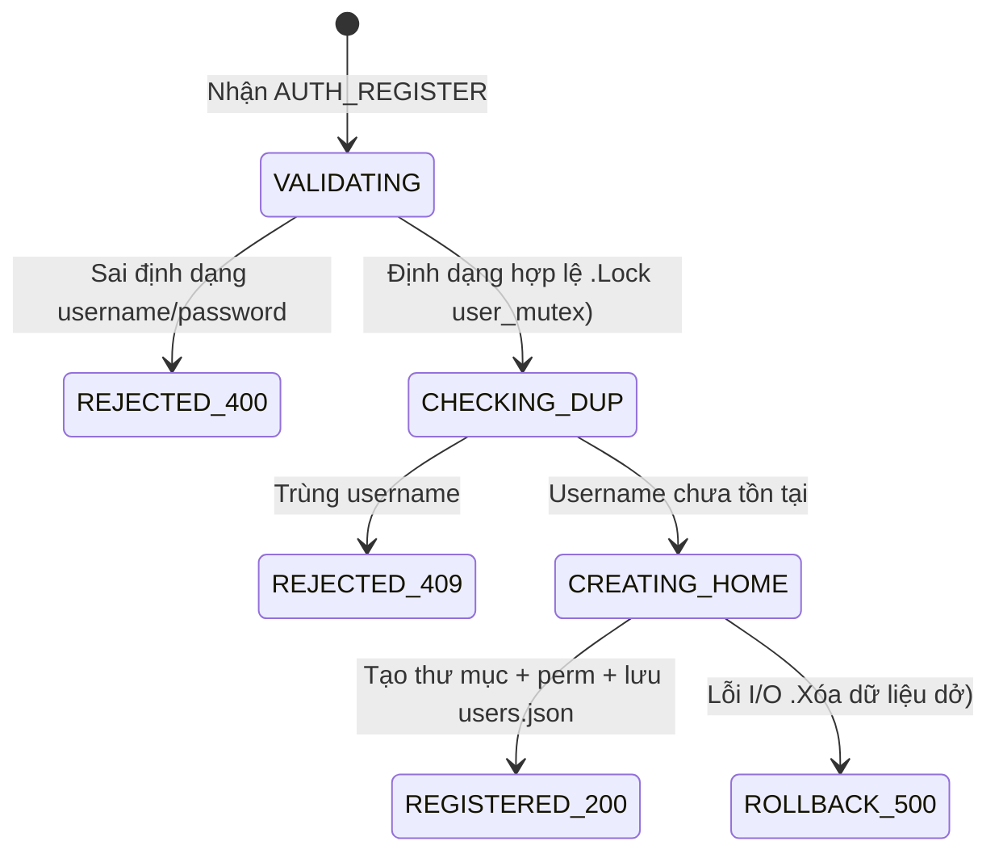
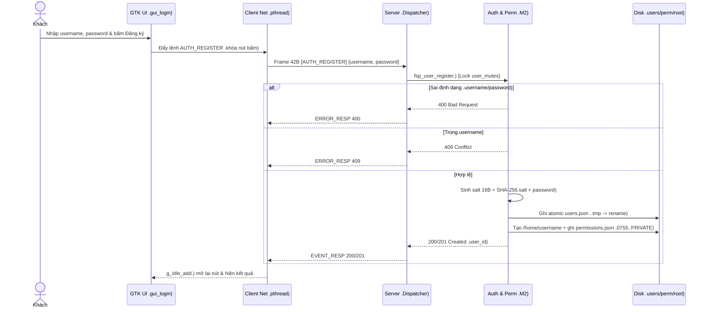
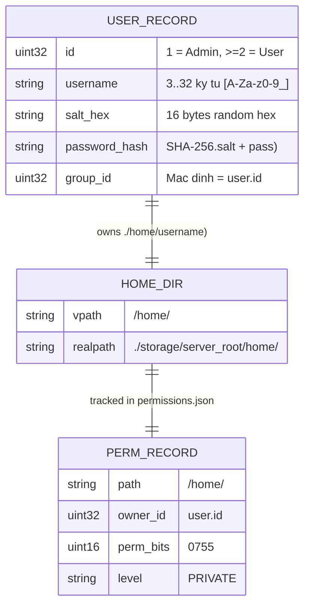

### [UC01] Đăng ký tài khoản .Account Registration)

> **Trạng thái:** `v1.0 Chính thức .Baseline) — Đã tích hợp 27 NFR chuẩn hóa`  
> **Phân hệ trực thuộc:** `M2 — Quản lý người dùng, Phiên & Phân quyền .Auth & Permissions)`  
> **Yêu cầu gốc:** `R1 .User Management: Account registration and login)` · **Ưu tiên:** `MUST`  
> **Tài liệu căn cứ:** [SRS.md].../SRS.md) .UC01, FR-1.1–FR-1.3, FR-6.2, FR-7.1), [FSPProtocol.h].../../include/common/FSPProtocol.h), [AGENTS.md].../../AGENTS.md)

---

#### 1. Định danh, Truy vết & Mục đích Nghiệp vụ Cốt lõi

| Thuộc tính | Giá trị |
| :--- | :--- |
| **Mã UC & Tên chuẩn** | `UC01`: **Đăng ký tài khoản** |
| **Sự kiện FSP** | `AUTH_REGISTER` .`FSP_EV_AUTH_REGISTER`) |
| **Mức ưu tiên** | `MUST` |
| **Module / File C dự kiến** | `fsp_user.c` .`user_register`), `fsp_sha256.c`, `fsp_perm.c`, `gui_login.c` |
| **Tác nhân chính** | Khách .`Guest`) |

##### 1.1. Mục đích Thực chất
- **Tự phục vụ tạo tài khoản .Khác FileZilla):** Cho phép người dùng mới trong mạng LAN tự đăng ký tài khoản trên server mà không cần Quản trị viên tạo thủ công.
- **Cô lập không gian lưu trữ & bảo mật mật khẩu:** Cấp phát ngay không gian cá nhân `/home/<username>` ở mức `PRIVATE` và lưu mật khẩu dưới dạng băm SHA-256 kèm salt ngẫu nhiên.

##### 1.2. Tính năng Cốt lõi
- Kiểm tra hợp lệ `username` .3–32 ký tự `[A-Za-z0-9_]`) và `password` .6–128 ký tự).
- Chống trùng `username` với mã lỗi `409 Conflict` .`FSP_STATUS_CONFLICT`).
- Tài khoản đăng ký **đầu tiên** trên server tự động mang mã user = `1` .vai trò Quản trị viên / `Admin`).
- Tự động tạo thư mục `/home/<username>` và bản ghi quyền mặc định .`owner` = user mới, `perm = 0755`, `level = PRIVATE`) trong `data/permissions.json`.

##### 1.3. Ma trận Tác động Chéo & Hiệu ứng Dây chuyền
- **Upstream:** Kết nối TCP thành công tới server .cổng mặc định `8088`).
- **Downstream:** Tạo điều kiện tiên quyết cho `UC02` .Đăng nhập), `UC04`–`UC06` .duyệt/tạo thư mục trong `/home/<username>`) và `UC13` .chia sẻ tài nguyên).
- **Concurrency:** Nhiều khách hàng đăng ký cùng lúc cùng một `username` được tuần tự hóa bằng `pthread_mutex_t` bảo vệ bảng user và `data/users.json`.

---

#### 2. Tác nhân & Ma trận Quyền

**Tác nhân:**
- **Primary Actor:** `Guest` .Khách — người mở client nhưng chưa đăng nhập).

| Hành động | Đối tượng | Ai được phép | Điều kiện | Ràng buộc cấm |
| :--- | :--- | :--- | :--- | :--- |
| `AUTH_REGISTER` | Tài khoản mới & `/home/<username>` | `Guest` .chưa cần token) | Kết nối TCP hợp lệ | Cấm trùng `username`; cấm ghi đè tài khoản đã tồn tại; cấm lưu mật khẩu plaintext |

---

#### 3. Điều kiện Tiên quyết & Sự kiện Kích hoạt
- **Preconditions:**
  - Client đã thiết lập kết nối TCP tới server .mặc định port `8088`).
  - Client đang hiển thị màn hình Đăng nhập/Đăng ký .SRS §6.1).
- **Trigger:** Khách nhập `Server`, `Port`, `Username`, `Password` và bấm nút **Đăng ký**.

---

#### 4. Điều kiện Hậu nghiệm
- **Success Guarantees:**
  - Bản ghi người dùng `{username, salt, hash, group}` được lưu bền vững vào `data/users.json` .mặc định `group = user_id`).
  - Thư mục thật `./storage/server_root/home/<username>` tồn tại trên đĩa.
  - Bản ghi quyền của `/home/<username>` .`owner` = user mới, `perm = 0755`, `level = PRIVATE`) được lưu trong `data/permissions.json`.
- **Failure Guarantees .Fail-Closed):**
  - Nếu đăng ký thất bại .trùng tên, sai định dạng, lỗi tạo thư mục), không lưu user dở dang và không tạo bản ghi quyền rác.

---

#### 5. Chuyển đổi Trạng thái & Kiểm soát Đồng thời



| Thực thể | Trạng thái đầu | Hành động | Trạng thái đích | Ràng buộc Đồng thời |
| :--- | :--- | :--- | :--- | :--- |
| Tài khoản | Chưa tồn tại | `user_register` | Đã lưu .`users.json`) | Khóa `pthread_mutex_t` khi kiểm tra trùng & ghi file |
| `/home/<username>` | Chưa tồn tại | `mkdir` + `perm_set` | `PRIVATE` .`0755`) | Khóa mutex bảng quyền khi ghi `permissions.json` |

---

#### 6. Luồng Sự kiện Chính .Happy Path)
- **Bước 1 .Client UI):** Khách nhập thông tin trên màn hình Đăng nhập/Đăng ký và bấm **Đăng ký**.
- **Bước 2 .Client Net):** Nút bấm bị vô hiệu hóa tạm thời; luồng mạng .`pthread`) đóng gói frame FSP 42 byte .`type = FSP_MSG_EVENT_REQ`, `event = "AUTH_REGISTER"`, `checksum = CRC32.payload)`) với payload JSON `{username, password}` và gửi qua `send_exact.)`.
- **Bước 3 .Server Dispatcher):** Server nhận đủ 42 byte header + `payload_len` byte qua `recv_exact.)`, kiểm tra CRC32 frame và điều phối tới handler `AUTH_REGISTER`.
- **Bước 4 .Server Auth - M2):**
  - Kiểm tra `username` .3–32 ký tự `[A-Za-z0-9_]`) và `password` .6–128 ký tự).
  - Khóa `user_mutex`, kiểm tra `username` chưa tồn tại.
  - Sinh `salt` ngẫu nhiên và tính `hash = SHA-256.salt + password)`.
  - Gán `user_id` .tài khoản đầu tiên nhận `user_id = 1` là Admin), `group = user_id`, lưu vào `data/users.json`.
- **Bước 5 .Server VFS & Perm):** Tạo `./storage/server_root/home/<username>`, ghi bản ghi quyền .`owner`, `group`, `perm = 0755`, `level = FSP_LEVEL_PRIVATE`) vào `data/permissions.json`.
- **Bước 6 .Server Response):** Trả frame `FSP_MSG_EVENT_RESP` với `status = 200` .hoặc `201`).
- **Bước 7 .Client UI):** Qua `g_idle_add.)`, luồng GTK hiển thị thông báo đăng ký thành công và cho phép người dùng đăng nhập .`UC02`).



---

#### 7. Các Luồng Thay thế Hợp lệ .Alternative Flows — AF)
- **`AF-UC01-01` .Đăng ký tài khoản đầu tiên):**
  - *Điều kiện:* Hệ thống chưa có tài khoản nào trong `data/users.json`.
  - *Xử lý:* Server cấp `user_id = 1`, tài khoản này mang quyền **Quản trị viên .Admin)** .bỏ qua kiểm tra quyền ở Bước 1 thuật toán `can_access`).

---

#### 8. Luồng Ngoại lệ & Kịch bản Đối kháng Cốt lõi .Adversarial / Error Flows — EF)
- **`EF-UC01-01` .Trùng `username` — Conflict 409):**
  - *Kịch bản:* Khách đăng ký `username` đã có trên hệ thống .hoặc 2 client đăng ký trùng tên cùng lúc).
  - *Xử lý:* Server trả `FSP_MSG_ERROR_RESP` với `status = 409` .`FSP_STATUS_CONFLICT`). Client hiển thị thông báo lỗi dễ hiểu .NFR-7).
- **`EF-UC01-02` .Dữ liệu đầu vào không hợp lệ — Bad Request 400):**
  - *Kịch bản:* `username` chứa ký tự đặc biệt .`../`, khoảng trắng) hoặc ngắn hơn 3 / dài hơn 32 ký tự; `password` ngắn hơn 6 hoặc dài hơn 128 ký tự.
  - *Xử lý:* Server từ chối với `status = 400` .`FSP_STATUS_BAD_REQUEST`), không tạo thư mục hay user.
- **`EF-UC01-03` .Lỗi hệ thống khi tạo thư mục/ghi file — 500):**
  - *Kịch bản:* Lỗi cấp phát bộ nhớ hoặc I/O đĩa khi tạo `/home/<username>`.
  - *Xử lý:* Hoàn tác bản ghi user trong bộ nhớ, trả `status = 500` .`FSP_STATUS_INTERNAL_SERVER_ERROR`).

---

#### 9. Quy tắc Nghiệp vụ & Ranh giới Cấu hình .Business Rules — BR)

| Mã Quy tắc | Nội dung Quy tắc Chi tiết | Ranh giới Kỹ thuật |
| :--- | :--- | :--- |
| `BR-UC01-01` | `username` phải dài 3–32 ký tự thuộc `[A-Za-z0-9_]`; `password` dài 6–128 ký tự .FR-1.1). | **Hardcoded** |
| `BR-UC01-02` | Mật khẩu bắt buộc băm bằng SHA-256 kèm salt ngẫu nhiên, tuyệt đối không lưu plaintext .FR-1.3). | **Hardcoded** |
| `BR-UC01-03` | Tài khoản đầu tiên .`user_id = 1`) là Admin; mỗi user mặc định có nhóm riêng `group = user_id`. | **Hardcoded** |
| `BR-UC01-04` | Đường truyền LAN không mã hóa TLS trong phạm vi đồ án .SRS §5 Giới hạn đã biết). | **Scope Boundary** |

##### 9.2. Ràng buộc Phi chức năng áp dụng .NFR Integration)
| Mã NFR | Mức | Hiện thực & Mục tiêu cụ thể trong UC01 | Cách kiểm chứng |
|:---|:-:|:---|:---|
| `NFR-A4`, `NFR-C2` | 🟢 MUST | Frame `AUTH_REGISTER` chuẩn 42B .`send_exact`/`recv_exact`); kiểm tra trùng `username` và ghi bảng user/quyền đồng bộ dưới `pthread_mutex_t`. | `test_auth_permissions` .multi-thread race register) |
| `NFR-D2`, `NFR-E3` | 🟢 MUST | Bỏ qua `SIGPIPE`, bật `SO_REUSEADDR`; mật khẩu băm `SHA-256.16B salt + pass)`, không lưu plaintext. | Kiểm tra `users.json` chỉ có `salt_hex` & `password_hash` |
| `NFR-F2`, `NFR-F3` | 🟢 MUST | Lỗi `400`/`409` hiển thị rõ nghĩa tiếng Việt; nút `[Đăng ký]` bị khóa khi đang chờ phản hồi để tránh double-submit. | Thử đăng ký trùng / mật khẩu ngắn trên GTK GUI |
| `NFR-G1`–`G3`, `NFR-H1` | 🟢 MUST | C11 POSIX thuần .`-Wall -Wextra -Wpedantic`), `clang-format`, test headless sạch dưới ASan + UBSan trên Linux/WSL2. | `ctest` build `Debug` .ASan + UBSan) trên CI |
| `NFR-A5`, `NFR-C3`, `NFR-E4`, `NFR-H2` | 🟡 SHOULD | Ghi `users.json` & `permissions.json` nguyên tử qua `.tmp + rename.)`; test đăng ký đa luồng sạch dưới TSan; chặn `\u0000` trong JSON; hỗ trợ đăng ký qua CLI test. | `test_json`, TSan run, CLI `register` |

---

#### 10. Đặc tả Dữ liệu & Wire Schema
- **FSP Header .42 byte):** `magic = 0xAA`, `type = FSP_MSG_EVENT_REQ .0x01)`, `event = "AUTH_REGISTER"`.
- **Request Payload .JSON):**
  ```json
  { "username": "an", "password": "secret_password" }
  ```
- **Response Payload .JSON):**
  ```json
  { "status": 200, "message": "Register successful" }
  ```
  .Lỗi trùng tên: `status: 409`; lỗi định dạng: `status: 400`).
- **Lưu trữ .`data/users.json`):** `{ "username", "salt", "hash", "group" }`.

---

#### 11. Yêu cầu Hành vi Giao diện GTK & CLI
- **GTK .`gui_login.c`):** Khung nhập `Server`, `Port`, `Username`, `Password` .ẩn ký tự `*`), nút `[ Đăng nhập ]`, `[ Đăng ký ]`. Trong lúc chờ server phản hồi, vô hiệu hóa nút bấm để tránh bấm đúp; lỗi hiển thị rõ bằng chữ/hộp thoại .NFR-7).
- **CLI test:** Hỗ trợ đăng ký để phục vụ kiểm thử tự động và integration test.

---

#### 12. Sự kiện Nhật ký, Lưu trữ & Điểm chạm Tích hợp
- **Lưu trữ:** Cập nhật `data/users.json`, `data/permissions.json` và tạo thư mục `./storage/server_root/home/<username>`.
- **Tích hợp:** Toàn bộ thao tác `permissions.json` đi qua module `fsp_perm.c` .M2).



---

#### 13. Tiêu chí Nghiệm thu Có thể Kiểm chứng .Acceptance Criteria — AC)
- **`AC-UC01-01`:** Given `username` hợp lệ chưa tồn tại; When gửi `AUTH_REGISTER`; Then nhận `200/201`, thư mục `./storage/server_root/home/<username>` được tạo với `perm = 0755`, `level = PRIVATE`, và `data/users.json` chỉ chứa `salt` + `hash` SHA-256.
- **`AC-UC01-02`:** Given `username` đã tồn tại; When gửi `AUTH_REGISTER` cùng `username` đó; Then server trả `409 Conflict`.
- **`AC-UC01-03`:** Given `username` chứa `../` hoặc `password` < 6 ký tự; When gửi `AUTH_REGISTER`; Then server trả `400 Bad Request`.

---

#### 14. Thiết kế Kịch bản Kiểm thử Đối kháng .Adversarial Test Probes)
- **`PROBE-UC01-01` .Duplicate & Race):** Gửi 2 yêu cầu `AUTH_REGISTER` cùng `username` đồng thời từ 2 thread → đúng 1 yêu cầu thành công .`200/201`), yêu cầu còn lại nhận `409` .SRS §9).
- **`PROBE-UC01-02` .Path Injection in Username):** Gửi `username = "../../etc"` → bị từ chối `400` ngay tại kiểm tra `[A-Za-z0-9_]`, không tạo thư mục ngoài sandbox.
- **`PROBE-UC01-03` .Memory Cleanliness):** Chạy test đăng ký dưới ASan + UBSan .`-fsanitize=address,undefined`) → không rò rỉ bộ nhớ .Probe 6).
