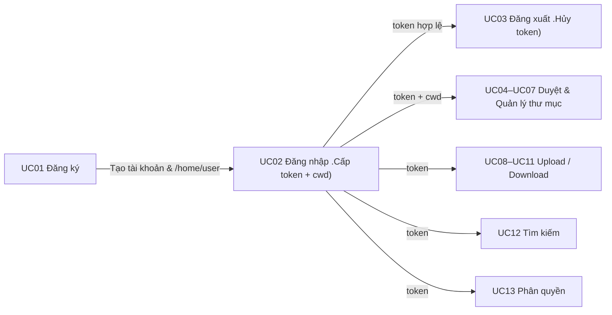
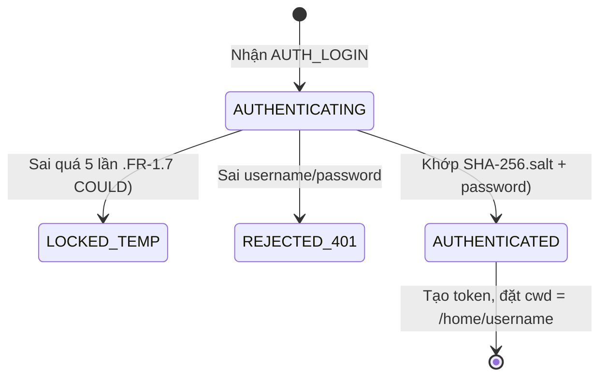
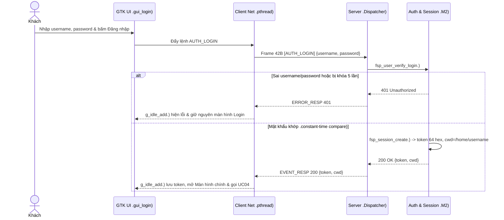

### [UC02] Đăng nhập .User Login)

> **Trạng thái:** `v1.0 Chính thức .Baseline) — Đã tích hợp 27 NFR chuẩn hóa`  
> **Phân hệ trực thuộc:** `M2 — Quản lý người dùng, Phiên & Phân quyền .Auth & Permissions)`  
> **Yêu cầu gốc:** `R1 .User Management: Account registration and login)` · **Ưu tiên:** `MUST`  
> **Tài liệu căn cứ:** [SRS.md].../SRS.md) .UC02 §3.3, FR-1.4, FR-1.6, FR-1.7, FR-7.1), [FSPProtocol.h].../../include/common/FSPProtocol.h), [AGENTS.md].../../AGENTS.md)

---

#### 1. Định danh, Truy vết & Mục đích Nghiệp vụ Cốt lõi

| Thuộc tính | Giá trị |
| :--- | :--- |
| **Mã UC & Tên chuẩn** | `UC02`: **Đăng nhập** |
| **Sự kiện FSP** | `AUTH_LOGIN` .`FSP_EV_AUTH_LOGIN`) |
| **Mức ưu tiên** | `MUST` |
| **Module / File C dự kiến** | `fsp_user.c` .`user_verify`), `fsp_session.c` .`session_create`), `gui_login.c` |
| **Tác nhân chính** | Khách .`Guest`) |

##### 1.1. Mục đích Thực chất
- Xác thực danh tính người dùng trước khi cấp quyền truy cập tài nguyên file trên server.
- Gắn kết nối TCP với một phiên làm việc có `session token` duy nhất và khởi tạo thư mục làm việc hiện tại .`cwd`) tại `/home/<username>`.

##### 1.2. Tính năng Cốt lõi
- So khớp mật khẩu bằng cách băm `SHA-256.salt + password)` với giá trị lưu trong `data/users.json`.
- Cấp phát `session token` và lưu vào bảng phiên .bảo vệ bằng `pthread_mutex_t`).
- Đặt thư mục hiện tại của phiên = `/home/<username>`.
- *.COULD)* Tự động hết hạn token sau 30 phút không hoạt động .FR-1.6) và khóa tạm tài khoản sau 5 lần sai mật khẩu liên tiếp .FR-1.7).

##### 1.3. Ma trận Tác động Chéo & Hiệu ứng Dây chuyền
- **Upstream:** Yêu cầu người dùng đã đăng ký .`UC01`).
- **Downstream:** Cung cấp `token` bắt buộc cho tất cả các Use Case từ `UC03` đến `UC13`.



---

#### 2. Tác nhân & Ma trận Quyền

**Tác nhân:**
- **Primary Actor:** `Guest` .Khách chưa đăng nhập).

| Hành động | Đối tượng | Ai được phép | Điều kiện | Ràng buộc cấm |
| :--- | :--- | :--- | :--- | :--- |
| `AUTH_LOGIN` | Phiên làm việc .`session`) | `Guest` có tài khoản hợp lệ | Sai thông tin → `401` | Không cấp token khi sai mật khẩu; không cho phép bypass xác thực |

---

#### 3. Điều kiện Tiên quyết & Sự kiện Kích hoạt
- **Preconditions:**
  - Client đã kết nối TCP tới server .port `8088`).
  - Tài khoản đã được tạo trước đó .`UC01`).
- **Trigger:** Người dùng nhập `Username`, `Password` trên màn hình Đăng nhập và bấm **Đăng nhập**.

---

#### 4. Điều kiện Hậu nghiệm
- **Success Guarantees:**
  - Kết nối/phiên gắn với một người dùng xác định; `session token` được lưu trong bảng phiên trên server và bộ nhớ client.
  - Thư mục hiện tại của phiên = `/home/<username>`.
  - Client chuyển từ màn hình Đăng nhập sang Màn hình chính .SRS §6.2).
- **Failure Guarantees:**
  - Không có `token` nào được tạo; client giữ nguyên ở màn hình Đăng nhập và hiển thị thông báo lỗi.

---

#### 5. Chuyển đổi Trạng thái & Kiểm soát Đồng thời



| Thực thể | Trạng thái đầu | Hành động | Trạng thái đích | Ràng buộc Đồng thời |
| :--- | :--- | :--- | :--- | :--- |
| Phiên .`Session`) | Chưa có | `session_create` | Hoạt động .`token` hợp lệ) | Khóa `session_mutex` khi thêm vào bảng phiên |

---

#### 6. Luồng Sự kiện Chính .Happy Path)
- **Bước 1 .Client UI):** Khách nhập `Server`, `Port`, `Username`, `Password` và bấm **Đăng nhập**.
- **Bước 2 .Client Net):** Vô hiệu hóa nút bấm; gửi frame `FSP_MSG_EVENT_REQ` sự kiện `AUTH_LOGIN` với JSON `{username, password}`.
- **Bước 3 .Server Auth - M2):** Server tìm `username` trong danh sách user, tính `SHA-256.salt + password)` và so khớp với `hash` đã lưu .`user_verify`).
- **Bước 4 .Server Session):** Tạo `session token` ngẫu nhiên, lưu phiên vào bảng phiên với `cwd = "/home/<username>"`.
- **Bước 5 .Server Response):** Trả `FSP_MSG_EVENT_RESP` mã `200 OK` kèm `token` và `cwd`.
- **Bước 6 .Client UI):** Lưu `token`, chuyển sang Màn hình chính .2 ngăn Local / Remote) qua `g_idle_add.)` và tự động gọi `DIR_LIST` .`UC04`) cho `/home/<username>`.



---

#### 7. Các Luồng Thay thế Hợp lệ .Alternative Flows — AF)
- **`AF-UC02-01` .Đăng nhập bằng CLI test client):**
  - Thực hiện lệnh `login <username> <password>` trong `cli_main.c` → gửi `AUTH_LOGIN` và lưu `token` cho các lệnh `ls`, `cd`, `put`, `get`, `find`, `chmod` tiếp theo.

---

#### 8. Luồng Ngoại lệ & Kịch bản Đối kháng Cốt lõi .Adversarial / Error Flows — EF)
- **`EF-UC02-01` .Sai `username` hoặc `password` — 401):**
  - *Xử lý:* Server trả `401` .`FSP_STATUS_UNAUTHORIZED`). Client hiển thị thông báo *"Sai tên đăng nhập hoặc mật khẩu"* .SRS §6.1, NFR-7) và ở lại màn hình đăng nhập.
- **`EF-UC02-02` .Gửi yêu cầu nghiệp vụ không token / token giả — 401):**
  - *Xử lý:* Mọi yêu cầu .trừ `AUTH_REGISTER`, `AUTH_LOGIN`) thiếu `token` hoặc `token` không có trong bảng phiên đều bị từ chối với mã `401`.
- **`EF-UC02-03` .Khóa tạm tài khoản sau 5 lần sai — COULD FR-1.7):**
  - *Xử lý:* Từ chối đăng nhập tạm thời khi vượt ngưỡng sai liên tiếp.

---

#### 9. Quy tắc Nghiệp vụ & Ranh giới Cấu hình .Business Rules — BR)

| Mã Quy tắc | Nội dung Quy tắc Chi tiết | Ranh giới Kỹ thuật |
| :--- | :--- | :--- |
| `BR-UC02-01` | Mọi yêu cầu trừ `AUTH_REGISTER`/`AUTH_LOGIN` bắt buộc phải có `token` hợp lệ .FR-1.4). | **Hardcoded** |
| `BR-UC02-02` | Token tự hết hạn sau 30 phút không hoạt động .FR-1.6 — COULD). | **Configurable** .30 phút) |
| `BR-UC02-03` | Khóa tạm tài khoản sau 5 lần nhập sai liên tiếp .FR-1.7 — COULD). | **Configurable** .5 lần) |

##### 9.2. Ràng buộc Phi chức năng áp dụng .NFR Integration)
| Mã NFR | Mức | Hiện thực & Mục tiêu cụ thể trong UC02 | Cách kiểm chứng |
|:---|:-:|:---|:---|
| `NFR-A4`, `NFR-C1`, `NFR-C2` | 🟢 MUST | Phục vụ đồng thời ≥ 5 client đăng nhập qua `1 thread/client`; bảng `session` & `user` khóa `pthread_mutex_t` không race. | `test_network_core`, test 5 client đăng nhập song song |
| `NFR-D2`, `NFR-E2`, `NFR-E3` | 🟢 MUST | Fail-Closed: sai mật khẩu/thiếu token → `401`; so sánh hash constant-time .`fsp_constant_time_memcmp`). | Probe 2 .`test_auth_permissions`) |
| `NFR-F2`, `NFR-F3` | 🟢 MUST | Hiển thị thông điệp *"Sai tên đăng nhập hoặc mật khẩu"*; vô hiệu hóa nút `[Đăng nhập]` khi đang chờ server. | Kiểm tra màn hình Login GTK |
| `NFR-G1`–`G3`, `NFR-H1` | 🟢 MUST | C11 POSIX thuần, `clang-format`, test headless sạch dưới ASan + UBSan trên Linux/WSL2. | CI `build-and-test` |
| `NFR-C3`, `NFR-E4`, `NFR-H2` | 🟡 SHOULD | Khóa tạm 5 phút sau 5 lần sai, token hết hạn sau 30 phút không hoạt động, chặn `\u0000` JSON; sạch dưới TSan; hỗ trợ CLI `login`. | `test_auth_permissions` .lockout + TTL 30p), TSan |

---

#### 10. Đặc tả Dữ liệu & Wire Schema
- **FSP Header .42 byte):** `type = FSP_MSG_EVENT_REQ .0x01)`, `event = "AUTH_LOGIN"`.
- **Request Payload .JSON):**
  ```json
  { "username": "an", "password": "secret_password" }
  ```
- **Response Payload .JSON):**
  ```json
  { "status": 200, "token": "<session_token>", "cwd": "/home/an" }
  ```

---

#### 11. Yêu cầu Hành vi Giao diện GTK & CLI
- Vô hiệu hóa nút `[ Đăng nhập ]` khi đang chờ phản hồi mạng.
- Lỗi hiển thị ngay tại vùng thông báo trên màn hình đăng nhập .SRS §6.1), không chỉ hiện mã số `401` .NFR-7).

---

#### 12. Sự kiện Nhật ký, Lưu trữ & Điểm chạm Tích hợp
- Bảng phiên trên RAM được bảo vệ bởi mutex; đọc thông tin user từ `data/users.json`.
- Khi chuyển sang màn hình chính, vùng nhật ký ghi nhận dòng kết nối/đăng nhập thành công.

---

#### 13. Tiêu chí Nghiệm thu Có thể Kiểm chứng .Acceptance Criteria — AC)
- **`AC-UC02-01`:** Given tài khoản đã đăng ký; When gửi `AUTH_LOGIN` đúng mật khẩu; Then nhận `200 OK` kèm `token` hợp lệ và `cwd = "/home/<username>"`.
- **`AC-UC02-02`:** Given sai mật khẩu hoặc sai `username`; When gửi `AUTH_LOGIN`; Then nhận `401` và không tạo phiên.
- **`AC-UC02-03`:** Given chưa đăng nhập hoặc dùng token giả; When gọi `DIR_LIST`; Then server trả `401`.

---

#### 14. Thiết kế Kịch bản Kiểm thử Đối kháng .Adversarial Test Probes)
- **`PROBE-UC02-01` .Probe 2 — Token giả / Không token):** Gọi các sự kiện được bảo vệ với `token = ""` hoặc `token = "fake_token_123"` → tất cả trả `401` .`FSP_STATUS_UNAUTHORIZED`).
- **`PROBE-UC02-02` .Concurrent Logins):** 5 client đăng nhập đồng thời → tất cả nhận 5 `token` độc lập, không ghi đè phiên của nhau .NFR-3).
