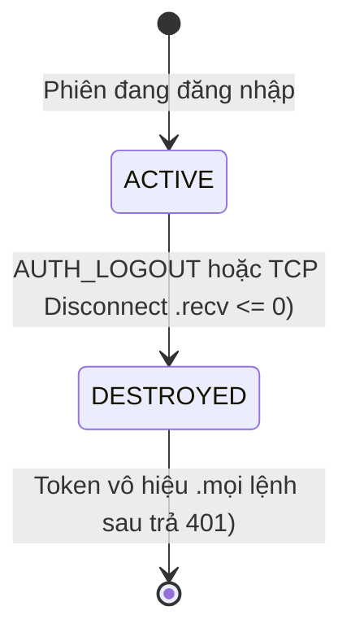
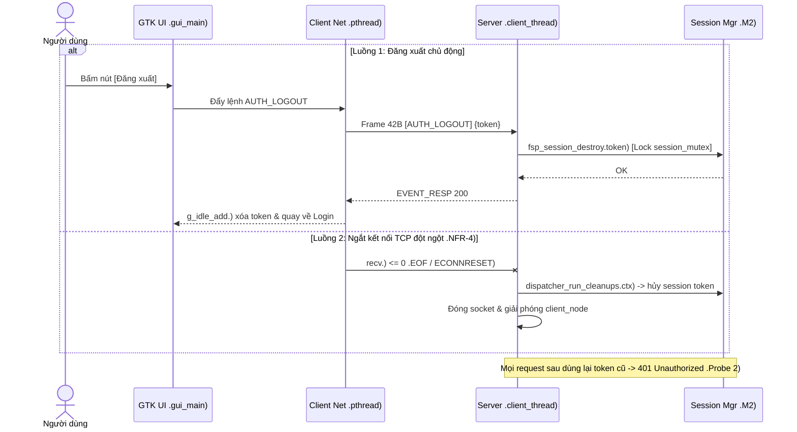

### [UC03] Đăng xuất .User Logout)

> **Trạng thái:** `v1.0 Chính thức .Baseline) — Đã tích hợp 27 NFR chuẩn hóa`  
> **Phân hệ trực thuộc:** `M2 — Quản lý người dùng, Phiên & Phân quyền .Auth & Permissions)`  
> **Yêu cầu gốc:** `R1 .User Management)` · **Ưu tiên:** `MUST`  
> **Tài liệu căn cứ:** [SRS.md].../SRS.md) .UC03, FR-1.5, NFR-4), [FSPProtocol.h].../../include/common/FSPProtocol.h), [AGENTS.md].../../AGENTS.md)

---

#### 1. Định danh, Truy vết & Mục đích Nghiệp vụ Cốt lõi

| Thuộc tính | Giá trị |
| :--- | :--- |
| **Mã UC & Tên chuẩn** | `UC03`: **Đăng xuất** |
| **Sự kiện FSP** | `AUTH_LOGOUT` .`FSP_EV_AUTH_LOGOUT`) |
| **Mức ưu tiên** | `MUST` |
| **Module / File C dự kiến** | `fsp_session.c` .`session_destroy`), `server_main.c`, `gui_main.c` |
| **Tác nhân chính** | Người dùng .`User`), Quản trị viên .`Admin`) |

##### 1.1. Mục đích Thực chất
- Kết thúc phiên làm việc một cách chủ động và thu hồi ngay hiệu lực của `session token`, ngăn chặn tái sử dụng token cũ.
- Bảo đảm khi client ngắt kết nối đột ngột, server cũng tự động hủy phiên và dọn tài nguyên .fail-closed).

##### 1.2. Tính năng Cốt lõi
- Hủy `token` khỏi bảng phiên khi nhận `AUTH_LOGOUT`.
- Tự động hủy `token` và đóng kết nối khi `recv.)`/`send.)` trả về `<= 0` .ngắt kết nối TCP).

##### 1.3. Ma trận Tác động Chéo & Hiệu ứng Dây chuyền
- **Upstream:** Phiên đang hoạt động từ `UC02`.
- **Downstream:** Mọi yêu cầu sau khi đăng xuất dùng token cũ đều bị chặn `401`; nếu đang upload dở mà ngắt kết nối thì file `.part` bị xóa .`UC08`).

---

#### 2. Tác nhân & Ma trận Quyền

| Hành động | Đối tượng | Ai được phép | Điều kiện | Ràng buộc cấm |
| :--- | :--- | :--- | :--- | :--- |
| `AUTH_LOGOUT` | Phiên hiện tại | `User`, `Admin` | Có `token` hợp lệ của chính phiên đó | Không thể dùng token cũ sau khi đã hủy |

---

#### 3. Điều kiện Tiên quyết & Sự kiện Kích hoạt
- **Preconditions:** Người dùng đã đăng nhập .`UC02`) và đang giữ `token` hợp lệ.
- **Trigger:** Người dùng bấm nút **[Đăng xuất]** trên thanh tiêu đề Màn hình chính .SRS §6.2) hoặc đóng kết nối TCP.

---

#### 4. Điều kiện Hậu nghiệm
- **Success Guarantees:**
  - `session token` bị xóa khỏi bảng phiên trên server.
  - Client xóa `token` cục bộ và quay về Màn hình Đăng nhập .SRS §6.1).
- **Disconnect Guarantees .NFR-4):**
  - Ngắt kết nối TCP đột ngột vẫn giải phóng phiên, bộ nhớ thread và xóa file `.part` nếu có.

---

#### 5. Chuyển đổi Trạng thái & Kiểm soát Đồng thời

---

#### 6. Luồng Sự kiện Chính .Happy Path)
- **Bước 1 .Client UI):** Người dùng bấm **[Đăng xuất]** trên Màn hình chính.
- **Bước 2 .Client Net):** Gửi frame `FSP_MSG_EVENT_REQ` sự kiện `AUTH_LOGOUT` kèm `token`.
- **Bước 3 .Server Session):** Xác thực `token`, khóa `session_mutex`, xóa bản ghi phiên khỏi bảng phiên .`session_destroy`).
- **Bước 4 .Server Response):** Trả `200 OK` .`FSP_MSG_EVENT_RESP`).
- **Bước 5 .Client UI):** Xóa `token` lưu trên client, đóng Màn hình chính và mở lại Màn hình Đăng nhập qua `g_idle_add.)`.

---

#### 7. Các Luồng Thay thế Hợp lệ .Alternative Flows — AF)
- **`AF-UC03-01` .Ngắt kết nối TCP không gửi `AUTH_LOGOUT`):**
  - *Điều kiện:* Client tắt đột ngột hoặc rớt mạng, `recv.)` trả về `<= 0` .khác `EINTR`).
  - *Xử lý:* Worker thread trên server dọn dẹp phiên .`session_destroy`), hủy phiên truyền dở/xóa `.part` .nếu có), đóng socket và kết thúc thread an toàn.

---

#### 8. Luồng Ngoại lệ & Kịch bản Đối kháng Cốt lõi .Adversarial / Error Flows — EF)
- **`EF-UC03-01` .Dùng lại token sau khi đã đăng xuất — Probe 2):**
  - *Kịch bản:* Client gửi lại lệnh .ví dụ `DIR_LIST`) với `token` đã gọi `AUTH_LOGOUT`.
  - *Xử lý:* Server không tìm thấy token trong bảng phiên → trả `401` .`FSP_STATUS_UNAUTHORIZED`).

---

#### 9. Quy tắc Nghiệp vụ & Ranh giới Cấu hình .Business Rules — BR)

| Mã Quy tắc | Nội dung Quy tắc Chi tiết | Ranh giới Kỹ thuật |
| :--- | :--- | :--- |
| `BR-UC03-01` | Đăng xuất hoặc ngắt kết nối TCP đều phải hủy token ngay lập tức .FR-1.5). | **Hardcoded** |
| `BR-UC03-02` | `recv.)`/`send.)` trả về `<= 0` .trừ `EINTR`) bắt buộc đóng kết nối, giải phóng phiên .Fail-Closed). | **Hardcoded** |

##### 9.2. Ràng buộc Phi chức năng áp dụng .NFR Integration)
| Mã NFR | Mức | Hiện thực & Mục tiêu cụ thể trong UC03 | Cách kiểm chứng |
|:---|:-:|:---|:---|
| `NFR-A4`, `NFR-C2` | 🟢 MUST | Hủy phiên dưới khóa `session_mutex` an toàn khi nhiều client logout/ngắt kết nối cùng lúc. | `test_auth_permissions`, `test_network_core` |
| `NFR-D1`, `NFR-D2`, `NFR-E2` | 🟢 MUST | Client ngắt TCP đột ngột không làm sập server .`SIGPIPE` ignored), `dispatcher_run_cleanups` hủy token trong < 1s; dùng lại token cũ → `401`. | Probe 2 + đóng socket đột ngột giữa phiên |
| `NFR-G1`–`G3`, `NFR-H1` | 🟢 MUST | Giải phóng sạch `client_node_t`, đóng `fd`, 0 leak dưới ASan + UBSan. | `ctest` Debug ASan/UBSan |
| `NFR-D3`, `NFR-H2` | 🟡 SHOULD | Đặt `SO_RCVTIMEO = 30s` .`FSP_SOCKET_TIMEOUT_S`) / `PING`/`PONG` để tự thu hồi kết nối treo im lặng; hỗ trợ CLI `logout`. | Mở kết nối `nc` im lặng > 30s → tự đóng |

---

#### 10. Đặc tả Dữ liệu & Wire Schema
- **FSP Header .42 byte):** `type = FSP_MSG_EVENT_REQ .0x01)`, `event = "AUTH_LOGOUT"`.
- **Request Payload .JSON):** `{ "token": "<session_token>" }`
- **Response Payload .JSON):** `{ "status": 200, "message": "Logged out" }`

---

#### 11. Yêu cầu Hành vi Giao diện GTK & CLI
- Sau khi bấm **[Đăng xuất]**, màn hình chính đóng sạch và quay về màn hình Đăng nhập.

---

#### 12. Sự kiện Nhật ký, Lưu trữ & Điểm chạm Tích hợp
- Giải phóng bộ nhớ phiên và đóng file descriptor socket ở `client_thread` trong `server_main.c`.

---

#### 13. Tiêu chí Nghiệm thu Có thể Kiểm chứng .Acceptance Criteria — AC)
- **`AC-UC03-01`:** Given phiên đang hợp lệ; When gọi `AUTH_LOGOUT`; Then nhận `200 OK` và mọi lệnh tiếp theo dùng lại `token` cũ đều bị từ chối `401`.
- **`AC-UC03-02`:** Given client ngắt kết nối TCP đột ngột; When server phát hiện `recv.) <= 0`; Then phiên bị hủy, server không sập và các client khác vẫn hoạt động.

---

#### 14. Thiết kế Kịch bản Kiểm thử Đối kháng .Adversarial Test Probes)
- **`PROBE-UC03-01` .Probe 2 — Replay Old Token):** Thực hiện `AUTH_LOGIN` → `AUTH_LOGOUT` → gọi `DIR_PWD` với `token` cũ → phải nhận `401`.
- **`PROBE-UC03-02` .Disconnect Cleanup):** Đóng socket client đột ngột trong khi vẫn còn 4 client khác đang kết nối → server không crash, chạy sạch dưới ASan/UBSan.
