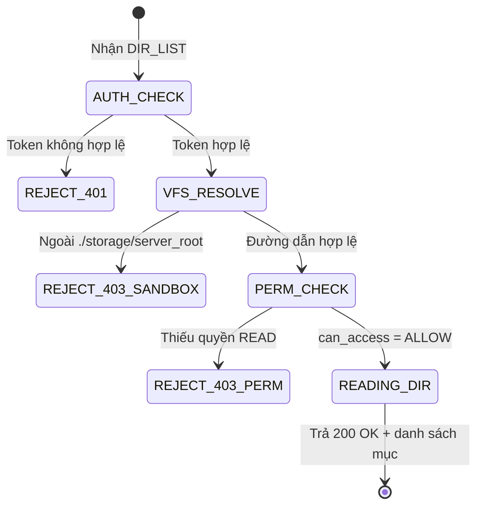
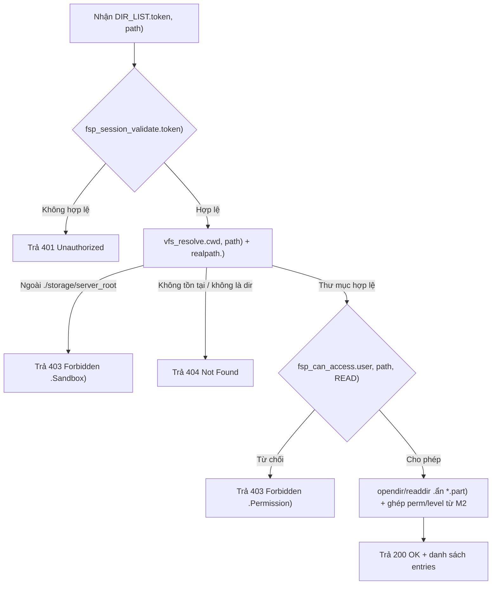
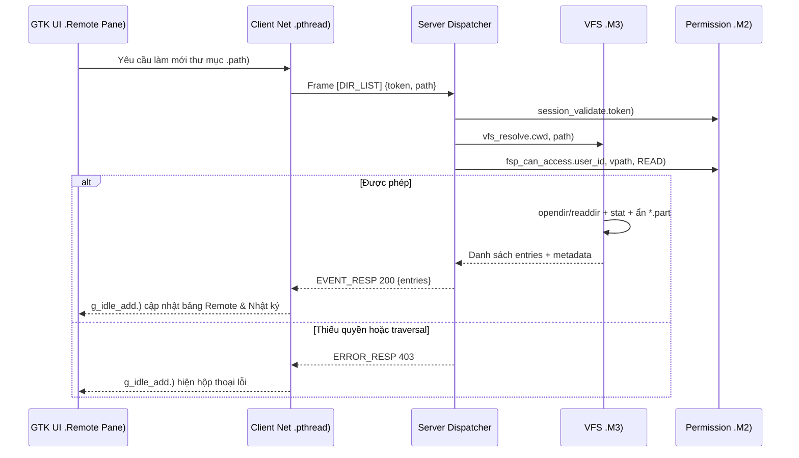

### [UC04] Liệt kê nội dung thư mục .`ls`)

> **Trạng thái:** `v1.0 Chính thức .Baseline) — Đã tích hợp 27 NFR chuẩn hóa`  
> **Phân hệ trực thuộc:** `M3 — Hệ thống tệp ảo & Truyền dữ liệu .VFS & Transfer)`  
> **Yêu cầu gốc:** `R2 .File Management Commands — similar to FTP LIST)` · **Ưu tiên:** `MUST`  
> **Tài liệu căn cứ:** [SRS.md].../SRS.md) .FR-2.1, FR-6.1, FR-7.2, NFR-5), [FSPProtocol.h].../../include/common/FSPProtocol.h), [AGENTS.md].../../AGENTS.md)

---

#### 1. Định danh, Truy vết & Mục đích Nghiệp vụ Cốt lõi

| Thuộc tính | Giá trị |
| :--- | :--- |
| **Mã UC & Tên chuẩn** | `UC04`: **Liệt kê nội dung thư mục .`ls`)** |
| **Sự kiện FSP** | `DIR_LIST` .`FSP_EV_DIR_LIST`) |
| **Mức ưu tiên** | `MUST` |
| **Module / File C dự kiến** | `fsp_vfs.c` .`vfs_resolve`, `vfs_list`), `fsp_perm.c` .`perm_can_access`), `gui_main.c` |
| **Tác nhân chính** | Người dùng .`User`), Quản trị viên .`Admin`) |

##### 1.1. Mục đích Thực chất
- Hiển thị danh sách file và thư mục con trên server .ngăn Remote) kèm đầy đủ metadata về quyền kiểu Linux và mức chia sẻ để người dùng thao tác tương tự FileZilla.

##### 1.2. Tính năng Cốt lõi
- Trả về tên, loại .file/thư mục), kích thước, thời gian sửa, chủ sở hữu .`owner`), quyền .`perm`), mức chia sẻ .`level`).
- Kiểm tra an toàn đường dẫn .`vfs_resolve`) và quyền `READ` trên thư mục đích .`can_access`).

##### 1.3. Ma trận Tác động Chéo & Hiệu ứng Dây chuyền
- **Upstream:** Phiên đăng nhập hợp lệ .`UC02`).
- **Downstream:** Được gọi tự động để làm mới ngăn Remote sau `UC02`, `UC05`, `UC06`, `UC07`, `UC08`, `UC10`, `UC13`.

---

#### 2. Tác nhân & Ma trận Quyền

| Hành động | Đối tượng | Ai được phép | Điều kiện .`can_access`) | Ràng buộc cấm |
| :--- | :--- | :--- | :--- | :--- |
| `DIR_LIST` | Thư mục trên server | `User`, `Admin` | Vượt qua `can_access.user, path, FSP_ACCESS_READ)` | Cấm liệt kê ngoài `./storage/server_root`; từ chối `403` nếu không có quyền `READ` |

---

#### 3. Điều kiện Tiên quyết & Sự kiện Kích hoạt
- **Preconditions:** Đã đăng nhập .`token` hợp lệ); thư mục đích tồn tại và người dùng có quyền `READ`.
- **Trigger:** Mở Màn hình chính, nhấp đúp thư mục ở ngăn Remote, đổi thư mục .`UC05`) hoặc làm mới danh sách.

---

#### 4. Điều kiện Hậu nghiệm
- **Success Guarantees:** Client nhận danh sách mục và cập nhật bảng ngăn Remote .Tên, Kích thước, Quyền dạng `rwsr-s`, Mức `PRV`/`SHR`/`PUB`).
- **Failure Guarantees:** Không tiết lộ nội dung thư mục không có quyền đọc hoặc nằm ngoài sandbox.

---

#### 5. Chuyển đổi Trạng thái & Kiểm soát Đồng thời



---

#### 6. Luồng Sự kiện Chính .Happy Path)
- **Bước 1 .Client):** Gửi frame `FSP_MSG_EVENT_REQ` sự kiện `DIR_LIST` kèm `token` và `path` .nếu rỗng dùng `cwd` hiện tại của phiên).
- **Bước 2 .Server Session):** Xác thực `token` để lấy `user` và `cwd`.
- **Bước 3 .Server VFS):** Gọi `vfs_resolve` chuẩn hóa đường dẫn ảo, kiểm tra `realpath.)` nằm trong tiền tố `./storage/server_root`.
- **Bước 4 .Server Perm):** Gọi `perm_can_access.user, target_path, FSP_ACCESS_READ)`.
- **Bước 5 .Server Read):** Duyệt thư mục bằng `opendir`/`readdir`, ghép metadata file .`stat`) với metadata quyền .`owner`, `perm`, `level` từ `permissions.json`).
- **Bước 6 .Server Response):** Trả `200 OK` với mảng JSON các mục.
- **Bước 7 .Client UI):** Cập nhật bảng ngăn Remote và ghi nhật ký .`> DIR_LIST ... 200 OK`).





---

#### 7. Các Luồng Thay thế Hợp lệ .Alternative Flows — AF)
- **`AF-UC04-01` .Thư mục rỗng):**
  - *Xử lý:* Server trả `200 OK` với danh sách rỗng `[]`. Ngăn Remote hiển thị trống.

---

#### 8. Luồng Ngoại lệ & Kịch bản Đối kháng Cốt lõi .Adversarial / Error Flows — EF)
- **`EF-UC04-01` .Path Traversal — Probe 5):**
  - *Kịch bản:* Client gửi `path = "../../../../etc"`.
  - *Xử lý:* `vfs_resolve` phát hiện vượt biên `./storage/server_root` → trả `403` .`FSP_STATUS_FORBIDDEN`).
- **`EF-UC04-02` .Không có quyền `READ` — 403):**
  - *Kịch bản:* User B gửi `DIR_LIST` tới `/home/an` .`PRIVATE`).
  - *Xử lý:* `can_access` trả từ chối ở bước 3 → trả `403`.
- **`EF-UC04-03` .Thư mục không tồn tại — 404):**
  - *Xử lý:* Trả `404` .`FSP_STATUS_NOT_FOUND`).

---

#### 9. Quy tắc Nghiệp vụ & Ranh giới Cấu hình .Business Rules — BR)

| Mã Quy tắc | Nội dung Quy tắc Chi tiết | Ranh giới Kỹ thuật |
| :--- | :--- | :--- |
| `BR-UC04-01` | Client chỉ thấy đường dẫn ảo bắt đầu bằng `/`; server ánh xạ `/` → `./storage/server_root`. | **Hardcoded** |
| `BR-UC04-02` | Bắt buộc kiểm tra `can_access...., READ)` trước khi đọc nội dung thư mục .FR-6.1). | **Hardcoded** |

##### 9.2. Ràng buộc Phi chức năng áp dụng .NFR Integration)
| Mã NFR | Mức | Hiện thực & Mục tiêu cụ thể trong UC04 | Cách kiểm chứng |
|:---|:-:|:---|:---|
| `NFR-A4`, `NFR-B2`, `NFR-C2` | 🟢 MUST | Frame `DIR_LIST` chuẩn 42B, kiểm tra `payload_len <= 128 KB`; đọc bảng quyền dưới `perm_mutex`. | `test_packet`, `test_vfs` |
| `NFR-E1`, `NFR-E2` | 🟢 MUST | `vfs_resolve` + `realpath.)` chặn thoát `./storage/server_root`; bắt buộc `token` .`401`) và `READ` .`403`); ẩn file `*.part`. | Probe 5 + Probe 3 trên `DIR_LIST` |
| `NFR-F1`, `NFR-F2` | 🟢 MUST | Gọi `DIR_LIST` qua luồng mạng `pthread` + `g_idle_add.)`, không làm đơ ngăn Local; lỗi `403`/`404` hiện thông báo rõ. | Kiểm thử trên GTK 3 |
| `NFR-G1`–`G3`, `NFR-H1` | 🟢 MUST | C11 POSIX .`opendir`/`readdir`), 0 leak dưới ASan + UBSan. | `ctest` Debug ASan/UBSan |
| `NFR-B3`, `NFR-F4`, `NFR-H2` | 🟡 SHOULD | Phản hồi ≤ 1 giây trên LAN .kho < 1.000 file); ghi dòng nhật ký `> DIR_LIST ... 200 OK`; hỗ trợ CLI `ls`. | Đo thời gian CLI `ls` |

---

#### 10. Đặc tả Dữ liệu & Wire Schema
- **FSP Header .42 byte):** `type = FSP_MSG_EVENT_REQ .0x01)`, `event = "DIR_LIST"`.
- **Request Payload .JSON):** `{ "token": "...", "path": "/home/an" }`
- **Response Payload .JSON):**
  ```json
  {
    "status": 200,
    "entries": [
      { "name": "BaoCao", "type": "dir", "size": 0, "mtime": 1700000000, "owner": "an", "perm": "0755", "level": "SHARED" }
    ]
  }
  ```

---

#### 11. Yêu cầu Hành vi Giao diện GTK & CLI
- **GTK .`gui_main.c`):** Bảng ngăn Remote hiển thị cột `Tên`, `Kích thước`, `Quyền` .`rwsr-s`), `Mức` .`PRV`/`SHR`/`PUB`).
- **CLI:** Lệnh `ls [path]`.

---

#### 12. Sự kiện Nhật ký, Lưu trữ & Điểm chạm Tích hợp
- Ghi dòng nhật ký ở vùng Nhật ký trên Màn hình chính .FR-7.7 — SHOULD): `> DIR_LIST /home/an ... 200 OK .N mục)`.

---

#### 13. Tiêu chí Nghiệm thu Có thể Kiểm chứng .Acceptance Criteria — AC)
- **`AC-UC04-01`:** Given user có quyền `READ`; When gọi `DIR_LIST`; Then nhận `200 OK` kèm đầy đủ 7 trường metadata của từng mục.
- **`AC-UC04-02`:** Given đường dẫn ngoài sandbox; When gọi `DIR_LIST`; Then nhận `403 Forbidden`.

---

#### 14. Thiết kế Kịch bản Kiểm thử Đối kháng .Adversarial Test Probes)
- **`PROBE-UC04-01` .Probe 5 — Traversal):** Gửi `DIR_LIST` với `../../../../etc` và `/home/an/../../../etc` → đều trả `403`.
- **`PROBE-UC04-02` .Unauthorized Read):** User không được chia sẻ gọi `DIR_LIST` vào thư mục `PRIVATE` của user khác → trả `403`.
