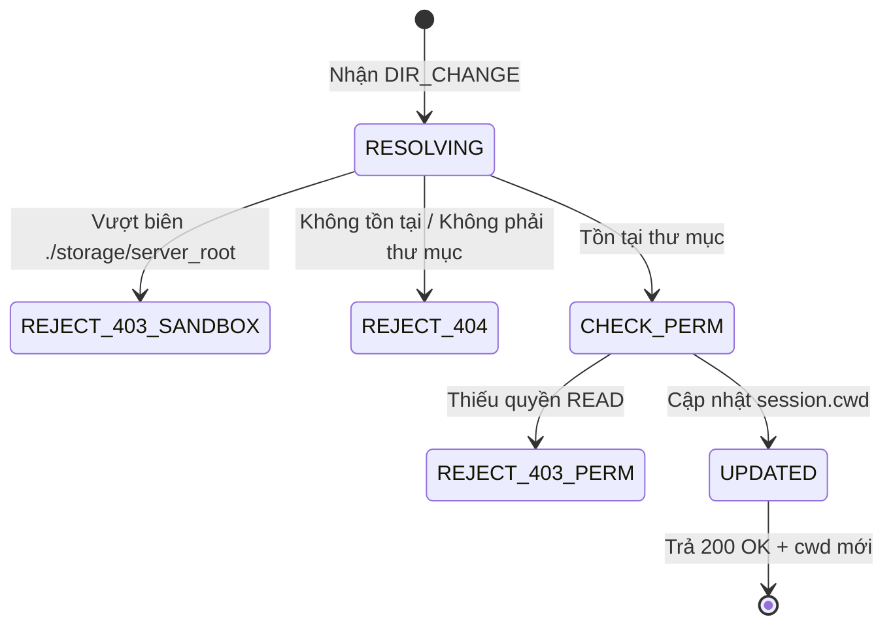
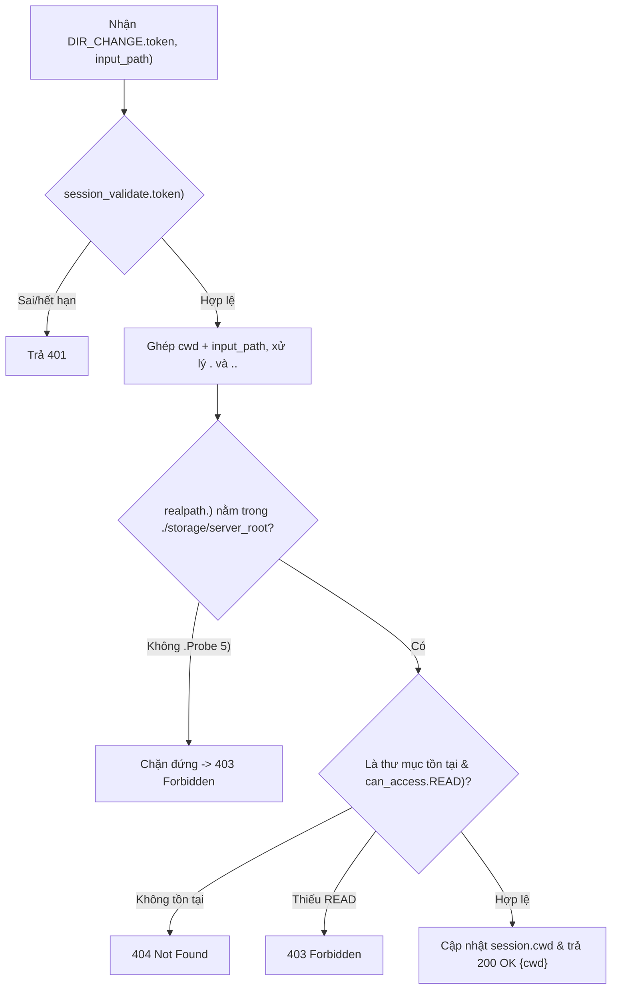
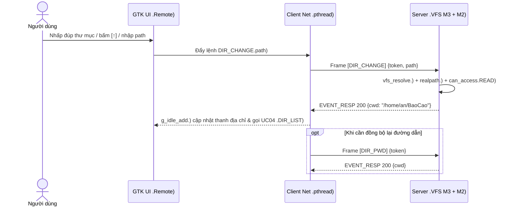

### [UC05] Đổi thư mục hiện tại .`cd`, `pwd`)

> **Trạng thái:** `v1.0 Chính thức .Baseline) — Đã tích hợp 27 NFR chuẩn hóa`  
> **Phân hệ trực thuộc:** `M3 — Hệ thống tệp ảo & Truyền dữ liệu .VFS & Transfer)`  
> **Yêu cầu gốc:** `R2 .File Management Commands — similar to FTP CWD, PWD)` · **Ưu tiên:** `MUST`  
> **Tài liệu căn cứ:** [SRS.md].../SRS.md) .FR-2.2, FR-2.3, FR-6.1, FR-7.2, NFR-5), [FSPProtocol.h].../../include/common/FSPProtocol.h), [AGENTS.md].../../AGENTS.md)

---

#### 1. Định danh, Truy vết & Mục đích Nghiệp vụ Cốt lõi

| Thuộc tính | Giá trị |
| :--- | :--- |
| **Mã UC & Tên chuẩn** | `UC05`: **Đổi thư mục hiện tại .`cd`, `pwd`)** |
| **Sự kiện FSP** | `DIR_CHANGE` .`FSP_EV_DIR_CHANGE`), `DIR_PWD` .`FSP_EV_DIR_PWD`) |
| **Mức ưu tiên** | `MUST` |
| **Module / File C dự kiến** | `fsp_vfs.c` .`vfs_resolve`), `fsp_session.c`, `gui_main.c` |
| **Tác nhân chính** | Người dùng .`User`), Quản trị viên .`Admin`) |

##### 1.1. Mục đích Thực chất
- Duy trì và điều hướng vị trí thư mục làm việc hiện tại .`cwd`) của phiên trên server, hỗ trợ đường dẫn tuyệt đối, tương đối và `..` giống lệnh `CWD`/`PWD` của FTP.
- Bảo đảm mọi thao tác điều hướng .`cd ../../..`) luôn bị chặn cứng trong sandbox `./storage/server_root`.

##### 1.2. Tính năng Cốt lõi
- `DIR_CHANGE`: Chuẩn hóa đường dẫn đích, kiểm tra tồn tại là thư mục, kiểm tra quyền `READ`, cập nhật `cwd` của phiên.
- `DIR_PWD`: Trả về đường dẫn ảo hiện tại .ví dụ `/home/an/BaoCao`).

##### 1.3. Ma trận Tác động Chéo & Hiệu ứng Dây chuyền
- **Upstream:** Phiên đăng nhập .`UC02`) khởi tạo `cwd = /home/<username>`.
- **Downstream:** Làm đường dẫn gốc mặc định cho `UC04` .`DIR_LIST`), `UC06` .`DIR_MKDIR`), `UC08`–`UC11` .upload/download theo đường dẫn tương đối).

---

#### 2. Tác nhân & Ma trận Quyền

| Hành động | Đối tượng | Ai được phép | Điều kiện .`can_access`) | Ràng buộc cấm |
| :--- | :--- | :--- | :--- | :--- |
| `DIR_CHANGE` | Thư mục đích | `User`, `Admin` | `can_access.user, target_path, FSP_ACCESS_READ)` | Cấm thoát khỏi `/` ảo .`./storage/server_root`) |
| `DIR_PWD` | Phiên hiện tại | `User`, `Admin` | `token` hợp lệ | Không tiết lộ đường dẫn thật trên hệ điều hành server |

---

#### 3. Điều kiện Tiên quyết & Sự kiện Kích hoạt
- **Preconditions:** Người dùng đã đăng nhập .`token` hợp lệ).
- **Trigger:** Người dùng nhấp đúp thư mục ở ngăn Remote, bấm nút lên thư mục cha `[↑]`, hoặc nhập đường dẫn vào ô địa chỉ Remote .SRS §6.2).

---

#### 4. Điều kiện Hậu nghiệm
- **Success Guarantees:** `cwd` của phiên được cập nhật sang đường dẫn ảo mới .bắt đầu bằng `/`); thanh địa chỉ ngăn Remote cập nhật và gọi `DIR_LIST` .`UC04`).
- **Failure Guarantees:** `cwd` của phiên giữ nguyên giá trị trước đó.

---

#### 5. Chuyển đổi Trạng thái & Kiểm soát Đồng thời

---

#### 6. Luồng Sự kiện Chính .Happy Path)
- **Bước 1 .Client UI):** Người dùng chọn thư mục đích hoặc bấm `[↑]` .`..`).
- **Bước 2 .Client Net):** Gửi frame `FSP_MSG_EVENT_REQ` sự kiện `DIR_CHANGE` kèm `token` và `path`.
- **Bước 3 .Server VFS):** Xác thực `token`, gọi `vfs_resolve.session.cwd, path)` chuẩn hóa thành đường dẫn thật bằng `realpath.)` và kiểm tra tiền tố `./storage/server_root`.
- **Bước 4 .Server Perm):** Kiểm tra đích là thư mục tồn tại và gọi `perm_can_access.user, target_path, FSP_ACCESS_READ)`.
- **Bước 5 .Server Session):** Cập nhật `session.cwd` thành đường dẫn ảo đã chuẩn hóa và trả `200 OK` kèm `cwd`.
- **Bước 6 .Client UI):** Cập nhật ô đường dẫn Remote và gọi `DIR_LIST` .`UC04`).

---

#### 7. Các Luồng Thay thế Hợp lệ .Alternative Flows — AF)
- **`AF-UC05-01` .Truy vấn đường dẫn hiện tại — `DIR_PWD`):**
  - Client gửi `DIR_PWD` kèm `token`; server trả `200 OK` kèm `session.cwd` hiện tại .ví dụ `/home/an/BaoCao`).

---

#### 8. Luồng Ngoại lệ & Kịch bản Đối kháng Cốt lõi .Adversarial / Error Flows — EF)
- **`EF-UC05-01` .Path Traversal `cd ../../..` — Probe 5):**
  - *Kịch bản:* Client gửi `cd ../../..` nhiều lần từ `/home/an` hoặc gửi `/../../../../etc/passwd`.
  - *Xử lý:* Không bao giờ thoát khỏi `./storage/server_root` .giữ ở `/` hoặc từ chối `403` nếu cố tình vượt biên).
- **`EF-UC05-02` .Đích là file hoặc không tồn tại — 400 / 404):**
  - *Xử lý:* Trả `404` .`FSP_STATUS_NOT_FOUND`) hoặc `400` .`FSP_STATUS_BAD_REQUEST`), `cwd` không đổi.
- **`EF-UC05-03` .Thiếu quyền `READ` — 403):**
  - *Xử lý:* Trả `403`, `cwd` không đổi.

---

#### 9. Quy tắc Nghiệp vụ & Ranh giới Cấu hình .Business Rules — BR)

| Mã Quy tắc | Nội dung Quy tắc Chi tiết | Ranh giới Kỹ thuật |
| :--- | :--- | :--- |
| `BR-UC05-01` | Hỗ trợ đường dẫn tuyệt đối .`/a/b`), tương đối .`b`), và `..` .FR-2.2). | **Hardcoded** |
| `BR-UC05-02` | Đường dẫn trả về luôn là đường dẫn ảo bắt đầu bằng `/` .FR-2.3). | **Hardcoded** |

##### 9.2. Ràng buộc Phi chức năng áp dụng .NFR Integration)
| Mã NFR | Mức | Hiện thực & Mục tiêu cụ thể trong UC05 | Cách kiểm chứng |
|:---|:-:|:---|:---|
| `NFR-A4`, `NFR-C2` | 🟢 MUST | Đóng gói `DIR_CHANGE`/`DIR_PWD` theo frame 42B; cập nhật `cwd` an toàn trong phiên của từng client thread. | `test_vfs`, `test_network_core` |
| `NFR-E1`, `NFR-E2` | 🟢 MUST | Chuẩn hóa + `realpath.)` chặn `cd ../../..` và `/../../../../etc` .không thoát `./storage/server_root`); cần `token` .`401`) và quyền `READ` .`403`). | Probe 5 .`cd ../../..` không thoát `/`) |
| `NFR-F1`, `NFR-F2` | 🟢 MUST | Điều hướng chạy qua `pthread` + `g_idle_add.)`; giữ nguyên đường dẫn cũ và báo lỗi rõ nếu `403`/`404`. | Thao tác đổi thư mục trên GTK 3 |
| `NFR-G1`–`G3`, `NFR-H1` | 🟢 MUST | C11 POSIX thuần, `clang-format`, test sạch ASan + UBSan trên Linux/WSL2. | `ctest` Debug ASan/UBSan |
| `NFR-B3`, `NFR-F4`, `NFR-H2` | 🟡 SHOULD | Phản hồi ≤ 1 giây trên LAN; ghi nhật ký điều hướng; hỗ trợ CLI `cd`/`pwd`. | CLI `cd`, `pwd` |

---

#### 10. Đặc tả Dữ liệu & Wire Schema
- **Request `DIR_CHANGE`:** `{ "token": "...", "path": "BaoCao" }`
- **Response `DIR_CHANGE` / `DIR_PWD`:** `{ "status": 200, "cwd": "/home/an/BaoCao" }`

---

#### 11. Yêu cầu Hành vi Giao diện GTK & CLI
- **GTK:** Ô đường dẫn `REMOTE: [/home/an ]` và nút lên thư mục cha `[↑]` .FR-7.2).
- **CLI:** Lệnh `cd <path>`, `pwd`.

---

#### 12. Sự kiện Nhật ký, Lưu trữ & Điểm chạm Tích hợp
- Lưu `cwd` trong struct phiên của `fsp_session.c`; không ghi xuống đĩa.

---

#### 13. Tiêu chí Nghiệm thu Có thể Kiểm chứng .Acceptance Criteria — AC)
- **`AC-UC05-01`:** Given đang ở `/home/an`; When gọi `DIR_CHANGE."BaoCao")` rồi `DIR_PWD`; Then trả `/home/an/BaoCao`.
- **`AC-UC05-02`:** Given đang ở `/`; When gọi `DIR_CHANGE."../../..")`; Then không thoát khỏi `./storage/server_root`.

---

#### 14. Thiết kế Kịch bản Kiểm thử Đối kháng .Adversarial Test Probes)
- **`PROBE-UC05-01` .Probe 5 — Sandbox Escape):** Thực hiện chuỗi `cd ../../..` và `cd /../../../../etc` → `DIR_PWD` không bao giờ hiển thị đường dẫn ngoài `/`, truy cập `/etc` bị chặn `403` .SRS §9).
