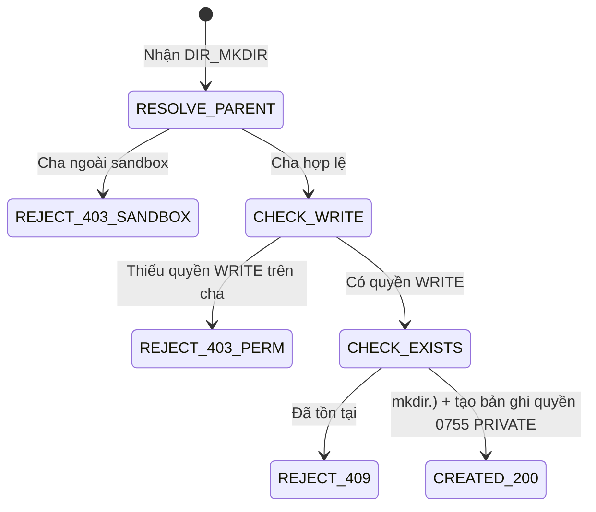
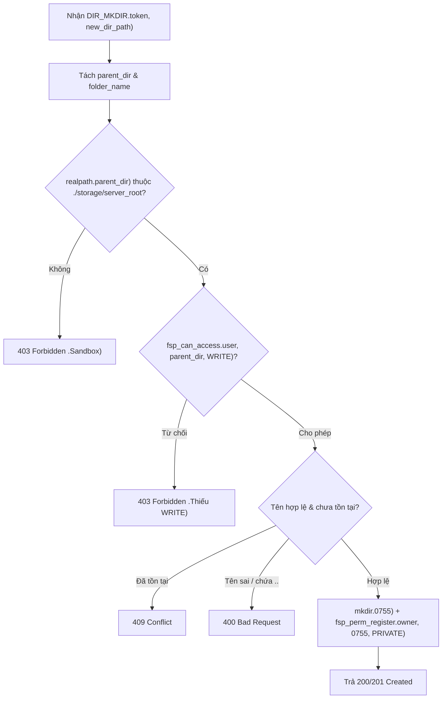
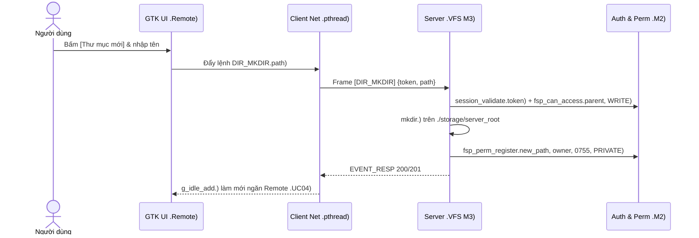

### [UC06] Tạo thư mục .`mkdir`)

> **Trạng thái:** `v1.0 Chính thức .Baseline) — Đã tích hợp 27 NFR chuẩn hóa`  
> **Phân hệ trực thuộc:** `M3 — Hệ thống tệp ảo & Truyền dữ liệu .VFS & Transfer)`  
> **Yêu cầu gốc:** `R2 .File Management Commands — similar to FTP MKD)` · **Ưu tiên:** `MUST`  
> **Tài liệu căn cứ:** [SRS.md].../SRS.md) .FR-2.4, FR-6.1, FR-6.2, FR-6.7, NFR-5), [FSPProtocol.h].../../include/common/FSPProtocol.h), [AGENTS.md].../../AGENTS.md)

---

#### 1. Định danh, Truy vết & Mục đích Nghiệp vụ Cốt lõi

| Thuộc tính | Giá trị |
| :--- | :--- |
| **Mã UC & Tên chuẩn** | `UC06`: **Tạo thư mục .`mkdir`)** |
| **Sự kiện FSP** | `DIR_MKDIR` .`FSP_EV_DIR_MKDIR`) |
| **Mức ưu tiên** | `MUST` |
| **Module / File C dự kiến** | `fsp_vfs.c` .`vfs_mkdir`, `vfs_resolve`), `fsp_perm.c`, `gui_main.c` |
| **Tác nhân chính** | Người dùng .`User`), Quản trị viên .`Admin`) |

##### 1.1. Mục đích Thực chất
- Cho phép người dùng tổ chức cây thư mục lưu trữ trên server và gắn ngay bản ghi phân quyền mặc định cho thư mục mới tạo.

##### 1.2. Tính năng Cốt lõi
- Kiểm tra quyền `WRITE` trên **thư mục cha** bằng `can_access`.
- Chuẩn hóa đường dẫn thư mục cha bằng `realpath.)` .vì thư mục mới chưa tồn tại) để chống path traversal.
- Tạo bản ghi quyền mặc định .`owner` = người tạo, `perm = 0755`, `level = PRIVATE`) trong `data/permissions.json`.

##### 1.3. Ma trận Tác động Chéo & Hiệu ứng Dây chuyền
- **Upstream:** Cần `token` .`UC02`) và quyền `WRITE` trên thư mục cha.
- **Downstream:** Thư mục mới sẵn sàng cho `UC04` .`DIR_LIST`), `UC08` .`Upload`), `UC13` .`PERM_SET`).

---

#### 2. Tác nhân & Ma trận Quyền

| Hành động | Đối tượng | Ai được phép | Điều kiện .`can_access`) | Ràng buộc cấm |
| :--- | :--- | :--- | :--- | :--- |
| `DIR_MKDIR` | Thư mục mới trong thư mục cha | `User`, `Admin` | `can_access.user, parent_path, FSP_ACCESS_WRITE)` | Cấm tạo ngoài sandbox; cấm ghi đè thư mục đã tồn tại .`409`) |

---

#### 3. Điều kiện Tiên quyết & Sự kiện Kích hoạt
- **Preconditions:** Đã đăng nhập .`token` hợp lệ); có quyền `WRITE` trên thư mục cha.
- **Trigger:** Người dùng bấm nút **[Thư mục mới]** trên thanh công cụ ngăn Remote .SRS §6.2) và nhập tên thư mục.

---

#### 4. Điều kiện Hậu nghiệm
- **Success Guarantees:**
  - Thư mục mới tồn tại trên đĩa tại `./storage/server_root/...`.
  - Bản ghi quyền `{path, owner, group, perm: 0755, level: PRIVATE}` được lưu bền vững vào `data/permissions.json`.
  - Ngăn Remote được làm mới .`UC04`).
- **Failure Guarantees:** Không tạo thư mục trên đĩa hoặc bản ghi quyền rác nếu có lỗi.

---

#### 5. Chuyển đổi Trạng thái & Kiểm soát Đồng thời

---

#### 6. Luồng Sự kiện Chính .Happy Path)
- **Bước 1 .Client UI):** Người dùng bấm **[Thư mục mới]** và nhập tên thư mục.
- **Bước 2 .Client Net):** Gửi frame `FSP_MSG_EVENT_REQ` sự kiện `DIR_MKDIR` kèm `token` và `path`.
- **Bước 3 .Server VFS):** Xác thực `token`; tách đường dẫn cha và tên thư mục mới; gọi `realpath.)` trên thư mục cha để xác minh nằm trong `./storage/server_root`.
- **Bước 4 .Server Perm):** Kiểm tra `perm_can_access.user, parent_path, FSP_ACCESS_WRITE)`.
- **Bước 5 .Server Exec):** Kiểm tra tên hợp lệ và chưa tồn tại; tạo thư mục trên đĩa .`mkdir...., 0755)`).
- **Bước 6 .Server Perm Save):** Tạo bản ghi quyền .`owner` = user, `group` = user.group, `perm = 0755`, `level = FSP_LEVEL_PRIVATE`) và lưu vào `data/permissions.json` .khóa mutex).
- **Bước 7 .Server Response & Client UI):** Trả `200 OK` / `201 Created`; client làm mới ngăn Remote .`UC04`).

---

#### 7. Các Luồng Thay thế Hợp lệ .Alternative Flows — AF)
- **`AF-UC06-01` .Thừa hưởng quyền từ thư mục cha đã chia sẻ — COULD FR-6.7):**
  - Nếu triển khai FR-6.7, thư mục mới tạo trong thư mục đã chia sẻ tự thừa hưởng `level` và `share_list` của thư mục cha thay vì mặc định `PRIVATE`.

---

#### 8. Luồng Ngoại lệ & Kịch bản Đối kháng Cốt lõi .Adversarial / Error Flows — EF)
- **`EF-UC06-01` .Thiếu quyền `WRITE` trên thư mục cha — 403):**
  - *Xử lý:* Trả `403`. Client hiện thông báo *"Bạn không có quyền ghi vào thư mục này"* .SRS §6, NFR-7).
- **`EF-UC06-02` .Tên đã tồn tại — 409):**
  - *Xử lý:* Trả `409` .`FSP_STATUS_CONFLICT`).
- **`EF-UC06-03` .Tên chứa `..` hoặc ký tự thoát sandbox — 400 / 403):**
  - *Xử lý:* Chặn trước khi gọi `mkdir.)`.

---

#### 9. Quy tắc Nghiệp vụ & Ranh giới Cấu hình .Business Rules — BR)

| Mã Quy tắc | Nội dung Quy tắc Chi tiết | Ranh giới Kỹ thuật |
| :--- | :--- | :--- |
| `BR-UC06-01` | Thư mục mới mặc định `perm = 0755` .`FSP_DEFAULT_DIR_PERM`), `level = PRIVATE` .FR-6.2). | **Hardcoded** |
| `BR-UC06-02` | Cần quyền `WRITE` trên thư mục cha .FR-2.4). | **Hardcoded** |

##### 9.2. Ràng buộc Phi chức năng áp dụng .NFR Integration)
| Mã NFR | Mức | Hiện thực & Mục tiêu cụ thể trong UC06 | Cách kiểm chứng |
|:---|:-:|:---|:---|
| `NFR-A4`, `NFR-C2` | 🟢 MUST | Khóa `perm_mutex` khi gọi `fsp_perm_register` ngay sau `mkdir.)` để không thiếu bản ghi quyền khi tạo đồng thời. | `test_vfs` + multi-thread test |
| `NFR-E1`, `NFR-E2` | 🟢 MUST | `realpath.)` kiểm tra **thư mục cha** trong `./storage/server_root`; bắt buộc `WRITE` trên thư mục cha .`403` nếu thiếu). | Probe 5 .`mkdir /home/an/../../evil` → `403`) |
| `NFR-F1`–`F3` | 🟢 MUST | Chạy nền qua `pthread`; vô hiệu hóa nút khi tạo thư mục; báo lỗi rõ khi `403`/`409` .*"Bạn không có quyền ghi..."*). | Kiểm tra trên GTK 3 |
| `NFR-G1`–`G3`, `NFR-H1` | 🟢 MUST | C11 POSIX thuần, sạch ASan + UBSan trên Linux/WSL2. | `ctest` Debug ASan/UBSan |
| `NFR-A5`, `NFR-B3`, `NFR-F4`, `NFR-H2` | 🟡 SHOULD | Ghi bản ghi quyền mới ra `permissions.json` bằng `.tmp + rename.)`; phản hồi ≤ 1s; ghi nhật ký; hỗ trợ CLI `mkdir`. | CLI `mkdir` + restart server |

---

#### 10. Đặc tả Dữ liệu & Wire Schema
- **Request .`DIR_MKDIR`):** `{ "token": "...", "path": "/home/an/BaoCao" }`
- **Response:** `{ "status": 200, "message": "Directory created" }`

---

#### 11. Yêu cầu Hành vi Giao diện GTK & CLI
- **GTK:** Nút `[Thư mục mới]` ở thanh công cụ dưới ngăn Remote .SRS §6.2), mở hộp thoại nhập tên.
- **CLI:** Lệnh `mkdir <name>`.

---

#### 12. Sự kiện Nhật ký, Lưu trữ & Điểm chạm Tích hợp
- Tạo thư mục thật trong `./storage/server_root/` và thêm bản ghi vào `data/permissions.json`.

---

#### 13. Tiêu chí Nghiệm thu Có thể Kiểm chứng .Acceptance Criteria — AC)
- **`AC-UC06-01`:** Given có quyền `WRITE` trên `/home/an`; When gọi `DIR_MKDIR."/home/an/NewDir")`; Then thư mục tồn tại và có bản ghi `0755`, `PRIVATE` trong `permissions.json`.
- **`AC-UC06-02`:** Given chỉ có quyền `READ` trên thư mục cha; When gọi `DIR_MKDIR`; Then trả `403`.

---

#### 14. Thiết kế Kịch bản Kiểm thử Đối kháng .Adversarial Test Probes)
- **`PROBE-UC06-01` .Probe 5 — Parent Traversal):** Gửi `DIR_MKDIR."/home/an/../../evil")` → bị chặn `403`, không tạo thư mục ngoài `./storage/server_root`.
- **`PROBE-UC06-02` .Conflict):** Tạo cùng tên thư mục 2 lần → lần 2 trả `409`.
