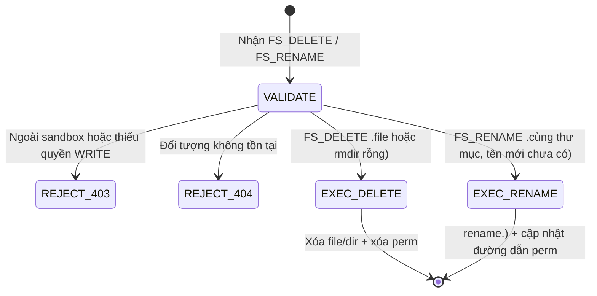
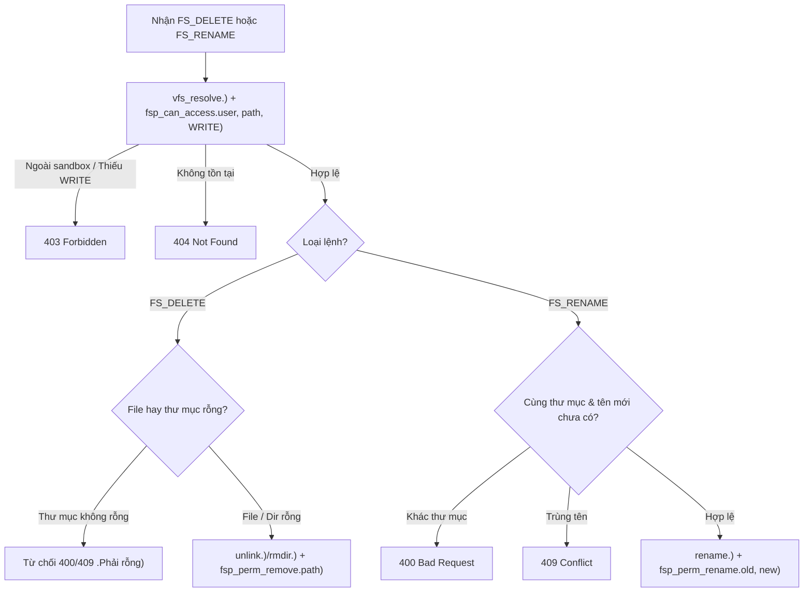
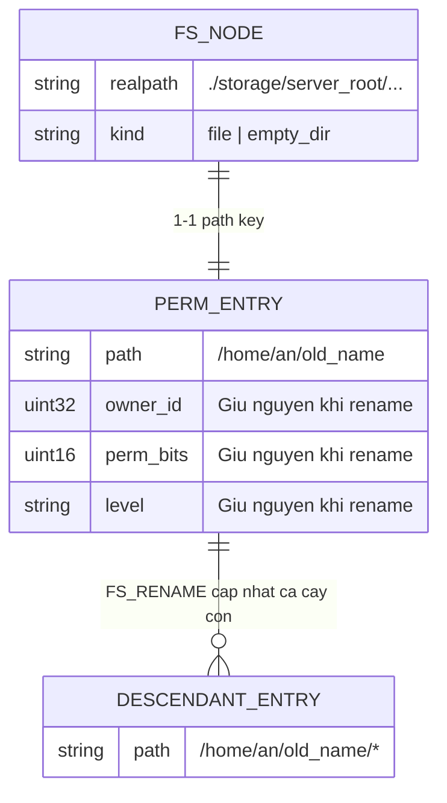

### [UC07] Xóa .`rm`) / Đổi tên .`mv`)

> **Trạng thái:** `v1.0 Chính thức .Baseline) — Đã tích hợp 27 NFR chuẩn hóa`  
> **Phân hệ trực thuộc:** `M3 — Hệ thống tệp ảo & Truyền dữ liệu .VFS & Transfer)`  
> **Yêu cầu gốc:** `R2 .File Management Commands — similar to FTP DELE/RMD, RNFR+RNTO)` · **Ưu tiên:** `SHOULD`  
> **Tài liệu căn cứ:** [SRS.md].../SRS.md) .FR-2.5, FR-2.6, FR-6.1, NFR-5), [FSPProtocol.h].../../include/common/FSPProtocol.h), [AGENTS.md].../../AGENTS.md)

---

#### 1. Định danh, Truy vết & Mục đích Nghiệp vụ Cốt lõi

| Thuộc tính | Giá trị |
| :--- | :--- |
| **Mã UC & Tên chuẩn** | `UC07`: **Xóa .`rm`) / Đổi tên .`mv`)** |
| **Sự kiện FSP** | `FS_DELETE` .`FSP_EV_FS_DELETE`), `FS_RENAME` .`FSP_EV_FS_RENAME`) |
| **Mức ưu tiên** | `SHOULD` |
| **Module / File C dự kiến** | `fsp_vfs.c` .`vfs_delete`, `vfs_rename`), `fsp_perm.c` |
| **Tác nhân chính** | Người dùng .`User`), Quản trị viên .`Admin`) |

##### 1.1. Mục đích Thực chất
- Hoàn thiện bộ lệnh quản lý file cơ bản kiểu FTP cho phép dọn dẹp file/thư mục rỗng và đổi tên tài nguyên trong cùng thư mục.

##### 1.2. Tính năng Cốt lõi
- `FS_DELETE`: Xóa file hoặc **thư mục rỗng**, đồng thời xóa bản ghi quyền tương ứng.
- `FS_RENAME`: Đổi tên file/thư mục **trong cùng thư mục**, giữ nguyên bản ghi quyền .chỉ cập nhật đường dẫn).

##### 1.3. Ma trận Tác động Chéo & Hiệu ứng Dây chuyền
- **Downstream:** Nếu đổi tên thư mục có chứa file con, cần cập nhật đường dẫn tương ứng trong `data/permissions.json` để tránh mất quyền truy cập các mục bên trong.

---

#### 2. Tác nhân & Ma trận Quyền

| Hành động | Đối tượng | Ai được phép | Điều kiện .`can_access`) | Ràng buộc cấm |
| :--- | :--- | :--- | :--- | :--- |
| `FS_DELETE` | File / Thư mục rỗng | `User`, `Admin` | `can_access.user, path, FSP_ACCESS_WRITE)` | Cấm xóa thư mục không rỗng; cấm xóa ngoài sandbox |
| `FS_RENAME` | File / Thư mục | `User`, `Admin` | `can_access.user, old_path, FSP_ACCESS_WRITE)` | Chỉ đổi tên trong cùng thư mục; cấm ghi đè tên đã tồn tại .`409`) |

---

#### 3. Điều kiện Tiên quyết & Sự kiện Kích hoạt
- **Preconditions:** Đã đăng nhập .`token` hợp lệ); đối tượng tồn tại; có quyền `WRITE`.
- **Trigger:** Chọn file/thư mục ở ngăn Remote → menu chuột phải chọn **Xóa** hoặc **Đổi tên**.

---

#### 4. Điều kiện Hậu nghiệm
- **Success Guarantees .`FS_DELETE`):** File/thư mục rỗng bị xóa khỏi đĩa và khỏi `data/permissions.json`.
- **Success Guarantees .`FS_RENAME`):** Đối tượng mang tên mới trong cùng thư mục; `owner`, `perm`, `level`, `share_list` được giữ nguyên.

---

#### 5. Chuyển đổi Trạng thái & Kiểm soát Đồng thời

---

#### 6. Luồng Sự kiện Chính .Happy Path)
- **Bước 1 .Client):** Gửi `FS_DELETE` .`{token, path}`) hoặc `FS_RENAME` .`{token, old_path, new_name}`).
- **Bước 2 .Server VFS & Perm):** Xác thực `token`, chuẩn hóa đường dẫn qua `vfs_resolve`, kiểm tra tồn tại và gọi `perm_can_access.user, path, FSP_ACCESS_WRITE)`.
- **Bước 3 .Server Exec):**
  - Với `FS_DELETE`: Nếu là file → `unlink.)`; nếu là thư mục → kiểm tra rỗng và gọi `rmdir.)`; xóa bản ghi trong `data/permissions.json`.
  - Với `FS_RENAME`: Kiểm tra `new_name` nằm trong cùng thư mục và chưa tồn tại; gọi `rename.)` và cập nhật key đường dẫn trong `data/permissions.json` .khóa mutex).
- **Bước 4 .Server & Client):** Trả `200 OK`; client làm mới ngăn Remote .`UC04`).

---

#### 7. Các Luồng Thay thế Hợp lệ .Alternative Flows — AF)
- **`AF-UC07-01` .Xác nhận trước khi xóa trên GUI):** Client hiện hộp thoại xác nhận trước khi gửi `FS_DELETE`.

---

#### 8. Luồng Ngoại lệ & Kịch bản Đối kháng Cốt lõi .Adversarial / Error Flows — EF)
- **`EF-UC07-01` .Xóa thư mục không rỗng — 400 / 409):** `rmdir.)` thất bại → trả lỗi, không xóa dữ liệu bên trong .FR-2.5).
- **`EF-UC07-02` .Đổi tên trùng tên đã có — 409):** Trả `409` .`FSP_STATUS_CONFLICT`), không ghi đè.
- **`EF-UC07-03` .Đổi tên kèm `/` để di chuyển sang thư mục khác — 400):** Từ chối vì FR-2.6 chỉ hỗ trợ đổi tên trong cùng thư mục.
- **`EF-UC07-04` .Thiếu quyền `WRITE` hoặc traversal — 403):** Trả `403`.

---

#### 9. Quy tắc Nghiệp vụ & Ranh giới Cấu hình .Business Rules — BR)

| Mã Quy tắc | Nội dung Quy tắc Chi tiết | Ranh giới Kỹ thuật |
| :--- | :--- | :--- |
| `BR-UC07-01` | `FS_DELETE` chỉ xóa file hoặc **thư mục rỗng** .FR-2.5). | **Hardcoded** |
| `BR-UC07-02` | `FS_RENAME` chỉ đổi tên **trong cùng thư mục** .FR-2.6). | **Hardcoded** |

##### 9.2. Ràng buộc Phi chức năng áp dụng .NFR Integration)
| Mã NFR | Mức | Hiện thực & Mục tiêu cụ thể trong UC07 | Cách kiểm chứng |
|:---|:-:|:---|:---|
| `NFR-A4`, `NFR-C2` | 🟢 MUST | Cập nhật file trên đĩa và `permissions.json` .kèm cây con khi `FS_RENAME`) đồng bộ dưới `perm_mutex`, không sinh bản ghi mồ côi. | `test_vfs`, `test_auth_permissions` .`fsp_perm_rename`) |
| `NFR-E1`, `NFR-E2` | 🟢 MUST | `vfs_resolve` chống thoát sandbox; kiểm tra `WRITE` .`403`); đổi tên thư mục `/a` không chạm `/a-b`. | Probe 5 + Probe 3 subtree isolation |
| `NFR-F1`, `NFR-F2` | 🟢 MUST | Thực thi bất đồng bộ trên `pthread`; hiển thị lỗi rõ nếu thư mục chưa rỗng .`409`) hoặc trùng tên. | Kiểm tra menu chuột phải GTK |
| `NFR-G1`–`G3`, `NFR-H1` | 🟢 MUST | C11 POSIX .`unlink`/`rmdir`/`rename`), sạch ASan + UBSan. | `ctest` Debug ASan/UBSan |
| `NFR-A5`, `NFR-B3`, `NFR-F4`, `NFR-H2` | 🟡 SHOULD | Ghi `permissions.json` nguyên tử qua `.tmp + rename.)`; phản hồi ≤ 1s; ghi nhật ký; hỗ trợ CLI `rm`/`mv`. | CLI `rm`, `mv` |

---

#### 10. Đặc tả Dữ liệu & Wire Schema
- **Request `FS_DELETE`:** `{ "token": "...", "path": "/home/an/old.txt" }`
- **Request `FS_RENAME`:** `{ "token": "...", "old_path": "/home/an/old.txt", "new_path": "/home/an/new.txt" }`
- **Response:** `{ "status": 200, "message": "OK" }`

---

#### 11. Yêu cầu Hành vi Giao diện GTK & CLI
- **GTK:** Menu chuột phải trên ngăn Remote có mục Xóa / Đổi tên.
- **CLI:** Lệnh tương ứng để kiểm thử.

---

#### 12. Sự kiện Nhật ký, Lưu trữ & Điểm chạm Tích hợp
- Đồng bộ cập nhật `./storage/server_root` và `data/permissions.json` dưới khóa mutex.

---

#### 13. Tiêu chí Nghiệm thu Có thể Kiểm chứng .Acceptance Criteria — AC)
- **`AC-UC07-01`:** Given file có quyền `WRITE`; When gọi `FS_DELETE`; Then file bị xóa trên đĩa và không còn trong `permissions.json`.
- **`AC-UC07-02`:** Given thư mục không rỗng; When gọi `FS_DELETE`; Then bị từ chối, dữ liệu bên trong còn nguyên.

---

#### 14. Thiết kế Kịch bản Kiểm thử Đối kháng .Adversarial Test Probes)
- **`PROBE-UC07-01` .Unauthorized Delete):** User chỉ có quyền `READ` trên file `SHARED` gọi `FS_DELETE` → trả `403`, file còn nguyên.
- **`PROBE-UC07-02` .Cross-dir Rename Injection):** Gửi `new_path` chứa `../../outside` → trả `403` / `400`.
