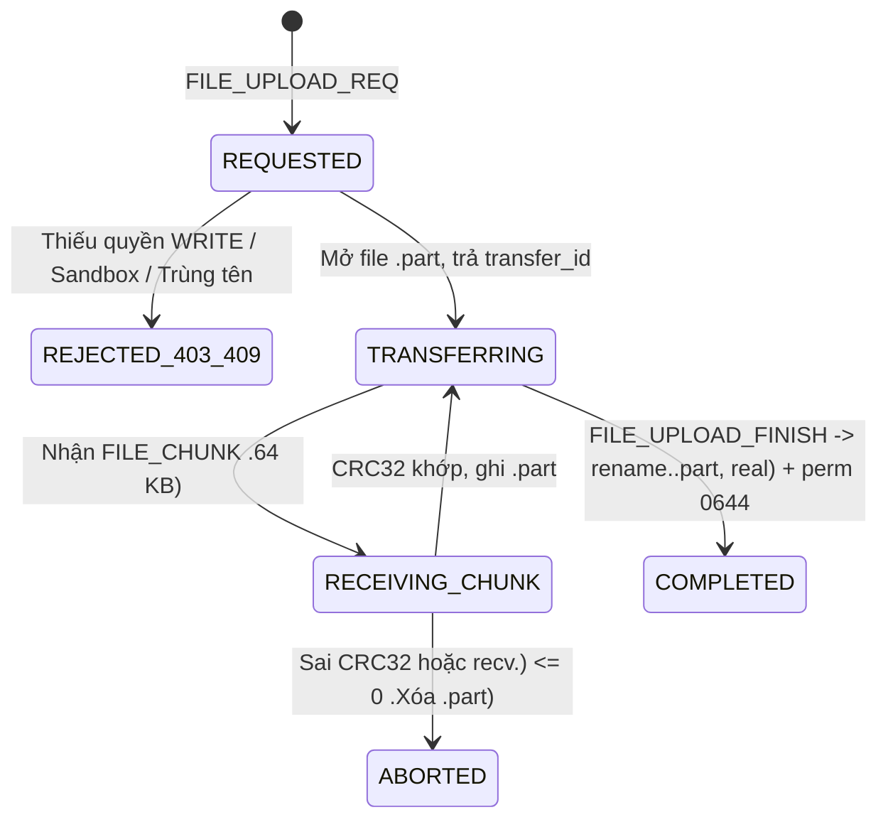
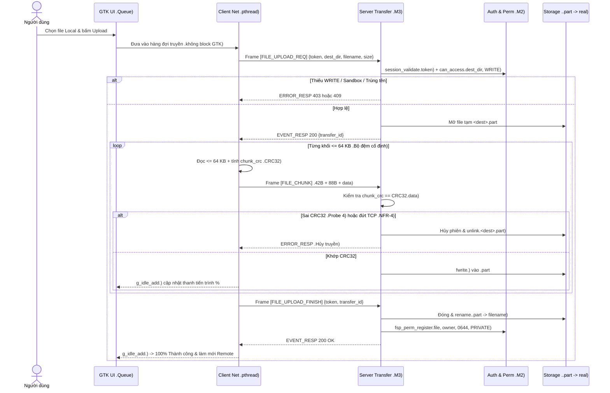
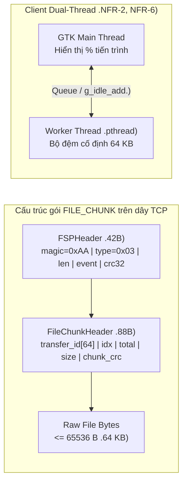

### [UC08] Upload một file .Single File Upload)

> **Trạng thái:** `v1.0 Chính thức .Baseline) — Đã tích hợp 27 NFR chuẩn hóa`  
> **Phân hệ trực thuộc:** `M3 — Truyền dữ liệu .Transfer) & M1 — Socket/Frame`  
> **Yêu cầu gốc:** `R3 .File Upload/Download)` · **Ưu tiên:** `MUST`  
> **Tài liệu căn cứ:** [SRS.md].../SRS.md) .UC08 §3.3, FR-3.1–3.6, FR-6.1, FR-6.2, NFR-1, NFR-2, NFR-4, NFR-6), [FSPProtocol.h].../../include/common/FSPProtocol.h), [AGENTS.md].../../AGENTS.md)

---

#### 1. Định danh, Truy vết & Mục đích Nghiệp vụ Cốt lõi

| Thuộc tính | Giá trị |
| :--- | :--- |
| **Mã UC & Tên chuẩn** | `UC08`: **Upload một file** |
| **Sự kiện FSP** | `FILE_UPLOAD_REQ`, `FSP_MSG_FILE_CHUNK` .`FILE_CHUNK`), `FILE_UPLOAD_FINISH` |
| **Mức ưu tiên** | `MUST` |
| **Module / File C dự kiến** | `fsp_transfer.c` .`transfer_upload_begin/chunk/finish`), `fsp_packet.c`, `fsp_crc32.c`, `gui_main.c` |
| **Tác nhân chính** | Người dùng .`User`), Quản trị viên .`Admin`) |

##### 1.1. Mục đích Thực chất
- Truyền file từ client lên server chính xác từng byte .NFR-1), không làm phình RAM khi truyền file lớn 500 MB .NFR-2), và không làm treo giao diện GTK .NFR-6).
- Bảo đảm tính nguyên tử của file đích bằng cơ chế ghi file tạm `.part` và kiểm tra CRC32 từng khối 64 KB.

##### 1.2. Tính năng Cốt lõi
- Chia file thành các khối tối đa **64 KB** .`FSP_DEFAULT_CHUNK_SIZE = 65536`), mỗi khối gắn `FileChunkHeader` **88 byte** kèm `chunk_crc` .FR-3.1).
- Chỉ sử dụng **bộ đệm cố định 64 KB** ở cả bên gửi và bên nhận .FR-3.2).
- Ghi vào file tạm `<dest>.part`; chỉ `rename.)` thành file thật khi nhận đủ và hợp lệ toàn bộ chunk .FR-3.4).
- Từ chối ghi đè nếu trùng tên .`409 Conflict` — FR-3.5).
- Gắn bản ghi quyền mặc định .`owner` = người upload, `perm = 0644`, `level = PRIVATE` — FR-6.2).

##### 1.3. Ma trận Tác động Chéo & Hiệu ứng Dây chuyền
- **Upstream:** Phiên hợp lệ .`UC02`), quyền `WRITE` trên thư mục đích.
- **Downstream:** Được tái sử dụng cho từng file trong `UC10` .Upload thư mục).

---

#### 2. Tác nhân & Ma trận Quyền

| Hành động | Đối tượng | Ai được phép | Điều kiện .`can_access`) | Ràng buộc cấm |
| :--- | :--- | :--- | :--- | :--- |
| `FILE_UPLOAD_REQ` | Thư mục đích | `User`, `Admin` | `can_access.user, dest_dir, FSP_ACCESS_WRITE)` | Cấm ghi đè file trùng tên .`409`); cấm vượt sandbox .`403`) |

---

#### 3. Điều kiện Tiên quyết & Sự kiện Kích hoạt
- **Preconditions:** Đã đăng nhập .`token` hợp lệ); có quyền `WRITE` trên thư mục đích; file nguồn cục bộ đọc được.
- **Trigger:** Chọn file ở ngăn Local → bấm **[ Upload → ]** hoặc chọn Upload từ menu chuột phải .FR-7.3).

---

#### 4. Điều kiện Hậu nghiệm
- **Success Guarantees:**
  - File nằm trên server với nội dung giống hệt file gốc .`sha256sum`/`cmp` khớp).
  - Bản ghi quyền được lưu trong `data/permissions.json` .`owner`, `perm = 0644`, `level = PRIVATE`).
  - Hàng đợi truyền hiển thị `100%` — **"Thành công"**.
- **Failure Guarantees .Fail-Closed):**
  - Nếu sai CRC32 hoặc mất kết nối giữa chừng: phiên truyền bị hủy, **file `.part` bị xóa sạch** khỏi đĩa, không để lại file rác .NFR-4).

---

#### 5. Chuyển đổi Trạng thái & Kiểm soát Đồng thời

---

#### 6. Luồng Sự kiện Chính .Happy Path)
- **Bước 1 .Client UI):** Người dùng chọn file ở ngăn Local, bấm Upload; tác vụ được thêm vào **Hàng đợi truyền** .FR-7.4) và đẩy sang luồng mạng .`pthread`).
- **Bước 2 .Client Net):** Gửi `FILE_UPLOAD_REQ` .`token`, thư mục đích ảo, tên file, kích thước file).
- **Bước 3 .Server Check):** Xác thực `token`, chuẩn hóa đường dẫn qua `vfs_resolve`, kiểm tra `can_access.user, dest_dir, WRITE)` và kiểm tra tên file chưa tồn tại.
- **Bước 4 .Server Init):** Cấp phát `transfer_id`, mở file tạm `<dest>.part` và trả `200 OK` kèm `transfer_id`.
- **Bước 5 .Client Stream):** Đọc file nguồn từng khối ≤ 64 KB vào bộ đệm cố định, tính `chunk_crc = crc32.data)`, gửi frame `FSP_MSG_FILE_CHUNK` .header 42B + `FileChunkHeader` 88B + payload ≤ 64 KB), cập nhật % tiến trình lên GTK qua `g_idle_add.)`.
- **Bước 6 .Server Write):** Dùng `recv_exact.)` đọc từng chunk, kiểm tra CRC32; nếu khớp thì ghi tuần tự vào `.part`.
- **Bước 7 .Client Finish):** Gửi `FILE_UPLOAD_FINISH` kèm `transfer_id` .và SHA-256 toàn file nếu áp dụng FR-3.6 COULD).
- **Bước 8 .Server Commit):** Đóng `.part`, `rename.)` thành file thật, tạo bản ghi quyền .`owner`, `perm = 0644`, `level = PRIVATE`) trong `data/permissions.json`, trả `200 OK`.
- **Bước 9 .Client UI):** Cập nhật hàng đợi truyền thành `100%` — **"Thành công"** và làm mới ngăn Remote .`UC04`).

---

#### 7. Các Luồng Thay thế Hợp lệ .Alternative Flows — AF)
- **`AF-UC08-01` .Upload file rỗng 0 byte):** `total_chunks = 0`, client gửi `FILE_UPLOAD_REQ` rồi `FILE_UPLOAD_FINISH` → tạo file 0 byte hợp lệ.
- **`AF-UC08-02` .Kiểm tra SHA-256 toàn file — COULD FR-3.6):** Đối chiếu thêm SHA-256 ở bước `FILE_UPLOAD_FINISH`.

---

#### 8. Luồng Ngoại lệ & Kịch bản Đối kháng Cốt lõi .Adversarial / Error Flows — EF)
- **`EF-UC08-01` .Thiếu quyền `WRITE` hoặc Path Traversal — 403):** Từ chối ngay ở `FILE_UPLOAD_REQ`.
- **`EF-UC08-02` .Trùng tên file — 409):** Từ chối ngay với `409 Conflict` .FR-3.5), không ghi đè.
- **`EF-UC08-03` .Chunk hỏng / Sai CRC32 — Probe 4):** Server phát hiện `crc32.data) != chunk_crc` → lập tức hủy phiên truyền, đóng & `unlink.)` file `.part`, trả lỗi.
- **`EF-UC08-04` .Mất kết nối giữa chừng — NFR-4):** `recv.) <= 0` → server hủy phiên, xóa `.part`, giải phóng tài nguyên .không hỗ trợ resume — SRS §5).

---

#### 9. Quy tắc Nghiệp vụ & Ranh giới Cấu hình .Business Rules — BR)

| Mã Quy tắc | Nội dung Quy tắc Chi tiết | Ranh giới Kỹ thuật |
| :--- | :--- | :--- |
| `BR-UC08-01` | Kích thước khối tối đa `64 KB` .`65536` byte), `FileChunkHeader` đúng 88 byte .FR-3.1). | **Hardcoded** .`FSPProtocol.h`) |
| `BR-UC08-02` | Bộ đệm cố định, không đọc cả file vào RAM .FR-3.2, NFR-2). | **Hardcoded** |
| `BR-UC08-03` | Không ghi đè file trùng tên .`409` — FR-3.5). | **Hardcoded** |
| `BR-UC08-04` | File mới mặc định `perm = 0644`, `level = PRIVATE` .FR-6.2). | **Hardcoded** |

##### 9.2. Ràng buộc Phi chức năng áp dụng .NFR Integration)
| Mã NFR | Mức | Hiện thực & Mục tiêu cụ thể trong UC08 | Cách kiểm chứng |
|:---|:-:|:---|:---|
| `NFR-A1`, `NFR-A2`, `NFR-A3`, `NFR-A4` | 🟢 MUST | File 1 KB–500 MB khớp từng byte; từng chunk ≤ 64 KB gắn CRC32 .`88B` header); ghi `.part` rồi `rename.)`; tách/ghép frame 42B chuẩn. | `sha256sum`/`cmp` + Probe 1 + Probe 4 |
| `NFR-B1`, `NFR-B2` | 🟢 MUST | Bộ đệm cố định 64 KB .RAM O.1) khi upload 500 MB); chặn `payload_len > 128 KB`. | `/usr/bin/time -v` hoặc `top` khi truyền 500 MB |
| `NFR-C1`, `NFR-C2` | 🟢 MUST | ≥ 5 client upload đồng thời; cập nhật `permissions.json` & bảng transfer dưới `pthread_mutex_t`. | Test ≥ 5 client upload song song |
| `NFR-D1`, `NFR-D2` | 🟢 MUST | Ngắt kết nối hoặc sai CRC32 → xóa `.part` trong < 1s, không sập server .`SIGPIPE` ignored). | Tắt client giữa chừng → `ls` không còn `.part` |
| `NFR-E1`, `NFR-E2` | 🟢 MUST | Kiểm tra `vfs_resolve` + `token` .`401`) + `WRITE` trên thư mục đích .`403`). | Probe 5 + upload vào thư mục `READ`-only |
| `NFR-F1`, `NFR-F2` | 🟢 MUST | Luồng `pthread` stream chunk; ngăn Local GTK vẫn cuộn/bấm mượt; báo lỗi rõ nếu `403`/`409`. | Thao tác trên GTK khi upload 500 MB |
| `NFR-G1`, `NFR-G2`, `NFR-G3`, `NFR-H1` | 🟢 MUST | C11 POSIX thuần, `goto cleanup` giải phóng `FILE*`/`fd`, sạch ASan + UBSan .CTest). | `ctest` Debug ASan/UBSan |
| `NFR-A5`, `NFR-C3`, `NFR-D3`, `NFR-F4`, `NFR-H2` | 🟡 SHOULD | Ghi `permissions.json` bằng `.tmp + rename.)`; TSan sạch; `SO_RCVTIMEO = 30s` phát hiện treo; cập nhật thanh `%` theo chunk; hỗ trợ CLI `put`. | CLI `put`, TSan, thanh `%` GTK |

---

#### 10. Đặc tả Dữ liệu & Wire Schema
- **`FILE_UPLOAD_REQ` .JSON):** `{ "token": "...", "dest_dir": "/home/an", "filename": "slide.pptx", "size": 2202009 }`
- **`FSP_MSG_FILE_CHUNK` .Binary):** `FSPHeader` .42B) + `FileChunkHeader` .88B: `transfer_id[64]`, `chunk_index`, `total_chunks`, `chunk_size`, `chunk_crc`) + `data[chunk_size]`.
- **`FILE_UPLOAD_FINISH` .JSON):** `{ "token": "...", "transfer_id": "..." }`

---

#### 11. Yêu cầu Hành vi Giao diện GTK & CLI
- **GTK .`gui_main.c`):** Bảng Hàng đợi truyền hiển thị: `↑ slide.pptx [████░░] 62% Đang truyền` → `100% Thành công` .SRS §6.2, FR-7.4). Ngăn Local vẫn cuộn/bấm được khi đang truyền .NFR-6).
- **CLI:** Lệnh `put <local_file> [remote_dir]`.

---

#### 12. Sự kiện Nhật ký, Lưu trữ & Điểm chạm Tích hợp
- Ghi file tạm `.part` rồi `rename.)` sang `./storage/server_root/...`; cập nhật `data/permissions.json`.

---

#### 13. Tiêu chí Nghiệm thu Có thể Kiểm chứng .Acceptance Criteria — AC)
- **`AC-UC08-01` .NFR-1, NFR-2):** Upload file 1 KB, 10 MB, 500 MB → nội dung khớp `sha256sum`/`cmp`, RAM tiến trình không tăng theo kích thước file.
- **`AC-UC08-02` .NFR-4):** Tắt client giữa chừng khi đang upload → server không sập, không còn file `.part`.

---

#### 14. Thiết kế Kịch bản Kiểm thử Đối kháng .Adversarial Test Probes)
- **`PROBE-UC08-01` .Probe 4 — Corrupted Chunk):** Lật 1 bit trong payload của 1 `FILE_CHUNK` → server phát hiện sai CRC32, trả lỗi và xác nhận trên đĩa **không còn file `.part`** .SRS §9, AGENTS.md).
- **`PROBE-UC08-02` .Probe 1 — TCP Framing):** 2 frame `FILE_CHUNK` dính trong 1 `recv.)` hoặc 1 frame tách làm nhiều mảnh → `recv_exact.)` ghép/tách đúng 100%.
- **`PROBE-UC08-03` .Duplicate Filename):** Upload file trùng tên → trả `409`, file cũ trên server nguyên vẹn.
