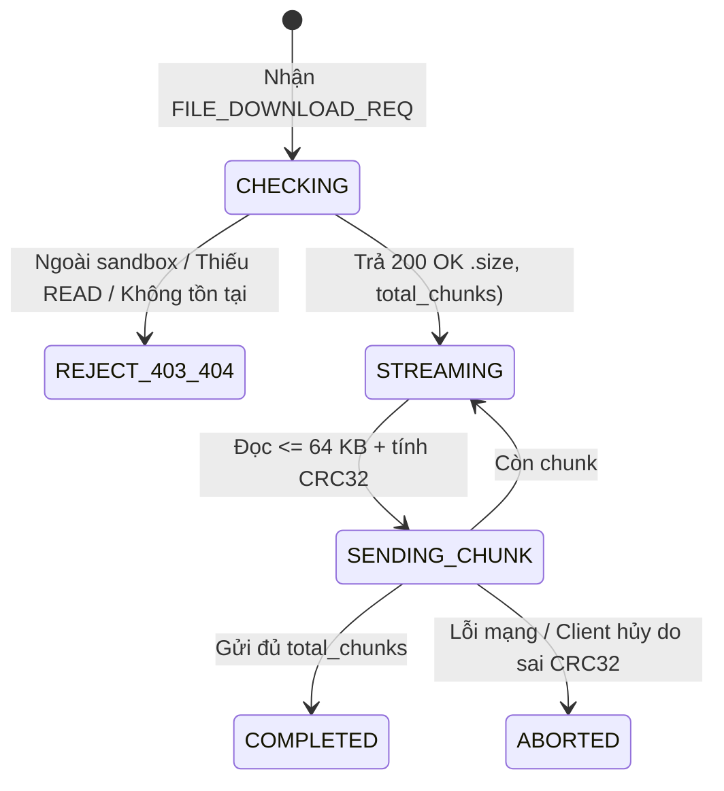
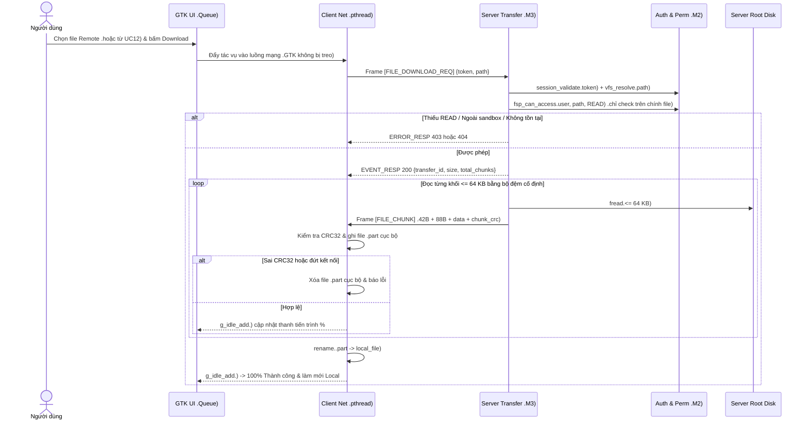
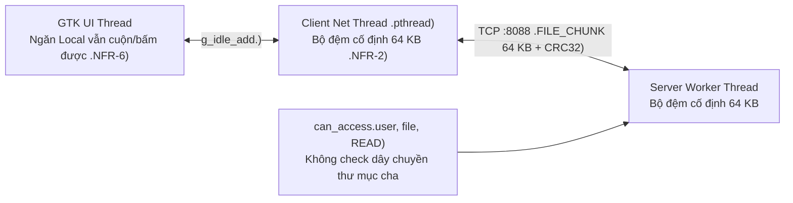

### [UC09] Download một file .Single File Download)

> **Trạng thái:** `v1.0 Chính thức .Baseline) — Đã tích hợp 27 NFR chuẩn hóa`  
> **Phân hệ trực thuộc:** `M3 — Truyền dữ liệu .Transfer) & M1 — Socket/Frame`  
> **Yêu cầu gốc:** `R3 .File Upload/Download)` · **Ưu tiên:** `MUST`  
> **Tài liệu căn cứ:** [SRS.md].../SRS.md) .FR-3.1–3.3, FR-3.6, FR-6.1, FR-7.3, FR-7.4, NFR-1–3, NFR-6), [FSPProtocol.h].../../include/common/FSPProtocol.h), [AGENTS.md].../../AGENTS.md)

---

#### 1. Định danh, Truy vết & Mục đích Nghiệp vụ Cốt lõi

| Thuộc tính | Giá trị |
| :--- | :--- |
| **Mã UC & Tên chuẩn** | `UC09`: **Download một file** |
| **Sự kiện FSP** | `FILE_DOWNLOAD_REQ`, `FSP_MSG_FILE_CHUNK` |
| **Mức ưu tiên** | `MUST` |
| **Module / File C dự kiến** | `fsp_transfer.c` .`transfer_send_file`), `fsp_packet.c`, `fsp_crc32.c`, `gui_main.c` |
| **Tác nhân chính** | Người dùng .`User`), Quản trị viên .`Admin`) |

##### 1.1. Mục đích Thực chất
- Cho phép người dùng tải file từ server .từ ngăn Remote hoặc từ kết quả tìm kiếm `UC12`) về máy cục bộ với độ toàn vẹn tuyệt đối và giao diện không bị treo khi tải file dung lượng lớn .500 MB).

##### 1.2. Tính năng Cốt lõi
- Kiểm tra `can_access.user, file_path, READ)` trên chính file mục tiêu .không kiểm tra dây chuyền thư mục cha — SRS §4 FR-6).
- Truyền tuần tự bằng các khối ≤ 64 KB .`FSP_MSG_FILE_CHUNK`) kèm `FileChunkHeader` 88 byte và CRC32.
- Sử dụng bộ đệm cố định ở cả server và client .NFR-2).

##### 1.3. Ma trận Tác động Chéo & Hiệu ứng Dây chuyền
- **Upstream:** Được gọi trực tiếp từ ngăn Remote hoặc được **include** bởi `UC12` .Tìm kiếm) và tái sử dụng bởi `UC11` .Download thư mục).

---

#### 2. Tác nhân & Ma trận Quyền

| Hành động | Đối tượng | Ai được phép | Điều kiện .`can_access`) | Ràng buộc cấm |
| :--- | :--- | :--- | :--- | :--- |
| `FILE_DOWNLOAD_REQ` | File trên server | `User`, `Admin` | `can_access.user, file_path, FSP_ACCESS_READ)` | Cấm tải file ngoài sandbox hoặc file không có quyền `READ` .`403`) |

---

#### 3. Điều kiện Tiên quyết & Sự kiện Kích hoạt
- **Preconditions:** Đã đăng nhập .`token` hợp lệ); file tồn tại trên server và người dùng có quyền `READ`.
- **Trigger:** Chọn file ở ngăn Remote → bấm **[ ← Download ]** / menu chuột phải, hoặc bấm **[ Download mục đã chọn ]** từ hộp thoại Tìm kiếm .`UC12`).

---

#### 4. Điều kiện Hậu nghiệm
- **Success Guarantees:** File được ghi hoàn chỉnh tại thư mục đích ở ngăn Local, nội dung giống hệt bản trên server; Hàng đợi truyền hiển thị `100%` — **"Thành công"**.
- **Failure Guarantees:** Nếu sai CRC32 hoặc mất kết nối, xóa file tạm `.part` cục bộ và báo lỗi rõ ràng.

---

#### 5. Chuyển đổi Trạng thái & Kiểm soát Đồng thời

---

#### 6. Luồng Sự kiện Chính .Happy Path)
- **Bước 1 .Client UI):** Người dùng kích hoạt Download; tác vụ vào Hàng đợi truyền và chạy trên luồng mạng .`pthread`).
- **Bước 2 .Client Net):** Gửi `FILE_DOWNLOAD_REQ` kèm `token` và đường dẫn ảo của file.
- **Bước 3 .Server VFS & Perm):** Xác thực `token`, gọi `vfs_resolve`, kiểm tra file tồn tại và gọi `perm_can_access.user, file_path, FSP_ACCESS_READ)`.
- **Bước 4 .Server Init):** Trả `200 OK` kèm `transfer_id`, kích thước file và `total_chunks`.
- **Bước 5 .Server Stream):** Đọc lần lượt từng khối ≤ 64 KB vào bộ đệm cố định, đóng gói `FSP_MSG_FILE_CHUNK` .`FileChunkHeader` 88B + payload) và gửi qua `send_exact.)`.
- **Bước 6 .Client Receive):** Nhận từng chunk bằng `recv_exact.)`, kiểm tra CRC32; ghi vào file tạm `.part` cục bộ và cập nhật % lên GTK qua `g_idle_add.)`.
- **Bước 7 .Client Commit):** Nhận đủ `total_chunks` hợp lệ → đổi tên `.part` thành tên file thật, cập nhật trạng thái **"Thành công"** và làm mới ngăn Local.

---

#### 7. Các Luồng Thay thế Hợp lệ .Alternative Flows — AF)
- **`AF-UC09-01` .Tải file được chia sẻ nằm trong thư mục cha `PRIVATE`):**
  - Vì `can_access` chỉ kiểm tra trên chính file mục tiêu .SRS §4 FR-6), người dùng vẫn tải thành công file `SHARED`/`PUBLIC` qua đường dẫn từ `UC12`.

---

#### 8. Luồng Ngoại lệ & Kịch bản Đối kháng Cốt lõi .Adversarial / Error Flows — EF)
- **`EF-UC09-01` .Không có quyền `READ` hoặc Path Traversal — 403):** Trả `403`, không gửi bất kỳ byte dữ liệu nào.
- **`EF-UC09-02` .File không tồn tại — 404):** Trả `404`.
- **`EF-UC09-03` .Sai CRC32 tại client):** Client hủy truyền, xóa `.part` cục bộ, báo lỗi toàn vẹn dữ liệu.

---

#### 9. Quy tắc Nghiệp vụ & Ranh giới Cấu hình .Business Rules — BR)

| Mã Quy tắc | Nội dung Quy tắc Chi tiết | Ranh giới Kỹ thuật |
| :--- | :--- | :--- |
| `BR-UC09-01` | Kích thước mỗi khối tối đa `64 KB`, bộ đệm cố định .FR-3.1, FR-3.2). | **Hardcoded** |
| `BR-UC09-02` | Không kiểm tra dây chuyền thư mục cha khi `can_access` file .SRS §4 FR-6). | **Hardcoded** |

##### 9.2. Ràng buộc Phi chức năng áp dụng .NFR Integration)
| Mã NFR | Mức | Hiện thực & Mục tiêu cụ thể trong UC09 | Cách kiểm chứng |
|:---|:-:|:---|:---|
| `NFR-A1`, `NFR-A2`, `NFR-A3`, `NFR-A4` | 🟢 MUST | File 1 KB–500 MB khớp `sha256sum`; kiểm tra CRC32 từng khối 64 KB; ghi `.part` cục bộ rồi `rename.)`. | `sha256sum`/`cmp` sau download |
| `NFR-B1`, `NFR-B2` | 🟢 MUST | Bộ đệm cố định 64 KB ở cả server và client .RAM O.1)); chặn gói `> 128 KB`. | `/usr/bin/time -v` khi tải 500 MB |
| `NFR-C1`, `NFR-C2` | 🟢 MUST | ≥ 5 client download đồng thời không race condition, không deadlock. | Test ≥ 5 client download song song |
| `NFR-D1`, `NFR-D2` | 🟢 MUST | Client tắt giữa chừng → server đóng `FILE*`, giữ tiến trình sống phục vụ client khác .`SIGPIPE` ignored). | Kill client khi đang tải 500 MB |
| `NFR-E1`, `NFR-E2` | 🟢 MUST | `vfs_resolve` chống `../../etc/passwd` .`403`); kiểm tra `READ` trên chính file .`403` nếu `PRIVATE`). | Probe 5 + Probe 3 |
| `NFR-F1`, `NFR-F2` | 🟢 MUST | `pthread` nhận chunk, `g_idle_add.)` cập nhật UI; ngăn Local vẫn cuộn/bấm mượt khi đang tải 500 MB. | Cuộn ngăn Local khi tải 500 MB trên GTK |
| `NFR-G1`, `NFR-G2`, `NFR-G3`, `NFR-H1` | 🟢 MUST | C11 POSIX thuần, sạch ASan + UBSan trên test headless. | `ctest` Debug ASan/UBSan |
| `NFR-C3`, `NFR-D3`, `NFR-F4`, `NFR-H2` | 🟡 SHOULD | TSan sạch; `SO_RCVTIMEO = 30s`; thanh `%` tiến trình mượt; hỗ trợ CLI `get`. | CLI `get`, TSan |

---

#### 10. Đặc tả Dữ liệu & Wire Schema
- **`FILE_DOWNLOAD_REQ` .JSON):** `{ "token": "...", "path": "/home/an/BaoCao/baocao_v1.pdf" }`
- **`200 OK` .JSON):** `{ "status": 200, "transfer_id": "...", "size": 1258291, "total_chunks": 20 }`
- **`FSP_MSG_FILE_CHUNK`:** `FSPHeader` .42B) + `FileChunkHeader` .88B) + `data[chunk_size]`.

---

#### 11. Yêu cầu Hành vi Giao diện GTK & CLI
- **GTK:** Trong lúc download file 500 MB, người dùng vẫn bấm/cuộn được trên ngăn Local .NFR-6).
- **CLI:** Lệnh `get <remote_file> [local_dir]`.

---

#### 12. Sự kiện Nhật ký, Lưu trữ & Điểm chạm Tích hợp
- Chỉ đọc file từ `./storage/server_root/...`; ghi file ra thư mục Local của client.

---

#### 13. Tiêu chí Nghiệm thu Có thể Kiểm chứng .Acceptance Criteria — AC)
- **`AC-UC09-01` .NFR-1, NFR-2, NFR-6):** Download file 500 MB → khớp `sha256sum`, RAM ổn định, GUI vẫn mượt.
- **`AC-UC09-02` .NFR-3):** 5 client đồng thời download/upload → tất cả hoàn tất chính xác.

---

#### 14. Thiết kế Kịch bản Kiểm thử Đối kháng .Adversarial Test Probes)
- **`PROBE-UC09-01` .Direct Traversal Download):** Gửi `FILE_DOWNLOAD_REQ` với `../../../../etc/passwd` → trả `403`.
- **`PROBE-UC09-02` .Shared File in Private Folder):** Tải file `SHARED` nằm trong thư mục `PRIVATE` của user khác → thành công `200 OK`, nội dung khớp gốc.
