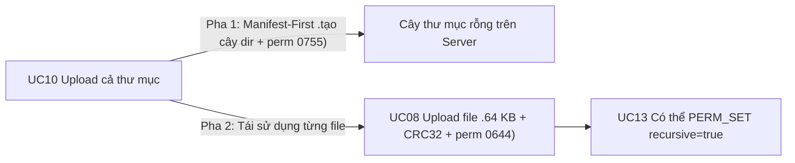
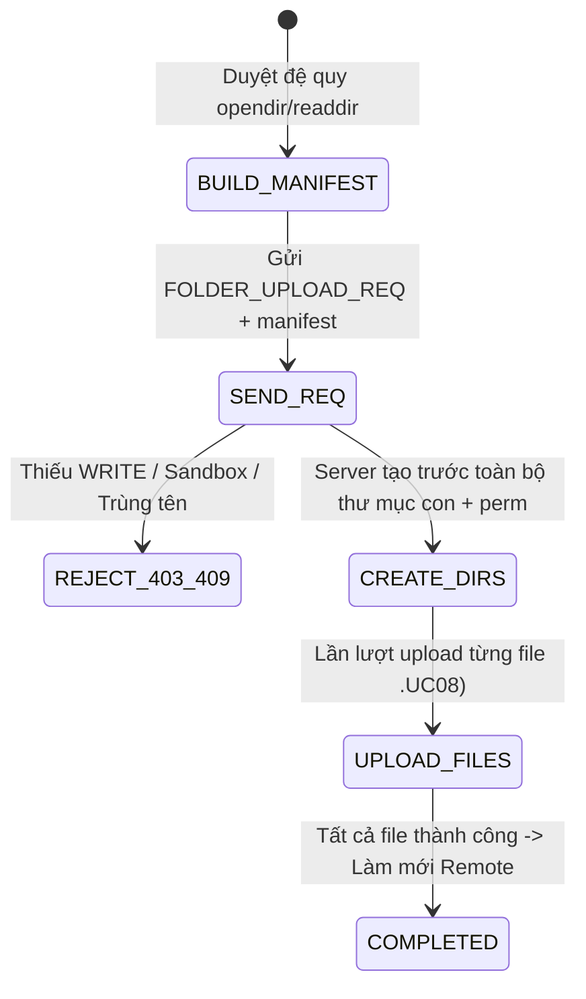
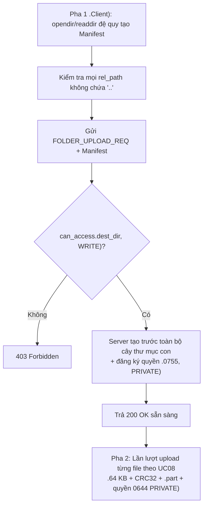

### [UC10] Upload cả thư mục .Folder Upload)

> **Trạng thái:** `v1.0 Chính thức .Baseline) — Đã tích hợp 27 NFR chuẩn hóa`  
> **Phân hệ trực thuộc:** `M3 — Hệ thống tệp ảo & Truyền dữ liệu .VFS & Transfer)`  
> **Yêu cầu gốc:** `R4 .Folder Upload/Download)` · **Ưu tiên:** `MUST`  
> **Tài liệu căn cứ:** [SRS.md].../SRS.md) .FR-4.1, FR-4.2, FR-4.4, FR-3, FR-6.1, FR-6.2, NFR-1), [FSPProtocol.h].../../include/common/FSPProtocol.h), [AGENTS.md].../../AGENTS.md)

---

#### 1. Định danh, Truy vết & Mục đích Nghiệp vụ Cốt lõi

| Thuộc tính | Giá trị |
| :--- | :--- |
| **Mã UC & Tên chuẩn** | `UC10`: **Upload cả thư mục** |
| **Sự kiện FSP** | `FOLDER_UPLOAD_REQ` .`FSP_EV_FOLDER_UPLOAD_REQ`) + chuỗi `UC08` |
| **Mức ưu tiên** | `MUST` |
| **Module / File C dự kiến** | `fsp_transfer.c` .`manifest_build`, `manifest_apply`), `fsp_perm.c`, `gui_main.c` |
| **Tác nhân chính** | Người dùng .`User`), Quản trị viên .`Admin`) |

##### 1.1. Mục đích Thực chất
- Tải toàn bộ cây thư mục nhiều cấp từ máy client lên server với cấu trúc thư mục và nội dung file giống hệt bản gốc .FR-4.4), đồng thời bảo đảm **mọi** thư mục và file con đều được cấp bản ghi quyền riêng.

##### 1.2. Tính năng Cốt lõi
- Duyệt đệ quy thư mục nguồn .`opendir`/`readdir`) tạo **manifest** gồm đường dẫn tương đối của từng thư mục con và file .FR-4.1).
- Server tạo trước toàn bộ cây thư mục con theo manifest, sau đó nhận từng file theo cơ chế khối 64 KB + CRC32 .`UC08`) .FR-4.2).
- Gắn bản ghi quyền .`owner` = người upload, `perm = 0755` cho thư mục / `0644` cho file, `level = PRIVATE`) cho **từng mục** tạo ra .FR-6.2).

##### 1.3. Ma trận Tác động Chéo & Hiệu ứng Dây chuyền
- **Upstream:** Quyền `WRITE` trên thư mục đích.
- **Downstream:** Gọi cơ chế `UC08` cho từng file; cung cấp dữ liệu cho `UC13` .chia sẻ đệ quy thư mục) và `UC11` .download thư mục).



---

#### 2. Tác nhân & Ma trận Quyền

| Hành động | Đối tượng | Ai được phép | Điều kiện .`can_access`) | Ràng buộc cấm |
| :--- | :--- | :--- | :--- | :--- |
| `FOLDER_UPLOAD_REQ` | Thư mục đích trên server | `User`, `Admin` | `can_access.user, dest_dir, FSP_ACCESS_WRITE)` | Cấm đường dẫn tương đối chứa `..`; cấm bỏ sót bản ghi quyền cho file con |

---

#### 3. Điều kiện Tiên quyết & Sự kiện Kích hoạt
- **Preconditions:** Đã đăng nhập .`token` hợp lệ); có quyền `WRITE` trên thư mục đích; thư mục nguồn đọc được trên client.
- **Trigger:** Chọn thư mục ở ngăn Local → bấm **[ Upload → ]** hoặc menu chuột phải → Upload.

---

#### 4. Điều kiện Hậu nghiệm
- **Success Guarantees:**
  - Cấu trúc thư mục và nội dung toàn bộ file trên server giống hệt nguồn .FR-4.4).
  - Mọi thư mục con .`0755`, `PRIVATE`) và mọi file .`0644`, `PRIVATE`) đều có bản ghi trong `data/permissions.json` .FR-6.2).
- **Failure Guarantees:** Nếu một file lỗi CRC32 hoặc mất mạng, không để lại file `.part` của file đó.

---

#### 5. Chuyển đổi Trạng thái & Kiểm soát Đồng thời



---

#### 6. Luồng Sự kiện Chính .Happy Path)
- **Bước 1 .Client):** Duyệt đệ quy thư mục nguồn .`manifest_build`), thu thập danh sách tương đối của thư mục con và file .FR-4.1).
- **Bước 2 .Client Net):** Gửi `FOLDER_UPLOAD_REQ` kèm `token`, `dest_dir` ảo, tên thư mục gốc và manifest.
- **Bước 3 .Server VFS & Perm):** Xác thực `token`, kiểm tra `vfs_resolve`, kiểm tra `can_access.user, dest_dir, FSP_ACCESS_WRITE)`, xác minh mọi đường dẫn trong manifest không chứa `..`.
- **Bước 4 .Server Manifest Apply):** Tạo trước toàn bộ thư mục con trên đĩa .`manifest_apply`), ghi bản ghi quyền .`0755`, `PRIVATE`, `owner` = user) cho từng thư mục vào `data/permissions.json`.
- **Bước 5 .Server Response):** Trả `200 OK` sẵn sàng nhận file.
- **Bước 6 .Client & Server Transfer):** Client lần lượt upload từng file trong manifest vào đúng đường dẫn con trên server theo luồng `UC08` .64 KB + CRC32 + `.part` + bản ghi quyền `0644` `PRIVATE`).
- **Bước 7 .Client UI):** Cập nhật hàng đợi truyền và làm mới ngăn Remote .`UC04`).



---

#### 7. Các Luồng Thay thế Hợp lệ .Alternative Flows — AF)
- **`AF-UC10-01` .Thư mục nguồn rỗng hoặc có thư mục con rỗng):** Server vẫn tạo đủ cây thư mục con rỗng theo manifest và cấp quyền `0755` `PRIVATE`.

---

#### 8. Luồng Ngoại lệ & Kịch bản Đối kháng Cốt lõi .Adversarial / Error Flows — EF)
- **`EF-UC10-01` .Thiếu quyền `WRITE` hoặc Path Traversal — 403):** Trả `403`, không tạo thư mục nào.
- **`EF-UC10-02` .Manifest chứa đường dẫn `../evil` — 403 / 400):** Từ chối ngay ở bước kiểm tra manifest.
- **`EF-UC10-03` .Trùng tên thư mục gốc — 409):** Từ chối theo quy tắc không ghi đè .`409 Conflict`).

---

#### 9. Quy tắc Nghiệp vụ & Ranh giới Cấu hình .Business Rules — BR)

| Mã Quy tắc | Nội dung Quy tắc Chi tiết | Ranh giới Kỹ thuật |
| :--- | :--- | :--- |
| `BR-UC10-01` | Tạo toàn bộ thư mục con theo manifest trước, sau đó mới truyền từng file theo FR-3 .FR-4.2). | **Hardcoded** |
| `BR-UC10-02` | Mỗi file/thư mục con được tạo ra bắt buộc có bản ghi quyền riêng trong `permissions.json` .FR-6.2). | **Hardcoded** |

##### 9.2. Ràng buộc Phi chức năng áp dụng .NFR Integration)
| Mã NFR | Mức | Hiện thực & Mục tiêu cụ thể trong UC10 | Cách kiểm chứng |
|:---|:-:|:---|:---|
| `NFR-A1`, `NFR-A2`, `NFR-A3`, `NFR-A4` | 🟢 MUST | Toàn bộ cấu trúc thư mục 3 cấp và 20 file con khớp 100%; từng file dùng 64 KB + CRC32 + `.part`. | `diff -r` / `sha256sum` toàn cây thư mục |
| `NFR-B1`, `NFR-B2` | 🟢 MUST | Truyền tuần tự từng file bằng bộ đệm 64 KB .không nạp cả thư mục vào RAM). | Quan sát RSS RAM khi upload thư mục nhiều file |
| `NFR-C1`, `NFR-C2` | 🟢 MUST | Hỗ trợ ≥ 5 client đồng thời; đăng ký bản ghi quyền từng mục con dưới `perm_mutex`. | Kiểm thử đồng thời + kiểm tra đủ bản ghi |
| `NFR-D1`, `NFR-E1`, `NFR-E2` | 🟢 MUST | Ngắt giữa chừng xóa `.part` file đang dở; bỏ symlink, chặn `..` trong `rel_path` .`403`); bắt buộc `WRITE` trên đích. | Test `rel_path = "../../evil"` → `403` |
| `NFR-F1`, `NFR-F2` | 🟢 MUST | Tạo manifest & upload qua `pthread` không treo GTK; thông báo lỗi rõ khi `403`/`409`. | Upload thư mục trên GTK 3 |
| `NFR-G1`–`G3`, `NFR-H1` | 🟢 MUST | C11 POSIX .`opendir`/`readdir`/`lstat`), sạch ASan + UBSan. | `ctest` Debug ASan/UBSan |
| `NFR-A5`, `NFR-F4`, `NFR-H2` | 🟡 SHOULD | Ghi `permissions.json` qua `.tmp + rename.)`; cập nhật tiến trình & nhật ký; hỗ trợ CLI `putdir`. | CLI `putdir` |

---

#### 10. Đặc tả Dữ liệu & Wire Schema
- **`FOLDER_UPLOAD_REQ` .JSON):**
  ```json
  {
    "token": "...",
    "dest_dir": "/home/an",
    "root_name": "BaoCao",
    "dirs": ["", "chuong1", "chuong2"],
    "files": [{ "rel_path": "chuong1/bai1.pdf", "size": 102400 }]
  }
  ```

---

#### 11. Yêu cầu Hành vi Giao diện GTK & CLI
- Hiển thị tiến trình từng file / toàn bộ thư mục trên Hàng đợi truyền; giao diện không treo .NFR-6).

---

#### 12. Sự kiện Nhật ký, Lưu trữ & Điểm chạm Tích hợp
- Lưu cấu trúc thật tại `./storage/server_root/...` và cập nhật hàng loạt bản ghi trong `data/permissions.json`.

---

#### 13. Tiêu chí Nghiệm thu Có thể Kiểm chứng .Acceptance Criteria — AC)
- **`AC-UC10-01` .SRS §9):** Upload thư mục 3 cấp gồm 20 file → cấu trúc thư mục và nội dung cả 20 file giống hệt bản gốc; tất cả 20 file và thư mục con đều có bản ghi quyền trong `permissions.json`.

---

#### 14. Thiết kế Kịch bản Kiểm thử Đối kháng .Adversarial Test Probes)
- **`PROBE-UC10-01` .Manifest Traversal Injection):** Gửi `FOLDER_UPLOAD_REQ` với `rel_path = "../../outside.txt"` → bị chặn `403`/`400`, không tạo file ngoài sandbox.
- **`PROBE-UC10-02` .Permission Completeness):** Sau khi upload thư mục 3 cấp, kiểm tra từng file con bằng user khác → bị từ chối `403` .chứng minh không file nào bị thiếu bản ghi `PRIVATE`).
