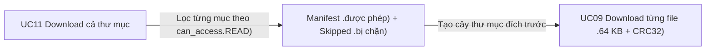
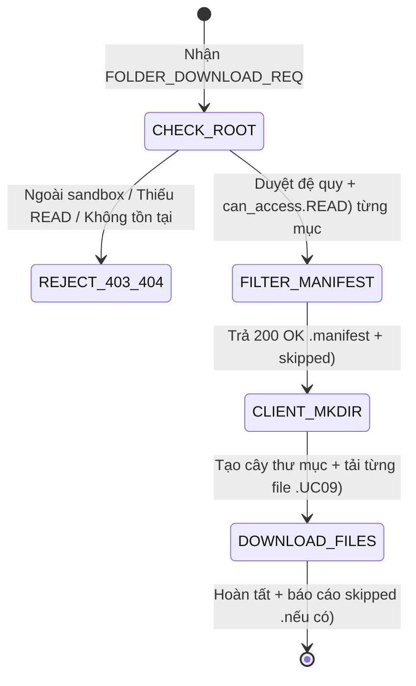
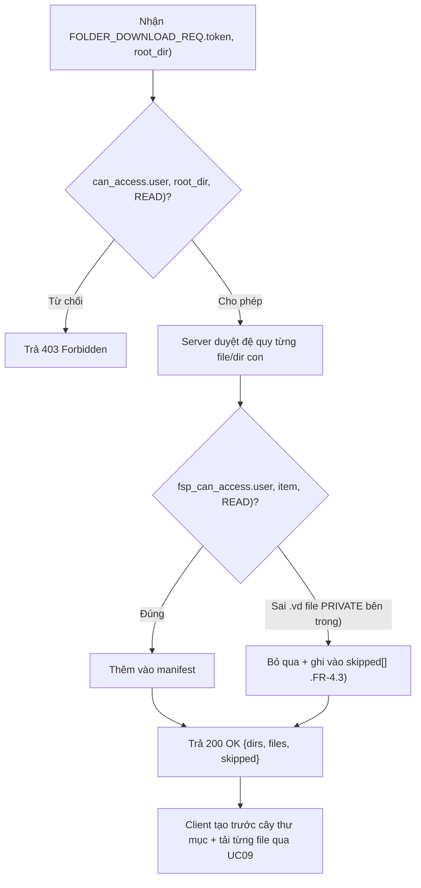

### [UC11] Download cả thư mục .Folder Download)

> **Trạng thái:** `v1.0 Chính thức .Baseline) — Đã tích hợp 27 NFR chuẩn hóa`  
> **Phân hệ trực thuộc:** `M3 — Hệ thống tệp ảo & Truyền dữ liệu .VFS & Transfer)`  
> **Yêu cầu gốc:** `R4 .Folder Upload/Download)` · **Ưu tiên:** `MUST`  
> **Tài liệu căn cứ:** [SRS.md].../SRS.md) .FR-4.1–4.4, FR-3, FR-6.1, NFR-1), [FSPProtocol.h].../../include/common/FSPProtocol.h), [AGENTS.md].../../AGENTS.md)

---

#### 1. Định danh, Truy vết & Mục đích Nghiệp vụ Cốt lõi

| Thuộc tính | Giá trị |
| :--- | :--- |
| **Mã UC & Tên chuẩn** | `UC11`: **Download cả thư mục** |
| **Sự kiện FSP** | `FOLDER_DOWNLOAD_REQ` .`FSP_EV_FOLDER_DOWNLOAD_REQ`) + chuỗi `UC09` |
| **Mức ưu tiên** | `MUST` |
| **Module / File C dự kiến** | `fsp_transfer.c` .`manifest_build`, `manifest_apply`), `fsp_perm.c`, `gui_main.c` |
| **Tác nhân chính** | Người dùng .`User`), Quản trị viên .`Admin`) |

##### 1.1. Mục đích Thực chất
- Cho phép người dùng tải trọn bộ thư mục từ server về máy cục bộ, đồng thời **lọc theo quyền `READ`** trên từng mục con để không rò rỉ file `PRIVATE` bên trong một thư mục được chia sẻ .FR-4.3).

##### 1.2. Tính năng Cốt lõi
- Server duyệt đệ quy thư mục nguồn, chỉ đưa vào **manifest** các thư mục con và file mà người dùng có quyền `READ`.
- Các mục không có quyền `READ` bị bỏ qua và báo lại trong danh sách `skipped` cho client .FR-4.3).
- Client tạo trước cây thư mục con cục bộ rồi tải lần lượt từng file bằng cơ chế `UC09` .64 KB + CRC32).

##### 1.3. Ma trận Tác động Chéo & Hiệu ứng Dây chuyền
- **Upstream:** Quyền `READ` trên thư mục nguồn .`can_access`).
- **Downstream:** Tái sử dụng luồng `UC09` cho từng file trong manifest.



---

#### 2. Tác nhân & Ma trận Quyền

| Hành động | Đối tượng | Ai được phép | Điều kiện .`can_access`) | Ràng buộc cấm |
| :--- | :--- | :--- | :--- | :--- |
| `FOLDER_DOWNLOAD_REQ` | Thư mục nguồn & mục con | `User`, `Admin` | `READ` trên thư mục gốc; lọc `READ` trên từng mục con | Cấm đưa mục không có quyền `READ` vào manifest |

---

#### 3. Điều kiện Tiên quyết & Sự kiện Kích hoạt
- **Preconditions:** Đã đăng nhập .`token` hợp lệ); thư mục tồn tại và có quyền `READ` trên thư mục gốc.
- **Trigger:** Chọn thư mục ở ngăn Remote → bấm **[ ← Download ]** hoặc menu chuột phải → Download.

---

#### 4. Điều kiện Hậu nghiệm
- **Success Guarantees:**
  - Cấu trúc thư mục và nội dung các file được phép đọc tại máy client giống hệt trên server .FR-4.4).
  - Nếu có mục bị bỏ qua do thiếu quyền `READ`, client nhận được danh sách `skipped` để thông báo cho người dùng .FR-4.3).
- **Failure Guarantees:** Không tạo file hỏng; file đang tải lỗi bị xóa `.part`.

---

#### 5. Chuyển đổi Trạng thái & Kiểm soát Đồng thời



---

#### 6. Luồng Sự kiện Chính .Happy Path)
- **Bước 1 .Client Net):** Gửi `FOLDER_DOWNLOAD_REQ` kèm `token` và đường dẫn ảo của thư mục nguồn.
- **Bước 2 .Server VFS & Perm):** Xác thực `token`, chuẩn hóa đường dẫn qua `vfs_resolve`, kiểm tra tồn tại và kiểm tra `can_access.user, root_dir, FSP_ACCESS_READ)`.
- **Bước 3 .Server Manifest Build):** Duyệt đệ quy `root_dir`:
  - Với mỗi thư mục con và mỗi file, gọi `perm_can_access.user, item_path, FSP_ACCESS_READ)`.
  - Mục được phép → thêm vào `manifest`; mục bị từ chối → thêm vào `skipped` .FR-4.3).
- **Bước 4 .Server Response):** Trả `200 OK` kèm `manifest` và `skipped`.
- **Bước 5 .Client Apply):** Tạo trước toàn bộ cây thư mục con tại đích cục bộ theo `manifest` .FR-4.2).
- **Bước 6 .Client Download):** Lần lượt tải từng file trong `manifest` bằng `UC09` .64 KB + CRC32).
- **Bước 7 .Client UI):** Làm mới ngăn Local và hiển thị cảnh báo nếu `skipped` khác rỗng.



---

#### 7. Các Luồng Thay thế Hợp lệ .Alternative Flows — AF)
- **`AF-UC11-01` .Thư mục có 1 số file con đặt `PRIVATE`):** Server bỏ qua các file `PRIVATE` đó, vẫn cho phép tải toàn bộ các file còn lại và trả danh sách `skipped` về client.

---

#### 8. Luồng Ngoại lệ & Kịch bản Đối kháng Cốt lõi .Adversarial / Error Flows — EF)
- **`EF-UC11-01` .Không có quyền `READ` trên thư mục gốc — 403):** Trả `403`, không trả manifest.
- **`EF-UC11-02` .Thư mục không tồn tại — 404):** Trả `404`.
- **`EF-UC11-03` .Lỗi CRC32 ở một file con):** Hủy file đó, xóa `.part` cục bộ và báo lỗi trên hàng đợi truyền.

---

#### 9. Quy tắc Nghiệp vụ & Ranh giới Cấu hình .Business Rules — BR)

| Mã Quy tắc | Nội dung Quy tắc Chi tiết | Ranh giới Kỹ thuật |
| :--- | :--- | :--- |
| `BR-UC11-01` | Server lọc từng mục theo `can_access...., READ)` khi dựng manifest; mục bị bỏ qua phải báo lại cho client .FR-4.3). | **Hardcoded** |

##### 9.2. Ràng buộc Phi chức năng áp dụng .NFR Integration)
| Mã NFR | Mức | Hiện thực & Mục tiêu cụ thể trong UC11 | Cách kiểm chứng |
|:---|:-:|:---|:---|
| `NFR-A1`, `NFR-A2`, `NFR-A3`, `NFR-A4` | 🟢 MUST | Cấu trúc thư mục & nội dung mọi file được phép khớp 100% nguồn; từng file tải theo 64 KB + CRC32 + `.part`. | `diff -r` thư mục 3 cấp, 20 file |
| `NFR-B1`, `NFR-B2` | 🟢 MUST | Bộ đệm cố định 64 KB tuần tự từng file; chặn manifest vượt khung bộ đệm cho phép. | Quan sát RAM khi tải thư mục |
| `NFR-C1`, `NFR-C2` | 🟢 MUST | ≥ 5 client đồng thời; kiểm tra quyền từng mục dưới `perm_mutex` không race. | Multi-client test |
| `NFR-D1`, `NFR-E1`, `NFR-E2` | 🟢 MUST | Zero-Leak: lọc từng mục con qua `fsp_can_access...., READ)`, file `PRIVATE` không đưa vào manifest và ghi nhận trong `skipped`; bỏ symlink. | Test thư mục `SHARED` chứa file `PRIVATE` |
| `NFR-F1`, `NFR-F2` | 🟢 MUST | Không treo GTK khi tải; hiển thị rõ thông báo danh sách `skipped` nếu có. | Kiểm tra GTK 3 |
| `NFR-G1`–`G3`, `NFR-H1` | 🟢 MUST | C11 POSIX thuần, sạch ASan + UBSan. | `ctest` Debug ASan/UBSan |
| `NFR-F4`, `NFR-H2` | 🟡 SHOULD | Tiến trình % trên hàng đợi truyền & nhật ký; hỗ trợ CLI `getdir`. | CLI `getdir` |

---

#### 10. Đặc tả Dữ liệu & Wire Schema
- **`FOLDER_DOWNLOAD_REQ` .JSON):** `{ "token": "...", "path": "/home/an/BaoCao" }`
- **`200 OK` .JSON):**
  ```json
  {
    "status": 200,
    "root_name": "BaoCao",
    "dirs": ["", "chuong1"],
    "files": [{ "rel_path": "chuong1/bai1.pdf", "size": 102400 }],
    "skipped": ["chuong1/secret.txt"]
  }
  ```

---

#### 11. Yêu cầu Hành vi Giao diện GTK & CLI
- Hiển thị tiến trình trên Hàng đợi truyền; nếu có mục trong `skipped`, hiển thị thông báo các mục không đủ quyền đọc đã được bỏ qua.

---

#### 12. Sự kiện Nhật ký, Lưu trữ & Điểm chạm Tích hợp
- Ghi nhật ký kết quả `FOLDER_DOWNLOAD_REQ` và số mục bỏ qua .nếu có).

---

#### 13. Tiêu chí Nghiệm thu Có thể Kiểm chứng .Acceptance Criteria — AC)
- **`AC-UC11-01` .SRS §9):** Download thư mục 3 cấp, 20 file → cấu trúc thư mục và nội dung 20 file ở đích giống hệt nguồn.
- **`AC-UC11-02` .FR-4.3):** Thư mục `SHARED` chứa 1 file `PRIVATE` → người nhận tải về đủ các file được phép, file `PRIVATE` không có trên máy client và xuất hiện trong `skipped`.

---

#### 14. Thiết kế Kịch bản Kiểm thử Đối kháng .Adversarial Test Probes)
- **`PROBE-UC11-01` .Mixed Permission Leak Check):** Tạo thư mục `SHARED` có 2 file .`public_note.txt` = `SHARED`, `secret.txt` = `PRIVATE`) → user được chia sẻ gọi `FOLDER_DOWNLOAD_REQ` → `manifest` chỉ có `public_note.txt`, `skipped` có `secret.txt`.
