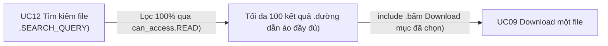
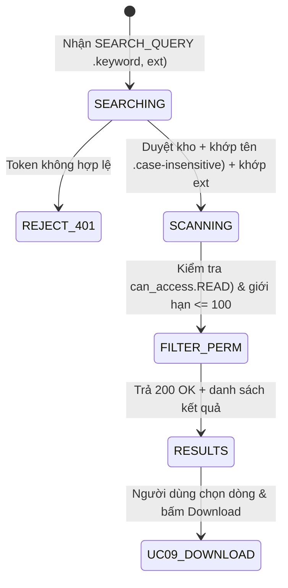
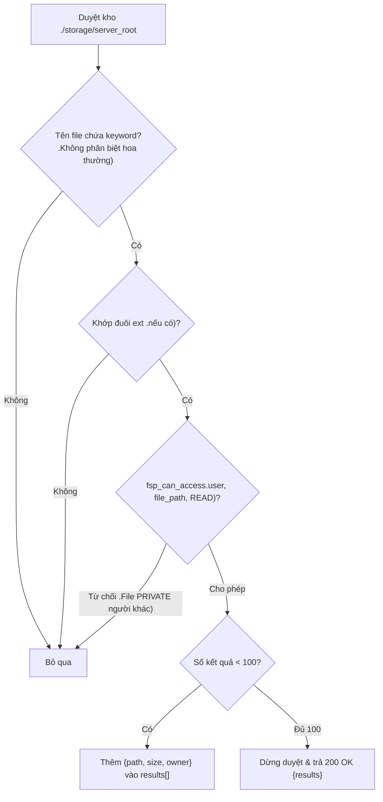

### [UC12] Tìm kiếm file theo tên và tải từ kết quả

> **Trạng thái:** `v1.0 Chính thức .Baseline) — Đã tích hợp 27 NFR chuẩn hóa`  
> **Phân hệ trực thuộc:** `M3 — Tìm kiếm .Search) & M2 — Phân quyền .Permission)`  
> **Yêu cầu gốc:** `R5 .File Search)` · **Ưu tiên:** `MUST`  
> **Tài liệu căn cứ:** [SRS.md].../SRS.md) .UC12 §3.3, FR-5.1–5.5, FR-6.1, FR-7.5), [FSPProtocol.h].../../include/common/FSPProtocol.h), [AGENTS.md].../../AGENTS.md)

---

#### 1. Định danh, Truy vết & Mục đích Nghiệp vụ Cốt lõi

| Thuộc tính | Giá trị |
| :--- | :--- |
| **Mã UC & Tên chuẩn** | `UC12`: **Tìm kiếm file theo tên + tải từ kết quả** |
| **Sự kiện FSP** | `SEARCH_QUERY` .`FSP_EV_SEARCH_QUERY`) + include `UC09` |
| **Mức ưu tiên** | `MUST` |
| **Module / File C dự kiến** | `fsp_search.c` .`search_by_name`), `fsp_perm.c` .`perm_can_access`), `gui_dialogs.c` |
| **Tác nhân chính** | Người dùng .`User`), Quản trị viên .`Admin`) |

##### 1.1. Mục đích Thực chất
- Cho phép người dùng tìm nhanh file theo chuỗi con tên file trên toàn kho server chỉ với 1 yêu cầu `SEARCH_QUERY` .khác FileZilla phải duyệt `LIST` đệ quy), đồng thời **bảo mật tuyệt đối** bằng cách chỉ trả về các file người dùng có quyền `READ`.

##### 1.2. Tính năng Cốt lõi
- Tìm theo chuỗi con trong tên file, không phân biệt hoa thường .FR-5.1).
- Lọc thêm theo đuôi file, ví dụ `.pdf` .FR-5.2 — SHOULD).
- Lọc mọi kết quả qua `can_access.user, file_path, READ)` .FR-5.3).
- Trả về đường dẫn ảo đầy đủ, kích thước, chủ sở hữu để client gọi `UC09` tải trực tiếp .FR-5.4); giới hạn tối đa **100 kết quả** .SRS §3.3).

##### 1.3. Ma trận Tác động Chéo & Hiệu ứng Dây chuyền
- **Include:** `UC09` .Download một file) khi người dùng chọn dòng kết quả và bấm Download.
- **Permission:** Tận dụng thiết kế không kiểm tra dây chuyền thư mục cha .SRS §4 FR-6) giúp người dùng tìm và tải được file chia sẻ dù thư mục cha là `PRIVATE`.



---

#### 2. Tác nhân & Ma trận Quyền

| Hành động | Đối tượng | Ai được phép | Điều kiện .`can_access`) | Ràng buộc cấm |
| :--- | :--- | :--- | :--- | :--- |
| `SEARCH_QUERY` | Toàn bộ kho `./storage/server_root` | `User`, `Admin` | Chỉ giữ file đạt `can_access.user, path, FSP_ACCESS_READ)` | File không có quyền `READ` **không bao giờ xuất hiện** trong kết quả |

---

#### 3. Điều kiện Tiên quyết & Sự kiện Kích hoạt
- **Preconditions:** Đã đăng nhập .`token` hợp lệ).
- **Trigger:** Bấm nút **[Tìm kiếm]** trên Màn hình chính .SRS §6.2) → nhập từ khóa .và đuôi file nếu muốn) → bấm **[Tìm]**.

---

#### 4. Điều kiện Hậu nghiệm
- **Success Guarantees:** Hộp thoại Tìm kiếm hiển thị danh sách tối đa 100 kết quả phù hợp và được phép đọc. Nếu bấm **[ Download mục đã chọn ]**, `UC09` được thực thi với đường dẫn ảo đầy đủ đó.
- **Empty Guarantees:** Nếu không có kết quả phù hợp hoặc chỉ khớp các file không có quyền đọc → trả danh sách rỗng `[]`.

---

#### 5. Chuyển đổi Trạng thái & Kiểm soát Đồng thời



---

#### 6. Luồng Sự kiện Chính .Happy Path)
- **Bước 1 .Client UI):** Người dùng mở hộp thoại Tìm kiếm .SRS §6.4), nhập `Từ khóa` và tùy chọn `Đuôi` .ví dụ `.pdf`), bấm **[Tìm]**.
- **Bước 2 .Client Net):** Gửi frame `FSP_MSG_EVENT_REQ` sự kiện `SEARCH_QUERY` kèm `token`, `keyword`, `ext`.
- **Bước 3 .Server Search - M3):** Xác thực `token`; duyệt cây thư mục trong `./storage/server_root`:
  - Khớp chuỗi con `keyword` không phân biệt hoa thường .FR-5.1).
  - Nếu có `ext`, kiểm tra đuôi file khớp .FR-5.2).
  - Gọi `perm_can_access.user, file_path, FSP_ACCESS_READ)` .FR-5.3).
  - Dừng khi đủ tối đa `100` kết quả .SRS §3.3).
- **Bước 4 .Server Response):** Trả `200 OK` kèm danh sách `{path, size, owner}` .FR-5.4).
- **Bước 5 .Client UI):** Hiển thị kết quả lên bảng trong hộp thoại Tìm kiếm.
- **Bước 6 .Client Download):** Người dùng chọn 1 dòng và bấm **[ Download mục đã chọn ]** → thực hiện `UC09` với `path` đó.



---

#### 7. Các Luồng Thay thế Hợp lệ .Alternative Flows — AF)
- **`AF-UC12-01` .Tìm kiếm không chỉ định đuôi file):** `ext` để trống → tìm mọi file có tên chứa `keyword` và có quyền `READ`.

---

#### 8. Luồng Ngoại lệ & Kịch bản Đối kháng Cốt lõi .Adversarial / Error Flows — EF)
- **`EF-UC12-01` .Token không hợp lệ — 401):** Trả `401`.
- **`EF-UC12-02` .Chỉ khớp file `PRIVATE` của người khác):** Trả `200 OK` với mảng rỗng `[]`, không làm lộ tên hay đường dẫn file `PRIVATE`.
- **`EF-UC12-03` .Tìm bằng Regex — WON'T FR-5.5):** Không hỗ trợ regex; chuỗi nhập vào được đối khớp như chuỗi con thuần túy.

---

#### 9. Quy tắc Nghiệp vụ & Ranh giới Cấu hình .Business Rules — BR)

| Mã Quy tắc | Nội dung Quy tắc Chi tiết | Ranh giới Kỹ thuật |
| :--- | :--- | :--- |
| `BR-UC12-01` | Tìm theo chuỗi con không phân biệt hoa thường .FR-5.1), không dùng regex .FR-5.5 WON'T). | **Hardcoded** |
| `BR-UC12-02` | Bắt buộc lọc qua `can_access...., READ)` .FR-5.3). | **Hardcoded** |
| `BR-UC12-03` | Giới hạn tối đa **100 kết quả** trên một truy vấn .SRS §3.3). | **Hardcoded** .`max = 100`) |

##### 9.2. Ràng buộc Phi chức năng áp dụng .NFR Integration)
| Mã NFR | Mức | Hiện thực & Mục tiêu cụ thể trong UC12 | Cách kiểm chứng |
|:---|:-:|:---|:---|
| `NFR-A4`, `NFR-B2`, `NFR-C2` | 🟢 MUST | Frame `SEARCH_QUERY` 42B .`payload_len <= 128 KB`); truy vấn quyền từng file dưới `perm_mutex`. | `test_search`, `test_json` |
| `NFR-E1`, `NFR-E2` | 🟢 MUST | Chỉ duyệt trong `./storage/server_root` .bỏ symlink, bỏ `*.part`); **Zero-Leak**: mọi kết quả qua `fsp_can_access...., READ)` .file `PRIVATE` không xuất hiện). | Test user khác tìm tên file `PRIVATE` → `[]` |
| `NFR-F1`–`F3` | 🟢 MUST | Tìm kiếm chạy nền trên `pthread`, khóa nút `[Tìm]` khi đang truy vấn, thông báo lỗi rõ; khi bấm Download kế thừa toàn bộ NFR của `UC09`. | Tìm & tải từ kết quả trên GTK 3 |
| `NFR-G1`–`G3`, `NFR-H1` | 🟢 MUST | C11 POSIX thuần, sạch ASan + UBSan. | `ctest` Debug ASan/UBSan |
| `NFR-B3`, `NFR-E4`, `NFR-F4`, `NFR-H2` | 🟡 SHOULD | Phản hồi tìm kiếm ≤ 1 giây trên LAN .kho test < 1.000 file, giới hạn 100 kết quả); chặn `\u0000` trong từ khóa JSON; ghi nhật ký; hỗ trợ CLI `find`. | CLI `find`, đo thời gian truy vấn |

---

#### 10. Đặc tả Dữ liệu & Wire Schema
- **`SEARCH_QUERY` .JSON):** `{ "token": "...", "keyword": "baocao", "ext": ".pdf" }`
- **`200 OK` .JSON):**
  ```json
  {
    "status": 200,
    "results": [
      { "path": "/home/an/BaoCao/baocao_v1.pdf", "size": 1258291, "owner": "an" }
    ]
  }
  ```

---

#### 11. Yêu cầu Hành vi Giao diện GTK & CLI
- **GTK .`gui_dialogs.c`):** Ô `Từ khóa`, ô `Đuôi`, nút `[Tìm]`, bảng `Đường dẫn | Kích thước | Chủ`, nút `[ Download mục đã chọn ]` .SRS §6.4, FR-7.5).
- **CLI:** Lệnh `find <keyword> [ext]`.

---

#### 12. Sự kiện Nhật ký, Lưu trữ & Điểm chạm Tích hợp
- Hàm `search_by_name.user, keyword, ext, results, max)` trong `fsp_search.c` gọi trực tiếp `perm_can_access` của M2.

---

#### 13. Tiêu chí Nghiệm thu Có thể Kiểm chứng .Acceptance Criteria — AC)
- **`AC-UC12-01` .SRS §9):** Chi tìm `"BaoCao"` khi Bình được chia sẻ đọc `/home/an/BaoCao` còn Chi thì không → Bình thấy kết quả và tải được; Chi nhận `[]`.
- **`AC-UC12-02`:** Lọc với `ext = ".pdf"` chỉ trả về file `.pdf`.

---

#### 14. Thiết kế Kịch bản Kiểm thử Đối kháng .Adversarial Test Probes)
- **`PROBE-UC12-01` .Private File Leakage):** User A có file `secret_baocao.pdf` mức `PRIVATE` .dù `perm = 0666`); User B tìm `"secret"` → kết quả trả về phải rỗng `[]`.
- **`PROBE-UC12-02` .Result Cap):** Tạo 150 file khớp từ khóa → kết quả trả về đúng tối đa 100 mục, không tràn bộ đệm.
