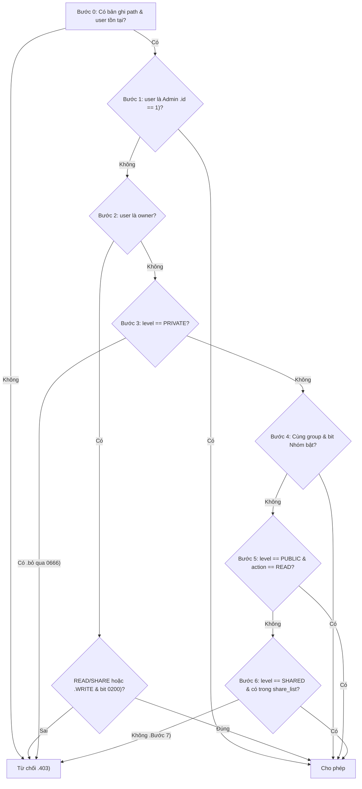
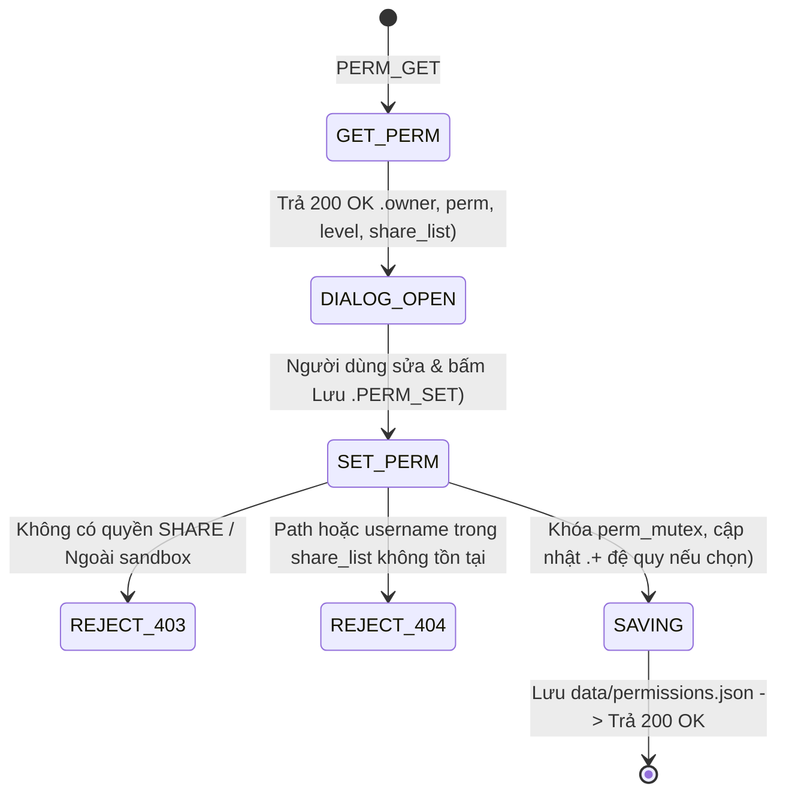
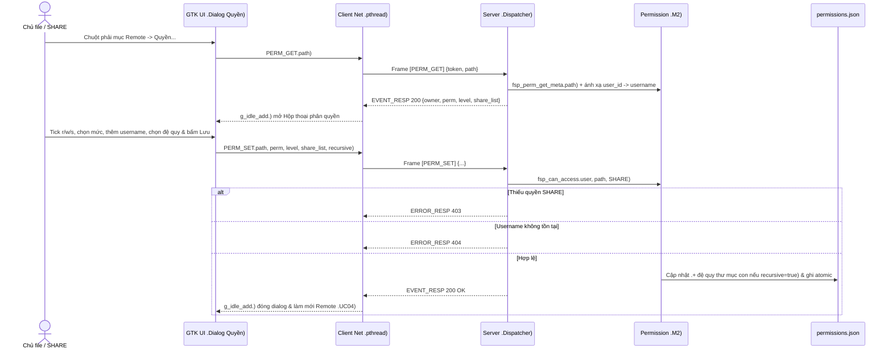
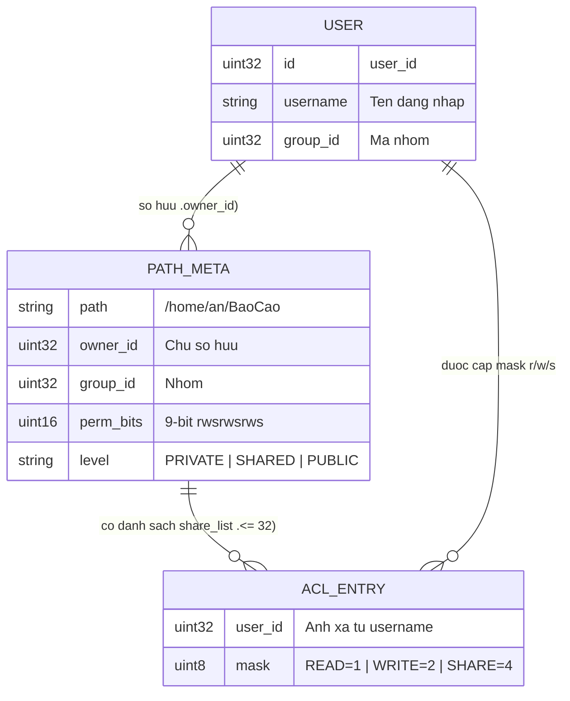

### [UC13] Xem / đặt quyền và mức chia sẻ .Permissions & Sharing Management)

> **Trạng thái:** `v1.0 Chính thức .Baseline) — Đã tích hợp 27 NFR chuẩn hóa`  
> **Phân hệ trực thuộc:** `M2 — Quản lý người dùng, Phiên & Phân quyền .Auth & Permissions)`  
> **Yêu cầu gốc:** `R6 .Permission Management — similar to Linux)` · **Ưu tiên:** `MUST`  
> **Tài liệu căn cứ:** [SRS.md].../SRS.md) .UC13 §3.3, FR-6.1–6.7, FR-7.6), [FSPProtocol.h].../../include/common/FSPProtocol.h), [AGENTS.md].../../AGENTS.md)

---

#### 1. Định danh, Truy vết & Mục đích Nghiệp vụ Cốt lõi

| Thuộc tính | Giá trị |
| :--- | :--- |
| **Mã UC & Tên chuẩn** | `UC13`: **Xem / đặt quyền và mức chia sẻ** |
| **Sự kiện FSP** | `PERM_GET` .`FSP_EV_PERM_GET`), `PERM_SET` .`FSP_EV_PERM_SET`) |
| **Mức ưu tiên** | `MUST` |
| **Module / File C dự kiến** | `fsp_perm.c` .`perm_can_access`, `perm_get`, `perm_set`, `perm_add_entry`, `perm_remove_entry`, `perm_load/save`), `gui_dialogs.c` |
| **Tác nhân chính** | Người dùng .`User`: chủ sở hữu hoặc có quyền `SHARE`), Quản trị viên .`Admin`) |

##### 1.1. Mục đích Thực chất
- Kết hợp mô hình phân quyền 9 bit kiểu Linux .`r`/`w`/`s` cho Chủ / Nhóm / Người khác) với 3 mức chia sẻ .`PRIVATE`, `SHARED`, `PUBLIC`) và danh sách chia sẻ đích danh .`share_list`), cho phép chủ sở hữu kiểm soát chính xác ai được xem, sửa hoặc chia sẻ tiếp tài nguyên.

##### 1.2. Tính năng Cốt lõi
- `PERM_GET`: Đọc chủ sở hữu, nhóm, 9 bit quyền .`r=4, w=2, s=1`), mức chia sẻ và `share_list` .hiển thị theo `username`).
- `PERM_SET`: Cập nhật `perm`, `level`, thêm/xóa `username` trong `share_list` .yêu cầu vượt qua `can_access...., SHARE)`).
- Hỗ trợ tùy chọn **đệ quy .`recursive`)** trên thư mục để áp dụng quyền/chia sẻ cho toàn bộ nội dung bên trong trong 1 thao tác .FR-6.4).
- Lưu bền vững vào `data/permissions.json` .FR-6.5).

##### 1.3. Ma trận Tác động Chéo & Hiệu ứng Dây chuyền
- **Upstream:** Phiên đăng nhập .`UC02`), bản ghi quyền được tạo từ `UC01`, `UC06`, `UC08`, `UC10`.
- **Downstream:** Quyết định trực tiếp kết quả cho phép/từ chối của mọi thao tác trong `UC04`–`UC12`.

---

#### 2. Tác nhân & Ma trận Quyền

**Thuật toán kiểm tra quyền `can_access.user, path, action)` .8 bước, 0–7 trong SRS §4 FR-6):**

| Bước | Điều kiện | Kết quả |
|:-:|:---|:---|
| 0 | Đường dẫn chưa có bản ghi quyền, hoặc user không tồn tại | **Từ chối** |
| 1 | Người dùng là Admin .`user_id == 1`) | **Cho phép** |
| 2 | Người dùng là chủ sở hữu .`owner`) | `READ`, `SHARE`: luôn cho phép · `WRITE`: theo bit `w` của bộ **Chủ** |
| 3 | `level = PRIVATE` | **Từ chối** .bỏ qua mọi bit Nhóm / Người khác) |
| 4 | Cùng nhóm với chủ sở hữu **và** bit tương ứng của bộ **Nhóm** bật | **Cho phép** |
| 5 | `level = PUBLIC` **và** `action = READ` | **Cho phép** |
| 6 | `level = SHARED` **và** người dùng có trong `share_list` với quyền tương ứng | **Cho phép** |
| 7 | Mọi trường hợp còn lại | **Từ chối** .`403`) |

> **Lưu ý:** Bộ bit **Người khác** không được dùng để cấp quyền; người ngoài nhóm chỉ truy cập qua `PUBLIC` .chỉ đọc) hoặc qua `share_list`.



---

#### 3. Điều kiện Tiên quyết & Sự kiện Kích hoạt
- **Preconditions:** Đã đăng nhập .`token` hợp lệ); đối tượng tồn tại trên server; với `PERM_SET`, người dùng phải có quyền `SHARE` .`can_access.user, path, FSP_ACCESS_SHARE)`).
- **Trigger:** Chuột phải vào file/thư mục ở ngăn Remote → **Quyền…** hoặc bấm nút **[Quyền]** trên thanh công cụ .SRS §6.2).

---

#### 4. Điều kiện Hậu nghiệm
- **Success Guarantees:**
  - `perm`, `level`, `share_list` mới được lưu bền vững vào `data/permissions.json` .tồn tại sau khi restart server — FR-6.5).
  - Nếu `recursive = true` trên thư mục, toàn bộ thư mục con và file bên trong được cập nhật đồng bộ .FR-6.4).
  - Ngăn Remote cập nhật cột Quyền và Mức chia sẻ.
- **Failure Guarantees:** Không lưu thay đổi dở dang nếu thiếu quyền hoặc có `username` không tồn tại.

---

#### 5. Chuyển đổi Trạng thái & Kiểm soát Đồng thời



---

#### 6. Luồng Sự kiện Chính .Happy Path)
- **Bước 1 .Client UI):** Người dùng chọn file/thư mục ở ngăn Remote và mở **Quyền…**.
- **Bước 2 .Client Net):** Gửi `PERM_GET` kèm `token` và `path`.
- **Bước 3 .Server Perm):** Xác thực `token`, chuẩn hóa `path` qua `vfs_resolve`, lấy bản ghi quyền từ `fsp_perm.c` .ánh xạ `user_id` trong `share_list` sang `username`) và trả `200 OK`.
- **Bước 4 .Client UI):** Mở **Hộp thoại phân quyền** .SRS §6.3, FR-7.6) với ma trận `r`/`w`/`s`, radio `Riêng tư`/`Chia sẻ`/`Công khai`, danh sách `share_list` và checkbox *"Áp dụng cho toàn bộ bên trong thư mục"*.
- **Bước 5 .Client Net):** Người dùng chỉnh sửa và bấm **[ Lưu ]** → client gửi `PERM_SET` kèm `token`, `path`, `perm`, `level`, `share_list` .theo `username`) và `recursive`.
- **Bước 6 .Server Check):** Xác thực `token`, kiểm tra `vfs_resolve`, kiểm tra `perm_can_access.user, path, FSP_ACCESS_SHARE)` và kiểm tra tất cả `username` trong `share_list` đều tồn tại.
- **Bước 7 .Server Save):** Khóa mutex, cập nhật bản ghi quyền .và duyệt đệ quy các mục con trong thư mục nếu `recursive = true`), lưu xuống `data/permissions.json`.
- **Bước 8 .Server & Client):** Trả `200 OK`; client đóng hộp thoại và làm mới ngăn Remote .`UC04`).



---

#### 7. Các Luồng Thay thế Hợp lệ .Alternative Flows — AF)
- **`AF-UC13-01` .Đổi chủ sở hữu `chown` và đổi nhóm user — COULD FR-6.6):** Chỉ Admin .`user_id == 1`) mới được thực hiện.

---

#### 8. Luồng Ngoại lệ & Kịch bản Đối kháng Cốt lõi .Adversarial / Error Flows — EF)
- **`EF-UC13-01` .Không có quyền `SHARE` — 403):** User không phải chủ sở hữu và không có bit/ACL `s` gọi `PERM_SET` → trả `403` .`FSP_STATUS_FORBIDDEN`).
- **`EF-UC13-02` .`username` trong `share_list` không tồn tại — 404):** Server trả `404` .`FSP_STATUS_NOT_FOUND`), không lưu thay đổi.
- **`EF-UC13-03` .Đường dẫn không tồn tại — 404 / Ngoài sandbox — 403):** Từ chối trước khi đọc/ghi `permissions.json`.

---

#### 9. Quy tắc Nghiệp vụ & Ranh giới Cấu hình .Business Rules — BR)

| Mã Quy tắc | Nội dung Quy tắc Chi tiết | Ranh giới Kỹ thuật |
| :--- | :--- | :--- |
| `BR-UC13-01` | Quyền 9 bit `r=4, w=2, s=1` .`s` thay cho `x` của Linux); `FSP_ACCESS_READ=1, WRITE=2, SHARE=4`. | **Hardcoded** .`FSPProtocol.h`) |
| `BR-UC13-02` | `level = PRIVATE` chặn mọi truy cập từ người khác, bỏ qua bit Nhóm/Người khác .Bước 3 `can_access`). | **Hardcoded** |
| `BR-UC13-03` | Giao diện nhập theo `username`, server ánh xạ và lưu theo mã user .SRS §4 FR-6). | **Hardcoded** |
| `BR-UC13-04` | Dữ liệu quyền lưu bền vững tại `data/permissions.json` .FR-6.5). | **Hardcoded** |

##### 9.2. Ràng buộc Phi chức năng áp dụng .NFR Integration)
| Mã NFR | Mức | Hiện thực & Mục tiêu cụ thể trong UC13 | Cách kiểm chứng |
|:---|:-:|:---|:---|
| `NFR-A4`, `NFR-C2` | 🟢 MUST | Frame `PERM_GET`/`PERM_SET` 42B; cập nhật quyền đơn lẻ hoặc đệ quy .`recursive=true`) bảo vệ bởi `perm_mutex`, hoàn tác nếu lỗi. | `test_auth_permissions` .Probe 3 + recursive) |
| `NFR-E1`, `NFR-E2` | 🟢 MUST | `vfs_resolve` kiểm tra biên sandbox; thực thi đầy đủ **8 bước `0–7`** của `fsp_can_access`; bắt buộc `SHARE` khi sửa; `PRIVATE` bit `0666` vẫn từ chối `403`. | Probe 3 .`test_auth_permissions`) |
| `NFR-F1`–`F3` | 🟢 MUST | Giao tiếp `PERM_GET`/`PERM_SET` chạy trên `pthread` + `g_idle_add.)`; khóa nút `[Lưu]` khi đang chờ; báo lỗi rõ khi `403`/`404`. | Thử cấp quyền cho username không tồn tại trên GTK |
| `NFR-G1`–`G3`, `NFR-H1` | 🟢 MUST | C11 POSIX thuần, 0 memory leak dưới ASan + UBSan. | `ctest` Debug ASan/UBSan |
| `NFR-A5`, `NFR-B3`, `NFR-C3`, `NFR-F4`, `NFR-H2` | 🟡 SHOULD | Lưu `permissions.json` nguyên tử qua `.tmp + rename.)` .còn nguyên sau restart); phản hồi ≤ 1s; sạch dưới TSan; ghi nhật ký; hỗ trợ CLI `chmod`. | Restart server → kiểm tra quyền còn nguyên; TSan |

---

#### 10. Đặc tả Dữ liệu & Wire Schema
- **`PERM_GET` .JSON):** `{ "token": "...", "path": "/home/an/BaoCao" }`
- **`PERM_SET` .JSON):**
  ```json
  {
    "token": "...",
    "path": "/home/an/BaoCao",
    "perm": "0740",
    "level": "SHARED",
    "share_list": [{ "username": "binh", "mask": 1 }],
    "recursive": true
  }
  ```
- **Lưu trữ .`data/permissions.json`):** `{ path, owner, group, perm, level, share_list }`.



---

#### 11. Yêu cầu Hành vi Giao diện GTK & CLI
- **GTK .`gui_dialogs.c`):** Hộp thoại phân quyền .SRS §6.3, FR-7.6) với các ô tick `r`/`w`/`s`, radio mức chia sẻ, ô thêm/xóa `username` + quyền `r`/`w`/`s`, checkbox đệ quy.
- **CLI:** Lệnh `chmod` .và kiểm tra quyền).

---

#### 12. Sự kiện Nhật ký, Lưu trữ & Điểm chạm Tích hợp
- Đồng bộ `data/permissions.json` dưới khóa mutex; đọc danh sách user từ `fsp_user.c` để ánh xạ `username` ↔ `user_id`.

---

#### 13. Tiêu chí Nghiệm thu Có thể Kiểm chứng .Acceptance Criteria — AC)
- **`AC-UC13-01` .SRS §3.4):** An upload `BaoCao/`, đặt `PERM_SET` `level = SHARED`, `share = binh:r`, `recursive = true` → Bình tìm thấy và tải được; Chi không thấy và bị từ chối `403`.
- **`AC-UC13-02` .FR-6.5):** Khởi động lại server → quyền đã đặt trong `permissions.json` vẫn còn nguyên hiệu lực.

---

#### 14. Thiết kế Kịch bản Kiểm thử Đối kháng .Adversarial Test Probes)
- **`PROBE-UC13-01` .Probe 3 — Phủ đủ 8 bước `can_access` 0–7):** Viết unit test C11 cho từng bước 0–7 của `perm_can_access` .SRS §9, AGENTS.md).
- **`PROBE-UC13-02` .Probe 3 — `PRIVATE` với `0666`):** Đặt file của An có `perm = 0666` nhưng `level = PRIVATE` → user khác .không phải Admin) gọi `READ`/`WRITE`/`SHARE` đều phải bị từ chối `403` ở Bước 3.
- **`PROBE-UC13-03` .Non-existent Share Target):** Gửi `PERM_SET` thêm `username = "ghost_user"` → trả `404`, `permissions.json` không bị thay đổi.
